# Entity relationships for Snowflake and Braze

> This page lists the entity relationships between Snowflake Data Sharing tables for each messaging channel.

Each relationship diagram combines a channel's event tables into one `EVENT` entity. That entity lists every column found across those tables, and links to the campaign, Canvas, snapshot, and changelog tables that the channel's events join to.

**Important:**


Because the `EVENT` entity combines several tables, a column in the diagram might not exist in every table for that channel. For the columns in each table, refer to the relationship tables under each diagram or the [individual table schemas](https://www.braze.com/docs/assets/download_file/data-sharing-raw-table-schemas.txt).


## Relationship diagram

```mermaid
---
config:
  layout: elk
  elk:
    mergeEdges: true
    nodePlacementStrategy: LINEAR_SEGMENTS
---
erDiagram
    EVENT["USERS_MESSAGES_BANNER_*_SHARED"] {
        string ID PK
        string APP_API_ID FK
        string APP_GROUP_API_ID FK
        string APP_GROUP_ID FK
        string BANNER_PLACEMENT_ID FK
        string CAMPAIGN_API_ID FK
        string CAMPAIGN_ID FK
        string CANVAS_API_ID FK
        string CANVAS_ID FK
        string CANVAS_STEP_API_ID FK
        string CANVAS_STEP_MESSAGE_VARIATION_API_ID FK
        string CANVAS_VARIATION_API_ID FK
        string DEVICE_ID FK
        string EXTERNAL_USER_ID FK
        string MESSAGE_VARIATION_API_ID FK
        string USER_ID FK
        string ABORT_LOG
        string ABORT_TYPE
        string AD_ID
        string AD_ID_TYPE
        boolean AD_TRACKING_ENABLED
        string BROWSER
        string BUTTON_ID
        string CAMPAIGN_NAME
        string CANVAS_NAME
        string CANVAS_STEP_NAME
        string CANVAS_VARIATION_NAME
        string CARRIER
        string COUNTRY
        string DEVICE_MODEL
        string GENDER
        boolean IS_CONTROL
        boolean IS_UNIQUE
        string LANGUAGE
        string MESSAGE_VARIATION_NAME
        string OS_VERSION
        string PLATFORM
        string RESOLUTION
        string SDK_VERSION
        timestamp SF_CREATED_AT
        integer TIME
        string TIMEZONE
    }

    CHANGELOGS_CAMPAIGN_SHARED {
        string ID FK
        integer TIME
        string APP_GROUP_ID
        string API_ID
        string NAME
        array CONVERSION_BEHAVIORS
        array ACTIONS
    }
    SNAPSHOTS_CAMPAIGN_MESSAGE_VARIATION_SHARED {
        string ID FK
        integer TIME
        string APP_GROUP_ID
        string API_ID
        string NAME
    }

    USERS_CAMPAIGNS_CONVERSION_SHARED {
        string ID PK
        string APP_API_ID FK
        string APP_GROUP_API_ID FK
        string APP_GROUP_ID FK
        string CAMPAIGN_API_ID FK
        string CAMPAIGN_ID FK
        string DEVICE_ID FK
        string DISPATCH_ID FK
        string EXTERNAL_USER_ID FK
        string MESSAGE_VARIATION_API_ID FK
        string USER_ID FK
        string CAMPAIGN_NAME
        string CONVERSION_BEHAVIOR
        integer CONVERSION_BEHAVIOR_INDEX
        string COUNTRY
        string GENDER
        string LANGUAGE
        string MESSAGE_VARIATION_NAME
        string SEND_ID
        timestamp SF_CREATED_AT
        integer TIME
        string TIMEZONE
    }
    USERS_CAMPAIGNS_ENROLLINCONTROL_SHARED {
        string ID PK
        string APP_API_ID FK
        string APP_GROUP_API_ID FK
        string APP_GROUP_ID FK
        string CAMPAIGN_API_ID FK
        string CAMPAIGN_ID FK
        string DEVICE_ID FK
        string DISPATCH_ID FK
        string EXTERNAL_USER_ID FK
        string MESSAGE_VARIATION_API_ID FK
        string USER_ID FK
        string CAMPAIGN_NAME
        string COUNTRY
        string GENDER
        string LANGUAGE
        string MESSAGE_VARIATION_NAME
        string SEND_ID
        timestamp SF_CREATED_AT
        integer TIME
        string TIMEZONE
    }
    USERS_CAMPAIGNS_FREQUENCYCAP_SHARED {
        string ID PK
        string APP_GROUP_API_ID FK
        string APP_GROUP_ID FK
        string CAMPAIGN_API_ID FK
        string CAMPAIGN_ID FK
        string DEVICE_ID FK
        string DISPATCH_ID FK
        string EXTERNAL_USER_ID FK
        string MESSAGE_VARIATION_API_ID FK
        string USER_ID FK
        string CHANNEL
        string COUNTRY
        string GENDER
        string LANGUAGE
        string SEND_ID
        timestamp SF_CREATED_AT
        integer TIME
        string TIMEZONE
    }
    USERS_CAMPAIGNS_REVENUE_SHARED {
        string ID PK
        string APP_API_ID FK
        string APP_GROUP_API_ID FK
        string APP_GROUP_ID FK
        string CAMPAIGN_API_ID FK
        string CAMPAIGN_ID FK
        string DEVICE_ID FK
        string DISPATCH_ID FK
        string EXTERNAL_USER_ID FK
        string MESSAGE_VARIATION_API_ID FK
        string USER_ID FK
        string COUNTRY
        string GENDER
        string LANGUAGE
        integer REVENUE
        string SEND_ID
        timestamp SF_CREATED_AT
        integer TIME
        string TIMEZONE
    }
    USERS_CAMPAIGNS_UNIQUERECEIPT_SHARED {
        string ID PK
        string APP_API_ID FK
        string APP_GROUP_API_ID FK
        string APP_GROUP_ID FK
        string CAMPAIGN_API_ID FK
        string CAMPAIGN_ID FK
        string DEVICE_ID FK
        string DISPATCH_ID FK
        string EXTERNAL_USER_ID FK
        string MESSAGE_VARIATION_API_ID FK
        string USER_ID FK
        string CAMPAIGN_NAME
        string COUNTRY
        string GENDER
        string LANGUAGE
        string MESSAGE_VARIATION_NAME
        string SEND_ID
        timestamp SF_CREATED_AT
        integer TIME
        string TIMEZONE
    }

    USERS_CANVAS_ENTRY_SHARED {
        string ID PK
        string APP_GROUP_API_ID FK
        string APP_GROUP_ID FK
        string CANVAS_API_ID FK
        string CANVAS_ID FK
        string CANVAS_STEP_API_ID FK
        string CANVAS_VARIATION_API_ID FK
        string DEVICE_ID FK
        string EXTERNAL_USER_ID FK
        string USER_ID FK
        string CANVAS_NAME
        string CANVAS_STEP_NAME
        string CANVAS_VARIATION_NAME
        string COUNTRY
        string GENDER
        boolean IN_CONTROL_GROUP
        string LANGUAGE
        timestamp SF_CREATED_AT
        integer TIME
        string TIMEZONE
    }
    USERS_CANVAS_EXPERIMENTSTEP_SPLITENTRY_SHARED {
        string ID PK
        string APP_GROUP_ID FK
        string CANVAS_API_ID FK
        string CANVAS_ID FK
        string CANVAS_STEP_API_ID FK
        string CANVAS_VARIATION_API_ID FK
        string EXPERIMENT_SPLIT_API_ID FK
        string EXPERIMENT_STEP_API_ID FK
        string EXTERNAL_USER_ID FK
        string USER_ID FK
        string CANVAS_NAME
        string CANVAS_STEP_NAME
        string CANVAS_VARIATION_NAME
        string EXPERIMENT_SPLIT_NAME
        boolean IN_CONTROL_GROUP
        timestamp SF_CREATED_AT
        integer TIME
    }
    USERS_CANVAS_EXIT_MATCHEDAUDIENCE_SHARED {
        string ID PK
        string APP_GROUP_API_ID FK
        string APP_GROUP_ID FK
        string CANVAS_API_ID FK
        string CANVAS_ID FK
        string CANVAS_STEP_API_ID FK
        string CANVAS_VARIATION_API_ID FK
        string EXTERNAL_USER_ID FK
        string USER_ID FK
        string CANVAS_NAME
        string CANVAS_STEP_NAME
        string CANVAS_VARIATION_NAME
        timestamp SF_CREATED_AT
        integer TIME
    }
    USERS_CANVAS_EXIT_PERFORMEDEVENT_SHARED {
        string ID PK
        string APP_GROUP_API_ID FK
        string APP_GROUP_ID FK
        string CANVAS_API_ID FK
        string CANVAS_ID FK
        string CANVAS_STEP_API_ID FK
        string CANVAS_VARIATION_API_ID FK
        string EXTERNAL_USER_ID FK
        string USER_ID FK
        string CANVAS_NAME
        string CANVAS_STEP_NAME
        string CANVAS_VARIATION_NAME
        timestamp SF_CREATED_AT
        integer TIME
    }
    USERS_CANVAS_FREQUENCYCAP_SHARED {
        string ID PK
        string APP_GROUP_API_ID FK
        string APP_GROUP_ID FK
        string CANVAS_API_ID FK
        string CANVAS_ID FK
        string CANVAS_STEP_API_ID FK
        string CANVAS_STEP_MESSAGE_VARIATION_API_ID FK
        string CANVAS_VARIATION_API_ID FK
        string DEVICE_ID FK
        string EXTERNAL_USER_ID FK
        string USER_ID FK
        string CHANNEL
        string COUNTRY
        string GENDER
        string LANGUAGE
        timestamp SF_CREATED_AT
        integer TIME
        string TIMEZONE
    }
    USERS_CANVAS_SENDTODESTINATION_NOTSENT_SHARED {
        string ID PK
        string APP_GROUP_API_ID FK
        string APP_GROUP_ID FK
        string CANVAS_API_ID FK
        string CANVAS_ID FK
        string CANVAS_STEP_API_ID FK
        string CANVAS_VARIATION_API_ID FK
        string DESTINATION_API_ID FK
        string EXTERNAL_USER_ID FK
        string USER_ID FK
        string CANVAS_NAME
        string CANVAS_STEP_NAME
        string CANVAS_STEP_TYPE
        string CANVAS_VARIATION_NAME
        string DESTINATION_NAME
        string DESTINATION_TYPE
        string REASON
        timestamp SF_CREATED_AT
        integer TIME
    }
    USERS_CANVAS_SENDTODESTINATION_SENT_SHARED {
        string ID PK
        string APP_GROUP_API_ID FK
        string APP_GROUP_ID FK
        string CANVAS_API_ID FK
        string CANVAS_ID FK
        string CANVAS_STEP_API_ID FK
        string CANVAS_VARIATION_API_ID FK
        string DESTINATION_API_ID FK
        string EXTERNAL_USER_ID FK
        string USER_ID FK
        string CANVAS_NAME
        string CANVAS_STEP_NAME
        string CANVAS_STEP_TYPE
        string CANVAS_VARIATION_NAME
        string DESTINATION_NAME
        string DESTINATION_TYPE
        string DESTINATION_VARIANT_TYPE
        string DESTINATION_VARIATION_NAME
        timestamp SF_CREATED_AT
        integer TIME
    }

    USERS_CANVAS_EXPERIMENTSTEP_CONVERSION_SHARED {
        string ID PK
        string APP_API_ID FK
        string APP_GROUP_ID FK
        string CANVAS_API_ID FK
        string CANVAS_ID FK
        string CANVAS_STEP_API_ID FK
        string CANVAS_VARIATION_API_ID FK
        string EXPERIMENT_SPLIT_API_ID FK
        string EXPERIMENT_STEP_API_ID FK
        string EXTERNAL_USER_ID FK
        string USER_ID FK
        string CANVAS_NAME
        string CANVAS_STEP_NAME
        string CANVAS_VARIATION_NAME
        string CONVERSION_BEHAVIOR
        integer CONVERSION_BEHAVIOR_INDEX
        string EXPERIMENT_SPLIT_NAME
        timestamp SF_CREATED_AT
        integer TIME
    }
    USERS_CANVAS_CONVERSION_SHARED {
        string ID PK
        string APP_API_ID FK
        string APP_GROUP_API_ID FK
        string APP_GROUP_ID FK
        string CANVAS_API_ID FK
        string CANVAS_ID FK
        string CANVAS_STEP_API_ID FK
        string CANVAS_STEP_MESSAGE_VARIATION_API_ID FK
        string CANVAS_VARIATION_API_ID FK
        string DEVICE_ID FK
        string EXTERNAL_USER_ID FK
        string USER_ID FK
        string CANVAS_NAME
        string CANVAS_STEP_NAME
        string CANVAS_VARIATION_NAME
        string CONVERSION_BEHAVIOR
        integer CONVERSION_BEHAVIOR_INDEX
        string COUNTRY
        string GENDER
        string LANGUAGE
        timestamp SF_CREATED_AT
        integer TIME
        string TIMEZONE
    }
    USERS_CANVAS_REVENUE_SHARED {
        string ID PK
        string APP_API_ID FK
        string APP_GROUP_API_ID FK
        string APP_GROUP_ID FK
        string CANVAS_API_ID FK
        string CANVAS_ID FK
        string CANVAS_STEP_API_ID FK
        string CANVAS_STEP_MESSAGE_VARIATION_API_ID FK
        string CANVAS_VARIATION_API_ID FK
        string DEVICE_ID FK
        string EXTERNAL_USER_ID FK
        string USER_ID FK
        string COUNTRY
        string GENDER
        string LANGUAGE
        integer REVENUE
        timestamp SF_CREATED_AT
        integer TIME
        string TIMEZONE
    }

    CHANGELOGS_CANVAS_SHARED {
        string ID FK
        integer TIME
        string APP_GROUP_ID
        string API_ID
        string NAME
        array CONVERSION_BEHAVIORS
        array VARIATIONS
    }
    SNAPSHOTS_CANVAS_FLOW_STEP_SHARED {
        string ID FK
        integer TIME
        string APP_GROUP_ID
        string TYPE
        string API_STEP_ID
        array EXPERIMENT_SPLITS
        array CONVERSION_BEHAVIORS
        string NAME
    }
    SNAPSHOTS_CANVAS_STEP_SHARED {
        string ID FK
        integer TIME
        string APP_GROUP_ID
        string API_ID
        string NAME
        array ACTIONS
    }
    SNAPSHOTS_CANVAS_VARIATION_SHARED {
        string ID FK
        integer TIME
        string APP_GROUP_ID
        string API_ID
        string NAME
    }
    SNAPSHOTS_EXPERIMENT_STEP_SHARED {
        string ID FK
        integer TIME
        string APP_GROUP_ID
        string TYPE
        string API_STEP_ID
        array EXPERIMENT_SPLITS
        array CONVERSION_BEHAVIORS
        string NAME
    }

    %% Relationships for Group Labels
    GROUP_1["Campaign Snapshots and Log"] { }
    CHANGELOGS_CAMPAIGN_SHARED ||--o{ GROUP_1 : joins
    SNAPSHOTS_CAMPAIGN_MESSAGE_VARIATION_SHARED ||--o{ GROUP_1 : joins
    GROUP_1 ||--o{ EVENT : joins

    GROUP_2["Campaign Events"] { }
    USERS_CAMPAIGNS_CONVERSION_SHARED ||--o{ GROUP_2 : joins
    USERS_CAMPAIGNS_ENROLLINCONTROL_SHARED ||--o{ GROUP_2 : joins
    USERS_CAMPAIGNS_FREQUENCYCAP_SHARED ||--o{ GROUP_2 : joins
    USERS_CAMPAIGNS_REVENUE_SHARED ||--o{ GROUP_2 : joins
    USERS_CAMPAIGNS_UNIQUERECEIPT_SHARED ||--o{ GROUP_2 : joins
    GROUP_2 ||--o{ EVENT : joins

    GROUP_3["Canvas Events"] { }
    USERS_CANVAS_ENTRY_SHARED ||--o{ GROUP_3 : joins
    USERS_CANVAS_EXPERIMENTSTEP_SPLITENTRY_SHARED ||--o{ GROUP_3 : joins
    USERS_CANVAS_EXIT_MATCHEDAUDIENCE_SHARED ||--o{ GROUP_3 : joins
    USERS_CANVAS_EXIT_PERFORMEDEVENT_SHARED ||--o{ GROUP_3 : joins
    USERS_CANVAS_FREQUENCYCAP_SHARED ||--o{ GROUP_3 : joins
    USERS_CANVAS_SENDTODESTINATION_NOTSENT_SHARED ||--o{ GROUP_3 : joins
    USERS_CANVAS_SENDTODESTINATION_SENT_SHARED ||--o{ GROUP_3 : joins
    GROUP_3 ||--o{ EVENT : joins

    GROUP_4["Canvas Conversions"] { }
    USERS_CANVAS_EXPERIMENTSTEP_CONVERSION_SHARED ||--o{ GROUP_4 : joins
    USERS_CANVAS_CONVERSION_SHARED ||--o{ GROUP_4 : joins
    USERS_CANVAS_REVENUE_SHARED ||--o{ GROUP_4 : joins
    GROUP_4 ||--o{ EVENT : joins

    GROUP_5["Canvas Snapshots and Log"] { }
    CHANGELOGS_CANVAS_SHARED ||--o{ GROUP_5 : joins
    SNAPSHOTS_CANVAS_FLOW_STEP_SHARED ||--o{ GROUP_5 : joins
    SNAPSHOTS_CANVAS_STEP_SHARED ||--o{ GROUP_5 : joins
    SNAPSHOTS_CANVAS_VARIATION_SHARED ||--o{ GROUP_5 : joins
    SNAPSHOTS_EXPERIMENT_STEP_SHARED ||--o{ GROUP_5 : joins
    GROUP_5 ||--o{ EVENT : joins
```

- `PK` = primary key
- `FK` = foreign key

## Relationship tables

### `ABORT_SHARED`

```json
// USERS_MESSAGES_BANNER_ABORT_SHARED
// An originally scheduled banner message was aborted for some reason.

{
    "primary_key": {
        "ID": "Globally unique ID for this event"
    },
    "foreign_keys": {
        "USER_ID": "[PII] Braze user ID of the user who performed this event",
        "EXTERNAL_USER_ID": "[PII] External ID of the user",
        "APP_GROUP_ID": "BSON ID of the app group this user belongs to",
        "APP_GROUP_API_ID": "API ID of the app group this user belongs to",
        "APP_API_ID": "API ID of the app on which this event occurred",
        "CAMPAIGN_ID": "BSON ID of the campaign this event belongs to",
        "CAMPAIGN_API_ID": "API ID of the campaign this event belongs to",
        "MESSAGE_VARIATION_API_ID": "API ID of the message variation this user received",
        "DEVICE_ID": "ID of the device on which the event occurred",
        "BANNER_PLACEMENT_ID": "Customer specified banner placement ID",
        "CANVAS_ID": "BSON ID of the Canvas this event belongs to",
        "CANVAS_API_ID": "API ID of the Canvas this event belongs to",
        "CANVAS_STEP_API_ID": "API ID of the Canvas step this event belongs to",
        "CANVAS_STEP_MESSAGE_VARIATION_API_ID": "API ID of the Canvas step message variation this user received",
        "CANVAS_VARIATION_API_ID": "API ID of the Canvas variation this event belongs to"
    },
    "native_keys": {
        "TIME": "UNIX timestamp at which the event happened",
        "GENDER": "[PII] Gender of the user",
        "COUNTRY": "[PII] Country of the user",
        "TIMEZONE": "Time zone of the user",
        "LANGUAGE": "[PII] Language of the user",
        "SDK_VERSION": "Version of the Braze SDK in use during the event",
        "PLATFORM": "Platform of the device",
        "OS_VERSION": "Version of the operating system of the device",
        "DEVICE_MODEL": "Model of the device",
        "RESOLUTION": "Resolution of the device",
        "CARRIER": "Carrier of the device",
        "BROWSER": "Device browser - extracted from user_agent - on which the open occurred",
        "AD_ID_TYPE": "One of ['ios_idfa', 'google_ad_id', 'windows_ad_id', 'roku_ad_id']",
        "AD_TRACKING_ENABLED": "Whether advertising tracking is enabled for the device",
        "ABORT_TYPE": "Type of abort. Refer to the abort types reference for a full list of values.",
        "ABORT_LOG": "[PII] Log message describing abort details (up to 128 chars)",
        "CAMPAIGN_NAME": "Name of the campaign",
        "MESSAGE_VARIATION_NAME": "Name of the message variation",
        "CANVAS_NAME": "Name of the Canvas",
        "CANVAS_STEP_NAME": "Name of the Canvas step",
        "CANVAS_VARIATION_NAME": "Name of the Canvas variation this user received",
        "SF_CREATED_AT": "when this event was picked up by the Snowpipe",
        "AD_ID": "[PII] Advertising identifier"
    }
}
```

### `CLICK_SHARED`

```json
// USERS_MESSAGES_BANNER_CLICK_SHARED
// When a user clicks a banner.

{
    "primary_key": {
        "ID": "Globally unique ID for this event"
    },
    "foreign_keys": {
        "USER_ID": "[PII] Braze user ID of the user who performed this event",
        "EXTERNAL_USER_ID": "[PII] External ID of the user",
        "APP_GROUP_ID": "BSON ID of the app group this user belongs to",
        "APP_GROUP_API_ID": "API ID of the app group this user belongs to",
        "APP_API_ID": "API ID of the app on which this event occurred",
        "CAMPAIGN_ID": "BSON ID of the campaign this event belongs to",
        "CAMPAIGN_API_ID": "API ID of the campaign this event belongs to",
        "MESSAGE_VARIATION_API_ID": "API ID of the message variation this user received",
        "DEVICE_ID": "ID of the device on which the event occurred",
        "BANNER_PLACEMENT_ID": "Customer specified banner placement ID",
        "CANVAS_API_ID": "API ID of the Canvas this event belongs to",
        "CANVAS_STEP_API_ID": "API ID of the Canvas step this event belongs to",
        "CANVAS_ID": "BSON ID of the Canvas this event belongs to",
        "CANVAS_STEP_MESSAGE_VARIATION_API_ID": "API ID of the Canvas step message variation this user received",
        "CANVAS_VARIATION_API_ID": "API ID of the Canvas variation this event belongs to"
    },
    "native_keys": {
        "TIME": "UNIX timestamp at which the event happened",
        "GENDER": "[PII] Gender of the user",
        "COUNTRY": "[PII] Country of the user",
        "TIMEZONE": "Time zone of the user",
        "LANGUAGE": "[PII] Language of the user",
        "SDK_VERSION": "Version of the Braze SDK in use during the event",
        "PLATFORM": "Platform of the device",
        "OS_VERSION": "Version of the operating system of the device",
        "DEVICE_MODEL": "Model of the device",
        "RESOLUTION": "Resolution of the device",
        "CARRIER": "Carrier of the device",
        "BROWSER": "Device browser - extracted from user_agent - on which the open occurred",
        "AD_ID_TYPE": "One of ['ios_idfa', 'google_ad_id', 'windows_ad_id', 'roku_ad_id']",
        "AD_TRACKING_ENABLED": "Whether advertising tracking is enabled for the device",
        "CAMPAIGN_NAME": "Name of the campaign",
        "MESSAGE_VARIATION_NAME": "Name of the message variation",
        "CANVAS_NAME": "Name of the Canvas",
        "CANVAS_STEP_NAME": "Name of the Canvas step",
        "CANVAS_VARIATION_NAME": "Name of the Canvas variation this user received",
        "IS_UNIQUE": "Whether this event was considered 7-day unique when processed",
        "SF_CREATED_AT": "when this event was picked up by the Snowpipe",
        "AD_ID": "[PII] Advertising identifier",
        "BUTTON_ID": "ID of the button clicked, if this click represents a click on a button"
    }
}
```

### `DISMISS_SHARED`

```json
// USERS_MESSAGES_BANNER_DISMISS_SHARED
// When a user dismisses a banner.

{
    "primary_key": {
        "ID": "Globally unique ID for this event"
    },
    "foreign_keys": {
        "APP_GROUP_API_ID": "API ID of the app group this user belongs to",
        "APP_GROUP_ID": "BSON ID of the app group this user belongs to",
        "EXTERNAL_USER_ID": "[PII] External ID of the user",
        "USER_ID": "[PII] Braze user ID of the user who performed this event",
        "APP_API_ID": "API ID of the app on which this event occurred",
        "CAMPAIGN_ID": "BSON ID of the campaign this event belongs to",
        "CAMPAIGN_API_ID": "API ID of the campaign this event belongs to",
        "MESSAGE_VARIATION_API_ID": "API ID of the message variation this user received",
        "DEVICE_ID": "ID of the device on which the event occurred",
        "BANNER_PLACEMENT_ID": "Customer specified banner placement ID",
        "CANVAS_API_ID": "API ID of the Canvas this event belongs to",
        "CANVAS_STEP_API_ID": "API ID of the Canvas step this event belongs to",
        "CANVAS_ID": "BSON ID of the Canvas this event belongs to",
        "CANVAS_STEP_MESSAGE_VARIATION_API_ID": "API ID of the Canvas step message variation this user received",
        "CANVAS_VARIATION_API_ID": "API ID of the Canvas variation this event belongs to"
    },
    "native_keys": {
        "TIME": "UNIX timestamp at which the event happened",
        "GENDER": "[PII] Gender of the user",
        "COUNTRY": "[PII] Country of the user",
        "TIMEZONE": "Time zone of the user",
        "LANGUAGE": "[PII] Language of the user",
        "SDK_VERSION": "Version of the Braze SDK in use during the event",
        "PLATFORM": "Platform of the device",
        "OS_VERSION": "Version of the operating system of the device",
        "DEVICE_MODEL": "Model of the device",
        "RESOLUTION": "Resolution of the device",
        "CARRIER": "Carrier of the device",
        "BROWSER": "Device browser - extracted from user_agent - on which the open occurred",
        "AD_ID_TYPE": "One of ['ios_idfa', 'google_ad_id', 'windows_ad_id', 'roku_ad_id']",
        "AD_TRACKING_ENABLED": "Whether advertising tracking is enabled for the device",
        "CAMPAIGN_NAME": "Name of the campaign",
        "MESSAGE_VARIATION_NAME": "Name of the message variation",
        "CANVAS_NAME": "Name of the Canvas",
        "CANVAS_STEP_NAME": "Name of the Canvas step",
        "CANVAS_VARIATION_NAME": "Name of the Canvas variation this user received",
        "IS_UNIQUE": "Whether this event was considered 7-day unique when processed",
        "SF_CREATED_AT": "when this event was picked up by the Snowpipe",
        "AD_ID": "[PII] Advertising identifier",
        "BUTTON_ID": "ID of the button clicked, if this click represents a click on a button"
    }
}
```

### `IMPRESSION_SHARED`

```json
// USERS_MESSAGES_BANNER_IMPRESSION_SHARED
// When a user views a banner.

{
    "primary_key": {
        "ID": "Globally unique ID for this event"
    },
    "foreign_keys": {
        "USER_ID": "[PII] Braze user ID of the user who performed this event",
        "EXTERNAL_USER_ID": "[PII] External ID of the user",
        "APP_GROUP_ID": "BSON ID of the app group this user belongs to",
        "APP_GROUP_API_ID": "API ID of the app group this user belongs to",
        "APP_API_ID": "API ID of the app on which this event occurred",
        "CAMPAIGN_ID": "BSON ID of the campaign this event belongs to",
        "CAMPAIGN_API_ID": "API ID of the campaign this event belongs to",
        "MESSAGE_VARIATION_API_ID": "API ID of the message variation this user received",
        "DEVICE_ID": "ID of the device on which the event occurred",
        "BANNER_PLACEMENT_ID": "Customer specified banner placement ID",
        "CANVAS_API_ID": "API ID of the Canvas this event belongs to",
        "CANVAS_STEP_API_ID": "API ID of the Canvas step this event belongs to",
        "CANVAS_ID": "BSON ID of the Canvas this event belongs to",
        "CANVAS_STEP_MESSAGE_VARIATION_API_ID": "API ID of the Canvas step message variation this user received",
        "CANVAS_VARIATION_API_ID": "API ID of the Canvas variation this event belongs to"
    },
    "native_keys": {
        "TIME": "UNIX timestamp at which the event happened",
        "GENDER": "[PII] Gender of the user",
        "COUNTRY": "[PII] Country of the user",
        "TIMEZONE": "Time zone of the user",
        "LANGUAGE": "[PII] Language of the user",
        "SDK_VERSION": "Version of the Braze SDK in use during the event",
        "PLATFORM": "Platform of the device",
        "OS_VERSION": "Version of the operating system of the device",
        "DEVICE_MODEL": "Model of the device",
        "RESOLUTION": "Resolution of the device",
        "CARRIER": "Carrier of the device",
        "BROWSER": "Device browser - extracted from user_agent - on which the open occurred",
        "AD_ID_TYPE": "One of ['ios_idfa', 'google_ad_id', 'windows_ad_id', 'roku_ad_id']",
        "AD_TRACKING_ENABLED": "Whether advertising tracking is enabled for the device",
        "CAMPAIGN_NAME": "Name of the campaign",
        "MESSAGE_VARIATION_NAME": "Name of the message variation",
        "CANVAS_NAME": "Name of the Canvas",
        "CANVAS_STEP_NAME": "Name of the Canvas step",
        "CANVAS_VARIATION_NAME": "Name of the Canvas variation this user received",
        "IS_UNIQUE": "Whether this event was considered 7-day unique when processed",
        "IS_CONTROL": "Control group flag",
        "SF_CREATED_AT": "when this event was picked up by the Snowpipe",
        "AD_ID": "[PII] Advertising identifier"
    }
}
```


## Relationship diagram

```mermaid
---
config:
  layout: elk
  elk:
    mergeEdges: true
    nodePlacementStrategy: LINEAR_SEGMENTS
---
erDiagram
    EVENT["USERS_MESSAGES_CONTENTCARD_*_SHARED"] {
        string ID PK
        string APP_API_ID FK
        string APP_GROUP_API_ID FK
        string APP_GROUP_ID FK
        string CAMPAIGN_API_ID FK
        string CAMPAIGN_ID FK
        string CANVAS_API_ID FK
        string CANVAS_ID FK
        string CANVAS_STEP_API_ID FK
        string CANVAS_STEP_MESSAGE_VARIATION_API_ID FK
        string CANVAS_VARIATION_API_ID FK
        string CONTENT_CARD_ID FK
        string DEVICE_ID FK
        string DISPATCH_ID FK
        string EXTERNAL_USER_ID FK
        string MESSAGE_VARIATION_API_ID FK
        string USER_ID FK
        string ABORT_LOG
        string ABORT_TYPE
        string AD_ID
        string AD_ID_TYPE
        boolean AD_TRACKING_ENABLED
        string BROWSER
        string CAMPAIGN_NAME
        string CANVAS_NAME
        string CANVAS_STEP_NAME
        string CANVAS_VARIATION_NAME
        string CARRIER
        string COUNTRY
        string DEVICE_MODEL
        string GENDER
        boolean IS_UNIQUE
        string LANGUAGE
        string MESSAGE_EXTRAS
        string MESSAGE_VARIATION_NAME
        string OS_VERSION
        string PLATFORM
        string RESOLUTION
        string SDK_VERSION
        string SEND_ID
        timestamp SF_CREATED_AT
        integer TIME
        string TIMEZONE
    }

    CHANGELOGS_CAMPAIGN_SHARED {
        string ID FK
        integer TIME
        string APP_GROUP_ID
        string API_ID
        string NAME
        array CONVERSION_BEHAVIORS
        array ACTIONS
    }
    SNAPSHOTS_CAMPAIGN_MESSAGE_VARIATION_SHARED {
        string ID FK
        integer TIME
        string APP_GROUP_ID
        string API_ID
        string NAME
    }

    USERS_CAMPAIGNS_CONVERSION_SHARED {
        string ID PK
        string APP_API_ID FK
        string APP_GROUP_API_ID FK
        string APP_GROUP_ID FK
        string CAMPAIGN_API_ID FK
        string CAMPAIGN_ID FK
        string DEVICE_ID FK
        string DISPATCH_ID FK
        string EXTERNAL_USER_ID FK
        string MESSAGE_VARIATION_API_ID FK
        string USER_ID FK
        string CAMPAIGN_NAME
        string CONVERSION_BEHAVIOR
        integer CONVERSION_BEHAVIOR_INDEX
        string COUNTRY
        string GENDER
        string LANGUAGE
        string MESSAGE_VARIATION_NAME
        string SEND_ID
        timestamp SF_CREATED_AT
        integer TIME
        string TIMEZONE
    }
    USERS_CAMPAIGNS_ENROLLINCONTROL_SHARED {
        string ID PK
        string APP_API_ID FK
        string APP_GROUP_API_ID FK
        string APP_GROUP_ID FK
        string CAMPAIGN_API_ID FK
        string CAMPAIGN_ID FK
        string DEVICE_ID FK
        string DISPATCH_ID FK
        string EXTERNAL_USER_ID FK
        string MESSAGE_VARIATION_API_ID FK
        string USER_ID FK
        string CAMPAIGN_NAME
        string COUNTRY
        string GENDER
        string LANGUAGE
        string MESSAGE_VARIATION_NAME
        string SEND_ID
        timestamp SF_CREATED_AT
        integer TIME
        string TIMEZONE
    }
    USERS_CAMPAIGNS_FREQUENCYCAP_SHARED {
        string ID PK
        string APP_GROUP_API_ID FK
        string APP_GROUP_ID FK
        string CAMPAIGN_API_ID FK
        string CAMPAIGN_ID FK
        string DEVICE_ID FK
        string DISPATCH_ID FK
        string EXTERNAL_USER_ID FK
        string MESSAGE_VARIATION_API_ID FK
        string USER_ID FK
        string CHANNEL
        string COUNTRY
        string GENDER
        string LANGUAGE
        string SEND_ID
        timestamp SF_CREATED_AT
        integer TIME
        string TIMEZONE
    }
    USERS_CAMPAIGNS_REVENUE_SHARED {
        string ID PK
        string APP_API_ID FK
        string APP_GROUP_API_ID FK
        string APP_GROUP_ID FK
        string CAMPAIGN_API_ID FK
        string CAMPAIGN_ID FK
        string DEVICE_ID FK
        string DISPATCH_ID FK
        string EXTERNAL_USER_ID FK
        string MESSAGE_VARIATION_API_ID FK
        string USER_ID FK
        string COUNTRY
        string GENDER
        string LANGUAGE
        integer REVENUE
        string SEND_ID
        timestamp SF_CREATED_AT
        integer TIME
        string TIMEZONE
    }
    USERS_CAMPAIGNS_UNIQUERECEIPT_SHARED {
        string ID PK
        string APP_API_ID FK
        string APP_GROUP_API_ID FK
        string APP_GROUP_ID FK
        string CAMPAIGN_API_ID FK
        string CAMPAIGN_ID FK
        string DEVICE_ID FK
        string DISPATCH_ID FK
        string EXTERNAL_USER_ID FK
        string MESSAGE_VARIATION_API_ID FK
        string USER_ID FK
        string CAMPAIGN_NAME
        string COUNTRY
        string GENDER
        string LANGUAGE
        string MESSAGE_VARIATION_NAME
        string SEND_ID
        timestamp SF_CREATED_AT
        integer TIME
        string TIMEZONE
    }

    USERS_CANVAS_ENTRY_SHARED {
        string ID PK
        string APP_GROUP_API_ID FK
        string APP_GROUP_ID FK
        string CANVAS_API_ID FK
        string CANVAS_ID FK
        string CANVAS_STEP_API_ID FK
        string CANVAS_VARIATION_API_ID FK
        string DEVICE_ID FK
        string EXTERNAL_USER_ID FK
        string USER_ID FK
        string CANVAS_NAME
        string CANVAS_STEP_NAME
        string CANVAS_VARIATION_NAME
        string COUNTRY
        string GENDER
        boolean IN_CONTROL_GROUP
        string LANGUAGE
        timestamp SF_CREATED_AT
        integer TIME
        string TIMEZONE
    }
    USERS_CANVAS_EXPERIMENTSTEP_SPLITENTRY_SHARED {
        string ID PK
        string APP_GROUP_ID FK
        string CANVAS_API_ID FK
        string CANVAS_ID FK
        string CANVAS_STEP_API_ID FK
        string CANVAS_VARIATION_API_ID FK
        string EXPERIMENT_SPLIT_API_ID FK
        string EXPERIMENT_STEP_API_ID FK
        string EXTERNAL_USER_ID FK
        string USER_ID FK
        string CANVAS_NAME
        string CANVAS_STEP_NAME
        string CANVAS_VARIATION_NAME
        string EXPERIMENT_SPLIT_NAME
        boolean IN_CONTROL_GROUP
        timestamp SF_CREATED_AT
        integer TIME
    }
    USERS_CANVAS_EXIT_MATCHEDAUDIENCE_SHARED {
        string ID PK
        string APP_GROUP_API_ID FK
        string APP_GROUP_ID FK
        string CANVAS_API_ID FK
        string CANVAS_ID FK
        string CANVAS_STEP_API_ID FK
        string CANVAS_VARIATION_API_ID FK
        string EXTERNAL_USER_ID FK
        string USER_ID FK
        string CANVAS_NAME
        string CANVAS_STEP_NAME
        string CANVAS_VARIATION_NAME
        timestamp SF_CREATED_AT
        integer TIME
    }
    USERS_CANVAS_EXIT_PERFORMEDEVENT_SHARED {
        string ID PK
        string APP_GROUP_API_ID FK
        string APP_GROUP_ID FK
        string CANVAS_API_ID FK
        string CANVAS_ID FK
        string CANVAS_STEP_API_ID FK
        string CANVAS_VARIATION_API_ID FK
        string EXTERNAL_USER_ID FK
        string USER_ID FK
        string CANVAS_NAME
        string CANVAS_STEP_NAME
        string CANVAS_VARIATION_NAME
        timestamp SF_CREATED_AT
        integer TIME
    }
    USERS_CANVAS_FREQUENCYCAP_SHARED {
        string ID PK
        string APP_GROUP_API_ID FK
        string APP_GROUP_ID FK
        string CANVAS_API_ID FK
        string CANVAS_ID FK
        string CANVAS_STEP_API_ID FK
        string CANVAS_STEP_MESSAGE_VARIATION_API_ID FK
        string CANVAS_VARIATION_API_ID FK
        string DEVICE_ID FK
        string EXTERNAL_USER_ID FK
        string USER_ID FK
        string CHANNEL
        string COUNTRY
        string GENDER
        string LANGUAGE
        timestamp SF_CREATED_AT
        integer TIME
        string TIMEZONE
    }
    USERS_CANVAS_SENDTODESTINATION_NOTSENT_SHARED {
        string ID PK
        string APP_GROUP_API_ID FK
        string APP_GROUP_ID FK
        string CANVAS_API_ID FK
        string CANVAS_ID FK
        string CANVAS_STEP_API_ID FK
        string CANVAS_VARIATION_API_ID FK
        string DESTINATION_API_ID FK
        string EXTERNAL_USER_ID FK
        string USER_ID FK
        string CANVAS_NAME
        string CANVAS_STEP_NAME
        string CANVAS_STEP_TYPE
        string CANVAS_VARIATION_NAME
        string DESTINATION_NAME
        string DESTINATION_TYPE
        string REASON
        timestamp SF_CREATED_AT
        integer TIME
    }
    USERS_CANVAS_SENDTODESTINATION_SENT_SHARED {
        string ID PK
        string APP_GROUP_API_ID FK
        string APP_GROUP_ID FK
        string CANVAS_API_ID FK
        string CANVAS_ID FK
        string CANVAS_STEP_API_ID FK
        string CANVAS_VARIATION_API_ID FK
        string DESTINATION_API_ID FK
        string EXTERNAL_USER_ID FK
        string USER_ID FK
        string CANVAS_NAME
        string CANVAS_STEP_NAME
        string CANVAS_STEP_TYPE
        string CANVAS_VARIATION_NAME
        string DESTINATION_NAME
        string DESTINATION_TYPE
        string DESTINATION_VARIANT_TYPE
        string DESTINATION_VARIATION_NAME
        timestamp SF_CREATED_AT
        integer TIME
    }

    USERS_CANVAS_EXPERIMENTSTEP_CONVERSION_SHARED {
        string ID PK
        string APP_API_ID FK
        string APP_GROUP_ID FK
        string CANVAS_API_ID FK
        string CANVAS_ID FK
        string CANVAS_STEP_API_ID FK
        string CANVAS_VARIATION_API_ID FK
        string EXPERIMENT_SPLIT_API_ID FK
        string EXPERIMENT_STEP_API_ID FK
        string EXTERNAL_USER_ID FK
        string USER_ID FK
        string CANVAS_NAME
        string CANVAS_STEP_NAME
        string CANVAS_VARIATION_NAME
        string CONVERSION_BEHAVIOR
        integer CONVERSION_BEHAVIOR_INDEX
        string EXPERIMENT_SPLIT_NAME
        timestamp SF_CREATED_AT
        integer TIME
    }
    USERS_CANVAS_CONVERSION_SHARED {
        string ID PK
        string APP_API_ID FK
        string APP_GROUP_API_ID FK
        string APP_GROUP_ID FK
        string CANVAS_API_ID FK
        string CANVAS_ID FK
        string CANVAS_STEP_API_ID FK
        string CANVAS_STEP_MESSAGE_VARIATION_API_ID FK
        string CANVAS_VARIATION_API_ID FK
        string DEVICE_ID FK
        string EXTERNAL_USER_ID FK
        string USER_ID FK
        string CANVAS_NAME
        string CANVAS_STEP_NAME
        string CANVAS_VARIATION_NAME
        string CONVERSION_BEHAVIOR
        integer CONVERSION_BEHAVIOR_INDEX
        string COUNTRY
        string GENDER
        string LANGUAGE
        timestamp SF_CREATED_AT
        integer TIME
        string TIMEZONE
    }
    USERS_CANVAS_REVENUE_SHARED {
        string ID PK
        string APP_API_ID FK
        string APP_GROUP_API_ID FK
        string APP_GROUP_ID FK
        string CANVAS_API_ID FK
        string CANVAS_ID FK
        string CANVAS_STEP_API_ID FK
        string CANVAS_STEP_MESSAGE_VARIATION_API_ID FK
        string CANVAS_VARIATION_API_ID FK
        string DEVICE_ID FK
        string EXTERNAL_USER_ID FK
        string USER_ID FK
        string COUNTRY
        string GENDER
        string LANGUAGE
        integer REVENUE
        timestamp SF_CREATED_AT
        integer TIME
        string TIMEZONE
    }

    CHANGELOGS_CANVAS_SHARED {
        string ID FK
        integer TIME
        string APP_GROUP_ID
        string API_ID
        string NAME
        array CONVERSION_BEHAVIORS
        array VARIATIONS
    }
    SNAPSHOTS_CANVAS_FLOW_STEP_SHARED {
        string ID FK
        integer TIME
        string APP_GROUP_ID
        string TYPE
        string API_STEP_ID
        array EXPERIMENT_SPLITS
        array CONVERSION_BEHAVIORS
        string NAME
    }
    SNAPSHOTS_CANVAS_STEP_SHARED {
        string ID FK
        integer TIME
        string APP_GROUP_ID
        string API_ID
        string NAME
        array ACTIONS
    }
    SNAPSHOTS_CANVAS_VARIATION_SHARED {
        string ID FK
        integer TIME
        string APP_GROUP_ID
        string API_ID
        string NAME
    }
    SNAPSHOTS_EXPERIMENT_STEP_SHARED {
        string ID FK
        integer TIME
        string APP_GROUP_ID
        string TYPE
        string API_STEP_ID
        array EXPERIMENT_SPLITS
        array CONVERSION_BEHAVIORS
        string NAME
    }

    %% Relationships for Group Labels
    GROUP_1["Campaign Snapshots and Log"] { }
    CHANGELOGS_CAMPAIGN_SHARED ||--o{ GROUP_1 : joins
    SNAPSHOTS_CAMPAIGN_MESSAGE_VARIATION_SHARED ||--o{ GROUP_1 : joins
    GROUP_1 ||--o{ EVENT : joins

    GROUP_2["Campaign Events"] { }
    USERS_CAMPAIGNS_CONVERSION_SHARED ||--o{ GROUP_2 : joins
    USERS_CAMPAIGNS_ENROLLINCONTROL_SHARED ||--o{ GROUP_2 : joins
    USERS_CAMPAIGNS_FREQUENCYCAP_SHARED ||--o{ GROUP_2 : joins
    USERS_CAMPAIGNS_REVENUE_SHARED ||--o{ GROUP_2 : joins
    USERS_CAMPAIGNS_UNIQUERECEIPT_SHARED ||--o{ GROUP_2 : joins
    GROUP_2 ||--o{ EVENT : joins

    GROUP_3["Canvas Events"] { }
    USERS_CANVAS_ENTRY_SHARED ||--o{ GROUP_3 : joins
    USERS_CANVAS_EXPERIMENTSTEP_SPLITENTRY_SHARED ||--o{ GROUP_3 : joins
    USERS_CANVAS_EXIT_MATCHEDAUDIENCE_SHARED ||--o{ GROUP_3 : joins
    USERS_CANVAS_EXIT_PERFORMEDEVENT_SHARED ||--o{ GROUP_3 : joins
    USERS_CANVAS_FREQUENCYCAP_SHARED ||--o{ GROUP_3 : joins
    USERS_CANVAS_SENDTODESTINATION_NOTSENT_SHARED ||--o{ GROUP_3 : joins
    USERS_CANVAS_SENDTODESTINATION_SENT_SHARED ||--o{ GROUP_3 : joins
    GROUP_3 ||--o{ EVENT : joins

    GROUP_4["Canvas Conversions"] { }
    USERS_CANVAS_EXPERIMENTSTEP_CONVERSION_SHARED ||--o{ GROUP_4 : joins
    USERS_CANVAS_CONVERSION_SHARED ||--o{ GROUP_4 : joins
    USERS_CANVAS_REVENUE_SHARED ||--o{ GROUP_4 : joins
    GROUP_4 ||--o{ EVENT : joins

    GROUP_5["Canvas Snapshots and Log"] { }
    CHANGELOGS_CANVAS_SHARED ||--o{ GROUP_5 : joins
    SNAPSHOTS_CANVAS_FLOW_STEP_SHARED ||--o{ GROUP_5 : joins
    SNAPSHOTS_CANVAS_STEP_SHARED ||--o{ GROUP_5 : joins
    SNAPSHOTS_CANVAS_VARIATION_SHARED ||--o{ GROUP_5 : joins
    SNAPSHOTS_EXPERIMENT_STEP_SHARED ||--o{ GROUP_5 : joins
    GROUP_5 ||--o{ EVENT : joins
```

- `PK` = primary key
- `FK` = foreign key

## Relationship tables

### `ABORT_SHARED`

```json
// USERS_MESSAGES_CONTENTCARD_ABORT_SHARED
// An originally scheduled contentcard message was aborted for some reason.

{
    "primary_key": {
        "ID": "Globally unique ID for this event"
    },
    "foreign_keys": {
        "USER_ID": "[PII] Braze user ID of the user who performed this event",
        "EXTERNAL_USER_ID": "[PII] External ID of the user",
        "DEVICE_ID": "ID of the device on which the event occurred",
        "APP_GROUP_ID": "BSON ID of the app group this user belongs to",
        "APP_GROUP_API_ID": "API ID of the app group this user belongs to",
        "DISPATCH_ID": "ID of the dispatch this message belongs to",
        "CAMPAIGN_ID": "BSON ID of the campaign this event belongs to",
        "CAMPAIGN_API_ID": "API ID of the campaign this event belongs to",
        "MESSAGE_VARIATION_API_ID": "API ID of the message variation this user received",
        "CANVAS_ID": "BSON ID of the Canvas this event belongs to",
        "CANVAS_API_ID": "API ID of the Canvas this event belongs to",
        "CANVAS_VARIATION_API_ID": "API ID of the Canvas variation this event belongs to",
        "CANVAS_STEP_API_ID": "API ID of the Canvas step this event belongs to",
        "CANVAS_STEP_MESSAGE_VARIATION_API_ID": "API ID of the Canvas step message variation this user received"
    },
    "native_keys": {
        "TIME": "UNIX timestamp at which the event happened",
        "GENDER": "[PII] Gender of the user",
        "COUNTRY": "[PII] Country of the user",
        "TIMEZONE": "Time zone of the user",
        "LANGUAGE": "[PII] Language of the user",
        "ABORT_TYPE": "Type of abort. Refer to the abort types reference for a full list of values.",
        "ABORT_LOG": "[PII] Log message describing abort details (up to 128 chars)",
        "CAMPAIGN_NAME": "Name of the campaign",
        "MESSAGE_VARIATION_NAME": "Name of the message variation",
        "CANVAS_NAME": "Name of the Canvas",
        "CANVAS_VARIATION_NAME": "Name of the Canvas variation this user received",
        "CANVAS_STEP_NAME": "Name of the Canvas step",
        "SF_CREATED_AT": "when this event was picked up by the Snowpipe",
        "SEND_ID": "Message send ID this message belongs to"
    }
}
```

### `CLICK_SHARED`

```json
// USERS_MESSAGES_CONTENTCARD_CLICK_SHARED
// When a user clicks a content card.

{
    "primary_key": {
        "ID": "Globally unique ID for this event"
    },
    "foreign_keys": {
        "USER_ID": "[PII] Braze user ID of the user who performed this event",
        "CONTENT_CARD_ID": "ID of the card that generated this event",
        "EXTERNAL_USER_ID": "[PII] External ID of the user",
        "APP_GROUP_ID": "BSON ID of the app group this user belongs to",
        "APP_GROUP_API_ID": "API ID of the app group this user belongs to",
        "APP_API_ID": "API ID of the app on which this event occurred",
        "DISPATCH_ID": "ID of the dispatch this message belongs to",
        "CAMPAIGN_ID": "BSON ID of the campaign this event belongs to",
        "CAMPAIGN_API_ID": "API ID of the campaign this event belongs to",
        "MESSAGE_VARIATION_API_ID": "API ID of the message variation this user received",
        "CANVAS_ID": "BSON ID of the Canvas this event belongs to",
        "CANVAS_API_ID": "API ID of the Canvas this event belongs to",
        "CANVAS_VARIATION_API_ID": "API ID of the Canvas variation this event belongs to",
        "CANVAS_STEP_API_ID": "API ID of the Canvas step this event belongs to",
        "CANVAS_STEP_MESSAGE_VARIATION_API_ID": "API ID of the Canvas step message variation this user received",
        "DEVICE_ID": "ID of the device on which the event occurred"
    },
    "native_keys": {
        "TIME": "UNIX timestamp at which the event happened",
        "GENDER": "[PII] Gender of the user",
        "COUNTRY": "[PII] Country of the user",
        "TIMEZONE": "Time zone of the user",
        "LANGUAGE": "[PII] Language of the user",
        "SDK_VERSION": "Version of the Braze SDK in use during the event",
        "PLATFORM": "Platform of the device",
        "OS_VERSION": "Version of the operating system of the device",
        "DEVICE_MODEL": "Model of the device",
        "RESOLUTION": "Resolution of the device",
        "CARRIER": "Carrier of the device",
        "BROWSER": "Device browser - extracted from user_agent - on which the open occurred",
        "AD_ID_TYPE": "One of ['ios_idfa', 'google_ad_id', 'windows_ad_id', 'roku_ad_id']",
        "AD_TRACKING_ENABLED": "Whether advertising tracking is enabled for the device",
        "CAMPAIGN_NAME": "Name of the campaign",
        "MESSAGE_VARIATION_NAME": "Name of the message variation",
        "CANVAS_NAME": "Name of the Canvas",
        "CANVAS_VARIATION_NAME": "Name of the Canvas variation this user received",
        "CANVAS_STEP_NAME": "Name of the Canvas step",
        "IS_UNIQUE": "Whether this event was considered 7-day unique when processed",
        "SF_CREATED_AT": "when this event was picked up by the Snowpipe",
        "AD_ID": "[PII] Advertising identifier",
        "SEND_ID": "Message send ID this message belongs to"
    }
}
```

### `DISMISS_SHARED`

```json
// USERS_MESSAGES_CONTENTCARD_DISMISS_SHARED
// When a user dismisses a content card.

{
    "primary_key": {
        "ID": "Globally unique ID for this event"
    },
    "foreign_keys": {
        "USER_ID": "[PII] Braze user ID of the user who performed this event",
        "CONTENT_CARD_ID": "ID of the card that generated this event",
        "EXTERNAL_USER_ID": "[PII] External ID of the user",
        "APP_GROUP_ID": "BSON ID of the app group this user belongs to",
        "APP_GROUP_API_ID": "API ID of the app group this user belongs to",
        "APP_API_ID": "API ID of the app on which this event occurred",
        "DISPATCH_ID": "ID of the dispatch this message belongs to",
        "CAMPAIGN_ID": "BSON ID of the campaign this event belongs to",
        "CAMPAIGN_API_ID": "API ID of the campaign this event belongs to",
        "MESSAGE_VARIATION_API_ID": "API ID of the message variation this user received",
        "CANVAS_ID": "BSON ID of the Canvas this event belongs to",
        "CANVAS_API_ID": "API ID of the Canvas this event belongs to",
        "CANVAS_VARIATION_API_ID": "API ID of the Canvas variation this event belongs to",
        "CANVAS_STEP_API_ID": "API ID of the Canvas step this event belongs to",
        "CANVAS_STEP_MESSAGE_VARIATION_API_ID": "API ID of the Canvas step message variation this user received",
        "DEVICE_ID": "ID of the device on which the event occurred"
    },
    "native_keys": {
        "TIME": "UNIX timestamp at which the event happened",
        "GENDER": "[PII] Gender of the user",
        "COUNTRY": "[PII] Country of the user",
        "TIMEZONE": "Time zone of the user",
        "LANGUAGE": "[PII] Language of the user",
        "SDK_VERSION": "Version of the Braze SDK in use during the event",
        "PLATFORM": "Platform of the device",
        "OS_VERSION": "Version of the operating system of the device",
        "DEVICE_MODEL": "Model of the device",
        "RESOLUTION": "Resolution of the device",
        "CARRIER": "Carrier of the device",
        "BROWSER": "Device browser - extracted from user_agent - on which the open occurred",
        "AD_ID_TYPE": "One of ['ios_idfa', 'google_ad_id', 'windows_ad_id', 'roku_ad_id']",
        "AD_TRACKING_ENABLED": "Whether advertising tracking is enabled for the device",
        "CAMPAIGN_NAME": "Name of the campaign",
        "MESSAGE_VARIATION_NAME": "Name of the message variation",
        "CANVAS_NAME": "Name of the Canvas",
        "CANVAS_VARIATION_NAME": "Name of the Canvas variation this user received",
        "CANVAS_STEP_NAME": "Name of the Canvas step",
        "IS_UNIQUE": "Whether this event was considered 7-day unique when processed",
        "SF_CREATED_AT": "when this event was picked up by the Snowpipe",
        "AD_ID": "[PII] Advertising identifier",
        "SEND_ID": "Message send ID this message belongs to"
    }
}
```

### `IMPRESSION_SHARED`

```json
// USERS_MESSAGES_CONTENTCARD_IMPRESSION_SHARED
// When a user views a content card.

{
    "primary_key": {
        "ID": "Globally unique ID for this event"
    },
    "foreign_keys": {
        "USER_ID": "[PII] Braze user ID of the user who performed this event",
        "CONTENT_CARD_ID": "ID of the card that generated this event",
        "EXTERNAL_USER_ID": "[PII] External ID of the user",
        "APP_GROUP_ID": "BSON ID of the app group this user belongs to",
        "APP_GROUP_API_ID": "API ID of the app group this user belongs to",
        "APP_API_ID": "API ID of the app on which this event occurred",
        "DISPATCH_ID": "ID of the dispatch this message belongs to",
        "CAMPAIGN_ID": "BSON ID of the campaign this event belongs to",
        "CAMPAIGN_API_ID": "API ID of the campaign this event belongs to",
        "MESSAGE_VARIATION_API_ID": "API ID of the message variation this user received",
        "CANVAS_ID": "BSON ID of the Canvas this event belongs to",
        "CANVAS_API_ID": "API ID of the Canvas this event belongs to",
        "CANVAS_VARIATION_API_ID": "API ID of the Canvas variation this event belongs to",
        "CANVAS_STEP_API_ID": "API ID of the Canvas step this event belongs to",
        "CANVAS_STEP_MESSAGE_VARIATION_API_ID": "API ID of the Canvas step message variation this user received",
        "DEVICE_ID": "ID of the device on which the event occurred"
    },
    "native_keys": {
        "TIME": "UNIX timestamp at which the event happened",
        "GENDER": "[PII] Gender of the user",
        "COUNTRY": "[PII] Country of the user",
        "TIMEZONE": "Time zone of the user",
        "LANGUAGE": "[PII] Language of the user",
        "SDK_VERSION": "Version of the Braze SDK in use during the event",
        "PLATFORM": "Platform of the device",
        "OS_VERSION": "Version of the operating system of the device",
        "DEVICE_MODEL": "Model of the device",
        "RESOLUTION": "Resolution of the device",
        "CARRIER": "Carrier of the device",
        "BROWSER": "Device browser - extracted from user_agent - on which the open occurred",
        "AD_ID_TYPE": "One of ['ios_idfa', 'google_ad_id', 'windows_ad_id', 'roku_ad_id']",
        "AD_TRACKING_ENABLED": "Whether advertising tracking is enabled for the device",
        "CAMPAIGN_NAME": "Name of the campaign",
        "MESSAGE_VARIATION_NAME": "Name of the message variation",
        "CANVAS_NAME": "Name of the Canvas",
        "CANVAS_VARIATION_NAME": "Name of the Canvas variation this user received",
        "CANVAS_STEP_NAME": "Name of the Canvas step",
        "IS_UNIQUE": "Whether this event was considered 7-day unique when processed",
        "SF_CREATED_AT": "when this event was picked up by the Snowpipe",
        "AD_ID": "[PII] Advertising identifier",
        "SEND_ID": "Message send ID this message belongs to"
    }
}
```

### `SEND_SHARED`

```json
// USERS_MESSAGES_CONTENTCARD_SEND_SHARED
// When we send a content card to a user.

{
    "primary_key": {
        "ID": "Globally unique ID for this event"
    },
    "foreign_keys": {
        "USER_ID": "[PII] Braze user ID of the user who performed this event",
        "EXTERNAL_USER_ID": "[PII] External ID of the user",
        "DEVICE_ID": "ID of the device on which the event occurred",
        "APP_GROUP_ID": "BSON ID of the app group this user belongs to",
        "APP_GROUP_API_ID": "API ID of the app group this user belongs to",
        "DISPATCH_ID": "ID of the dispatch this message belongs to",
        "CAMPAIGN_ID": "BSON ID of the campaign this event belongs to",
        "CAMPAIGN_API_ID": "API ID of the campaign this event belongs to",
        "MESSAGE_VARIATION_API_ID": "API ID of the message variation this user received",
        "CANVAS_ID": "BSON ID of the Canvas this event belongs to",
        "CANVAS_API_ID": "API ID of the Canvas this event belongs to",
        "CANVAS_VARIATION_API_ID": "API ID of the Canvas variation this event belongs to",
        "CANVAS_STEP_API_ID": "API ID of the Canvas step this event belongs to",
        "CANVAS_STEP_MESSAGE_VARIATION_API_ID": "API ID of the Canvas step message variation this user received",
        "CONTENT_CARD_ID": "ID of the card that generated this event"
    },
    "native_keys": {
        "TIME": "UNIX timestamp at which the event happened",
        "GENDER": "[PII] Gender of the user",
        "COUNTRY": "[PII] Country of the user",
        "TIMEZONE": "Time zone of the user",
        "LANGUAGE": "[PII] Language of the user",
        "MESSAGE_EXTRAS": "[PII] A JSON string of the tagged key-value pairs during liquid rendering",
        "CAMPAIGN_NAME": "Name of the campaign",
        "MESSAGE_VARIATION_NAME": "Name of the message variation",
        "CANVAS_NAME": "Name of the Canvas",
        "CANVAS_VARIATION_NAME": "Name of the Canvas variation this user received",
        "CANVAS_STEP_NAME": "Name of the Canvas step",
        "SF_CREATED_AT": "when this event was picked up by the Snowpipe",
        "SEND_ID": "Message send ID this message belongs to"
    }
}
```


## Relationship diagram

```mermaid
---
config:
  layout: elk
  elk:
    mergeEdges: true
    nodePlacementStrategy: LINEAR_SEGMENTS
---
erDiagram
    EVENT["USERS_MESSAGES_EMAIL_*_SHARED"] {
        string ID PK
        string APP_GROUP_API_ID FK
        string APP_GROUP_ID FK
        string CAMPAIGN_API_ID FK
        string CAMPAIGN_ID FK
        string CANVAS_API_ID FK
        string CANVAS_ID FK
        string CANVAS_STEP_API_ID FK
        string CANVAS_STEP_MESSAGE_VARIATION_API_ID FK
        string CANVAS_VARIATION_API_ID FK
        string DEVICE_ID FK
        string DISPATCH_ID FK
        string EXTERNAL_USER_ID FK
        string MESSAGE_VARIATION_API_ID FK
        string USER_ID FK
        string ABORT_LOG
        string ABORT_TYPE
        integer ATTEMPT_COUNT
        string BOUNCE_REASON
        string CAMPAIGN_NAME
        string CANVAS_NAME
        string CANVAS_STEP_NAME
        string CANVAS_VARIATION_NAME
        string COUNTRY
        string DEFERRAL_REASON
        string EMAIL_ADDRESS
        string ESP
        string FROM_DOMAIN
        string GENDER
        boolean HAS_URL_PARAMETERS
        string IP_POOL
        boolean IS_AMP
        boolean IS_ARCHIVED
        boolean IS_DROP
        boolean IS_SUSPECTED_BOT_CLICK
        string LANGUAGE
        string LINK_ALIAS
        boolean LINK_ALIASING_ENABLED
        string LINK_ID
        string MACHINE_OPEN
        string MESSAGE_EXTRAS
        string MESSAGE_VARIATION_NAME
        string RECIPIENT_DOMAIN
        string RETRY_LOG
        string RETRY_TYPE
        string SENDING_IP
        string SEND_ID
        integer SEND_TIME
        timestamp SF_CREATED_AT
        array SUSPECTED_BOT_CLICK_REASON
        integer TIME
        string TIMEZONE
        string URL
        string USER_AGENT
    }

    CHANGELOGS_CAMPAIGN_SHARED {
        string ID FK
        integer TIME
        string APP_GROUP_ID
        string API_ID
        string NAME
        array CONVERSION_BEHAVIORS
        array ACTIONS
    }
    SNAPSHOTS_CAMPAIGN_MESSAGE_VARIATION_SHARED {
        string ID FK
        integer TIME
        string APP_GROUP_ID
        string API_ID
        string NAME
    }

    USERS_CAMPAIGNS_CONVERSION_SHARED {
        string ID PK
        string APP_API_ID FK
        string APP_GROUP_API_ID FK
        string APP_GROUP_ID FK
        string CAMPAIGN_API_ID FK
        string CAMPAIGN_ID FK
        string DEVICE_ID FK
        string DISPATCH_ID FK
        string EXTERNAL_USER_ID FK
        string MESSAGE_VARIATION_API_ID FK
        string USER_ID FK
        string CAMPAIGN_NAME
        string CONVERSION_BEHAVIOR
        integer CONVERSION_BEHAVIOR_INDEX
        string COUNTRY
        string GENDER
        string LANGUAGE
        string MESSAGE_VARIATION_NAME
        string SEND_ID
        timestamp SF_CREATED_AT
        integer TIME
        string TIMEZONE
    }
    USERS_CAMPAIGNS_ENROLLINCONTROL_SHARED {
        string ID PK
        string APP_API_ID FK
        string APP_GROUP_API_ID FK
        string APP_GROUP_ID FK
        string CAMPAIGN_API_ID FK
        string CAMPAIGN_ID FK
        string DEVICE_ID FK
        string DISPATCH_ID FK
        string EXTERNAL_USER_ID FK
        string MESSAGE_VARIATION_API_ID FK
        string USER_ID FK
        string CAMPAIGN_NAME
        string COUNTRY
        string GENDER
        string LANGUAGE
        string MESSAGE_VARIATION_NAME
        string SEND_ID
        timestamp SF_CREATED_AT
        integer TIME
        string TIMEZONE
    }
    USERS_CAMPAIGNS_FREQUENCYCAP_SHARED {
        string ID PK
        string APP_GROUP_API_ID FK
        string APP_GROUP_ID FK
        string CAMPAIGN_API_ID FK
        string CAMPAIGN_ID FK
        string DEVICE_ID FK
        string DISPATCH_ID FK
        string EXTERNAL_USER_ID FK
        string MESSAGE_VARIATION_API_ID FK
        string USER_ID FK
        string CHANNEL
        string COUNTRY
        string GENDER
        string LANGUAGE
        string SEND_ID
        timestamp SF_CREATED_AT
        integer TIME
        string TIMEZONE
    }
    USERS_CAMPAIGNS_REVENUE_SHARED {
        string ID PK
        string APP_API_ID FK
        string APP_GROUP_API_ID FK
        string APP_GROUP_ID FK
        string CAMPAIGN_API_ID FK
        string CAMPAIGN_ID FK
        string DEVICE_ID FK
        string DISPATCH_ID FK
        string EXTERNAL_USER_ID FK
        string MESSAGE_VARIATION_API_ID FK
        string USER_ID FK
        string COUNTRY
        string GENDER
        string LANGUAGE
        integer REVENUE
        string SEND_ID
        timestamp SF_CREATED_AT
        integer TIME
        string TIMEZONE
    }
    USERS_CAMPAIGNS_UNIQUERECEIPT_SHARED {
        string ID PK
        string APP_API_ID FK
        string APP_GROUP_API_ID FK
        string APP_GROUP_ID FK
        string CAMPAIGN_API_ID FK
        string CAMPAIGN_ID FK
        string DEVICE_ID FK
        string DISPATCH_ID FK
        string EXTERNAL_USER_ID FK
        string MESSAGE_VARIATION_API_ID FK
        string USER_ID FK
        string CAMPAIGN_NAME
        string COUNTRY
        string GENDER
        string LANGUAGE
        string MESSAGE_VARIATION_NAME
        string SEND_ID
        timestamp SF_CREATED_AT
        integer TIME
        string TIMEZONE
    }

    USERS_CANVAS_ENTRY_SHARED {
        string ID PK
        string APP_GROUP_API_ID FK
        string APP_GROUP_ID FK
        string CANVAS_API_ID FK
        string CANVAS_ID FK
        string CANVAS_STEP_API_ID FK
        string CANVAS_VARIATION_API_ID FK
        string DEVICE_ID FK
        string EXTERNAL_USER_ID FK
        string USER_ID FK
        string CANVAS_NAME
        string CANVAS_STEP_NAME
        string CANVAS_VARIATION_NAME
        string COUNTRY
        string GENDER
        boolean IN_CONTROL_GROUP
        string LANGUAGE
        timestamp SF_CREATED_AT
        integer TIME
        string TIMEZONE
    }
    USERS_CANVAS_EXPERIMENTSTEP_SPLITENTRY_SHARED {
        string ID PK
        string APP_GROUP_ID FK
        string CANVAS_API_ID FK
        string CANVAS_ID FK
        string CANVAS_STEP_API_ID FK
        string CANVAS_VARIATION_API_ID FK
        string EXPERIMENT_SPLIT_API_ID FK
        string EXPERIMENT_STEP_API_ID FK
        string EXTERNAL_USER_ID FK
        string USER_ID FK
        string CANVAS_NAME
        string CANVAS_STEP_NAME
        string CANVAS_VARIATION_NAME
        string EXPERIMENT_SPLIT_NAME
        boolean IN_CONTROL_GROUP
        timestamp SF_CREATED_AT
        integer TIME
    }
    USERS_CANVAS_EXIT_MATCHEDAUDIENCE_SHARED {
        string ID PK
        string APP_GROUP_API_ID FK
        string APP_GROUP_ID FK
        string CANVAS_API_ID FK
        string CANVAS_ID FK
        string CANVAS_STEP_API_ID FK
        string CANVAS_VARIATION_API_ID FK
        string EXTERNAL_USER_ID FK
        string USER_ID FK
        string CANVAS_NAME
        string CANVAS_STEP_NAME
        string CANVAS_VARIATION_NAME
        timestamp SF_CREATED_AT
        integer TIME
    }
    USERS_CANVAS_EXIT_PERFORMEDEVENT_SHARED {
        string ID PK
        string APP_GROUP_API_ID FK
        string APP_GROUP_ID FK
        string CANVAS_API_ID FK
        string CANVAS_ID FK
        string CANVAS_STEP_API_ID FK
        string CANVAS_VARIATION_API_ID FK
        string EXTERNAL_USER_ID FK
        string USER_ID FK
        string CANVAS_NAME
        string CANVAS_STEP_NAME
        string CANVAS_VARIATION_NAME
        timestamp SF_CREATED_AT
        integer TIME
    }
    USERS_CANVAS_COSTEP_SEND_SHARED {
        string ID PK
        string APP_GROUP_API_ID FK
        string APP_GROUP_ID FK
        string CANVAS_ID FK
        string CANVAS_VARIATION_API_ID FK
        string CONTENT_OPTIMIZER_STEP_ID FK
        string DISPATCH_ID FK
        string EXTERNAL_USER_ID FK
        string USER_ID FK
        string CHANNEL
        string COMBINATION_TOKEN
        timestamp SF_CREATED_AT
        integer TIME
    }
    USERS_CANVAS_FREQUENCYCAP_SHARED {
        string ID PK
        string APP_GROUP_API_ID FK
        string APP_GROUP_ID FK
        string CANVAS_API_ID FK
        string CANVAS_ID FK
        string CANVAS_STEP_API_ID FK
        string CANVAS_STEP_MESSAGE_VARIATION_API_ID FK
        string CANVAS_VARIATION_API_ID FK
        string DEVICE_ID FK
        string EXTERNAL_USER_ID FK
        string USER_ID FK
        string CHANNEL
        string COUNTRY
        string GENDER
        string LANGUAGE
        timestamp SF_CREATED_AT
        integer TIME
        string TIMEZONE
    }
    USERS_CANVAS_SENDTODESTINATION_NOTSENT_SHARED {
        string ID PK
        string APP_GROUP_API_ID FK
        string APP_GROUP_ID FK
        string CANVAS_API_ID FK
        string CANVAS_ID FK
        string CANVAS_STEP_API_ID FK
        string CANVAS_VARIATION_API_ID FK
        string DESTINATION_API_ID FK
        string EXTERNAL_USER_ID FK
        string USER_ID FK
        string CANVAS_NAME
        string CANVAS_STEP_NAME
        string CANVAS_STEP_TYPE
        string CANVAS_VARIATION_NAME
        string DESTINATION_NAME
        string DESTINATION_TYPE
        string REASON
        timestamp SF_CREATED_AT
        integer TIME
    }
    USERS_CANVAS_SENDTODESTINATION_SENT_SHARED {
        string ID PK
        string APP_GROUP_API_ID FK
        string APP_GROUP_ID FK
        string CANVAS_API_ID FK
        string CANVAS_ID FK
        string CANVAS_STEP_API_ID FK
        string CANVAS_VARIATION_API_ID FK
        string DESTINATION_API_ID FK
        string EXTERNAL_USER_ID FK
        string USER_ID FK
        string CANVAS_NAME
        string CANVAS_STEP_NAME
        string CANVAS_STEP_TYPE
        string CANVAS_VARIATION_NAME
        string DESTINATION_NAME
        string DESTINATION_TYPE
        string DESTINATION_VARIANT_TYPE
        string DESTINATION_VARIATION_NAME
        timestamp SF_CREATED_AT
        integer TIME
    }

    USERS_CANVAS_EXPERIMENTSTEP_CONVERSION_SHARED {
        string ID PK
        string APP_API_ID FK
        string APP_GROUP_ID FK
        string CANVAS_API_ID FK
        string CANVAS_ID FK
        string CANVAS_STEP_API_ID FK
        string CANVAS_VARIATION_API_ID FK
        string EXPERIMENT_SPLIT_API_ID FK
        string EXPERIMENT_STEP_API_ID FK
        string EXTERNAL_USER_ID FK
        string USER_ID FK
        string CANVAS_NAME
        string CANVAS_STEP_NAME
        string CANVAS_VARIATION_NAME
        string CONVERSION_BEHAVIOR
        integer CONVERSION_BEHAVIOR_INDEX
        string EXPERIMENT_SPLIT_NAME
        timestamp SF_CREATED_AT
        integer TIME
    }
    USERS_CANVAS_CONVERSION_SHARED {
        string ID PK
        string APP_API_ID FK
        string APP_GROUP_API_ID FK
        string APP_GROUP_ID FK
        string CANVAS_API_ID FK
        string CANVAS_ID FK
        string CANVAS_STEP_API_ID FK
        string CANVAS_STEP_MESSAGE_VARIATION_API_ID FK
        string CANVAS_VARIATION_API_ID FK
        string DEVICE_ID FK
        string EXTERNAL_USER_ID FK
        string USER_ID FK
        string CANVAS_NAME
        string CANVAS_STEP_NAME
        string CANVAS_VARIATION_NAME
        string CONVERSION_BEHAVIOR
        integer CONVERSION_BEHAVIOR_INDEX
        string COUNTRY
        string GENDER
        string LANGUAGE
        timestamp SF_CREATED_AT
        integer TIME
        string TIMEZONE
    }
    USERS_CANVAS_COSTEP_CONVERSION_SHARED {
        string ID PK
        string APP_GROUP_API_ID FK
        string APP_GROUP_ID FK
        string DISPATCH_ID FK
        string EXTERNAL_USER_ID FK
        string USER_ID FK
        string CHANNEL
        string COMBINATION_TOKEN
        string CONVERSION_TYPE
        timestamp SF_CREATED_AT
        integer TIME
    }
    USERS_CANVAS_REVENUE_SHARED {
        string ID PK
        string APP_API_ID FK
        string APP_GROUP_API_ID FK
        string APP_GROUP_ID FK
        string CANVAS_API_ID FK
        string CANVAS_ID FK
        string CANVAS_STEP_API_ID FK
        string CANVAS_STEP_MESSAGE_VARIATION_API_ID FK
        string CANVAS_VARIATION_API_ID FK
        string DEVICE_ID FK
        string EXTERNAL_USER_ID FK
        string USER_ID FK
        string COUNTRY
        string GENDER
        string LANGUAGE
        integer REVENUE
        timestamp SF_CREATED_AT
        integer TIME
        string TIMEZONE
    }

    CHANGELOGS_CANVAS_SHARED {
        string ID FK
        integer TIME
        string APP_GROUP_ID
        string API_ID
        string NAME
        array CONVERSION_BEHAVIORS
        array VARIATIONS
    }
    SNAPSHOTS_CANVAS_FLOW_STEP_SHARED {
        string ID FK
        integer TIME
        string APP_GROUP_ID
        string TYPE
        string API_STEP_ID
        array EXPERIMENT_SPLITS
        array CONVERSION_BEHAVIORS
        string NAME
    }
    SNAPSHOTS_CANVAS_STEP_SHARED {
        string ID FK
        integer TIME
        string APP_GROUP_ID
        string API_ID
        string NAME
        array ACTIONS
    }
    SNAPSHOTS_CANVAS_VARIATION_SHARED {
        string ID FK
        integer TIME
        string APP_GROUP_ID
        string API_ID
        string NAME
    }
    SNAPSHOTS_EXPERIMENT_STEP_SHARED {
        string ID FK
        integer TIME
        string APP_GROUP_ID
        string TYPE
        string API_STEP_ID
        array EXPERIMENT_SPLITS
        array CONVERSION_BEHAVIORS
        string NAME
    }

    %% Relationships for Group Labels
    GROUP_1["Campaign Snapshots and Log"] { }
    CHANGELOGS_CAMPAIGN_SHARED ||--o{ GROUP_1 : joins
    SNAPSHOTS_CAMPAIGN_MESSAGE_VARIATION_SHARED ||--o{ GROUP_1 : joins
    GROUP_1 ||--o{ EVENT : joins

    GROUP_2["Campaign Events"] { }
    USERS_CAMPAIGNS_CONVERSION_SHARED ||--o{ GROUP_2 : joins
    USERS_CAMPAIGNS_ENROLLINCONTROL_SHARED ||--o{ GROUP_2 : joins
    USERS_CAMPAIGNS_FREQUENCYCAP_SHARED ||--o{ GROUP_2 : joins
    USERS_CAMPAIGNS_REVENUE_SHARED ||--o{ GROUP_2 : joins
    USERS_CAMPAIGNS_UNIQUERECEIPT_SHARED ||--o{ GROUP_2 : joins
    GROUP_2 ||--o{ EVENT : joins

    GROUP_3["Canvas Events"] { }
    USERS_CANVAS_ENTRY_SHARED ||--o{ GROUP_3 : joins
    USERS_CANVAS_EXPERIMENTSTEP_SPLITENTRY_SHARED ||--o{ GROUP_3 : joins
    USERS_CANVAS_EXIT_MATCHEDAUDIENCE_SHARED ||--o{ GROUP_3 : joins
    USERS_CANVAS_EXIT_PERFORMEDEVENT_SHARED ||--o{ GROUP_3 : joins
    USERS_CANVAS_COSTEP_SEND_SHARED ||--o{ GROUP_3 : joins
    USERS_CANVAS_FREQUENCYCAP_SHARED ||--o{ GROUP_3 : joins
    USERS_CANVAS_SENDTODESTINATION_NOTSENT_SHARED ||--o{ GROUP_3 : joins
    USERS_CANVAS_SENDTODESTINATION_SENT_SHARED ||--o{ GROUP_3 : joins
    GROUP_3 ||--o{ EVENT : joins

    GROUP_4["Canvas Conversions"] { }
    USERS_CANVAS_EXPERIMENTSTEP_CONVERSION_SHARED ||--o{ GROUP_4 : joins
    USERS_CANVAS_CONVERSION_SHARED ||--o{ GROUP_4 : joins
    USERS_CANVAS_COSTEP_CONVERSION_SHARED ||--o{ GROUP_4 : joins
    USERS_CANVAS_REVENUE_SHARED ||--o{ GROUP_4 : joins
    GROUP_4 ||--o{ EVENT : joins

    GROUP_5["Canvas Snapshots and Log"] { }
    CHANGELOGS_CANVAS_SHARED ||--o{ GROUP_5 : joins
    SNAPSHOTS_CANVAS_FLOW_STEP_SHARED ||--o{ GROUP_5 : joins
    SNAPSHOTS_CANVAS_STEP_SHARED ||--o{ GROUP_5 : joins
    SNAPSHOTS_CANVAS_VARIATION_SHARED ||--o{ GROUP_5 : joins
    SNAPSHOTS_EXPERIMENT_STEP_SHARED ||--o{ GROUP_5 : joins
    GROUP_5 ||--o{ EVENT : joins
```

- `PK` = primary key
- `FK` = foreign key

## Relationship tables

### `ABORT_SHARED`

```json
// USERS_MESSAGES_EMAIL_ABORT_SHARED
// An originally scheduled email message was aborted for some reason.

{
    "primary_key": {
        "ID": "Globally unique ID for this event"
    },
    "foreign_keys": {
        "USER_ID": "[PII] Braze user ID of the user who performed this event",
        "EXTERNAL_USER_ID": "[PII] External ID of the user",
        "DEVICE_ID": "ID of the device on which the event occurred",
        "APP_GROUP_ID": "BSON ID of the app group this user belongs to",
        "APP_GROUP_API_ID": "API ID of the app group this user belongs to",
        "DISPATCH_ID": "ID of the dispatch this message belongs to",
        "CAMPAIGN_ID": "BSON ID of the campaign this event belongs to",
        "CAMPAIGN_API_ID": "API ID of the campaign this event belongs to",
        "MESSAGE_VARIATION_API_ID": "API ID of the message variation this user received",
        "CANVAS_ID": "BSON ID of the Canvas this event belongs to",
        "CANVAS_API_ID": "API ID of the Canvas this event belongs to",
        "CANVAS_VARIATION_API_ID": "API ID of the Canvas variation this event belongs to",
        "CANVAS_STEP_API_ID": "API ID of the Canvas step this event belongs to",
        "CANVAS_STEP_MESSAGE_VARIATION_API_ID": "API ID of the Canvas step message variation this user received"
    },
    "native_keys": {
        "TIME": "UNIX timestamp at which the event happened",
        "GENDER": "[PII] Gender of the user",
        "COUNTRY": "[PII] Country of the user",
        "TIMEZONE": "Time zone of the user",
        "LANGUAGE": "[PII] Language of the user",
        "EMAIL_ADDRESS": "[PII] Email address of the user",
        "IP_POOL": "IP pool from which the email send was made",
        "ABORT_TYPE": "Type of abort. Refer to the abort types reference for a full list of values.",
        "ABORT_LOG": "[PII] Log message describing abort details (up to 128 chars)",
        "CAMPAIGN_NAME": "Name of the campaign",
        "MESSAGE_VARIATION_NAME": "Name of the message variation",
        "CANVAS_NAME": "Name of the Canvas",
        "CANVAS_VARIATION_NAME": "Name of the Canvas variation this user received",
        "CANVAS_STEP_NAME": "Name of the Canvas step",
        "MESSAGE_EXTRAS": "[PII] A JSON string of the tagged key-value pairs during liquid rendering",
        "SF_CREATED_AT": "when this event was picked up by the Snowpipe",
        "SEND_ID": "Message send ID this message belongs to"
    }
}
```

### `BOUNCE_SHARED`

```json
// USERS_MESSAGES_EMAIL_BOUNCE_SHARED
// An Email Service Provider returned a hard bounce. A hard bounce signifies a permanent deliverability failure.

{
    "primary_key": {
        "ID": "Globally unique ID for this event"
    },
    "foreign_keys": {
        "USER_ID": "[PII] Braze user ID of the user who performed this event",
        "EXTERNAL_USER_ID": "[PII] External ID of the user",
        "DEVICE_ID": "ID of the device on which the event occurred",
        "APP_GROUP_ID": "BSON ID of the app group this user belongs to",
        "APP_GROUP_API_ID": "API ID of the app group this user belongs to",
        "DISPATCH_ID": "ID of the dispatch this message belongs to",
        "CAMPAIGN_ID": "BSON ID of the campaign this event belongs to",
        "CAMPAIGN_API_ID": "API ID of the campaign this event belongs to",
        "MESSAGE_VARIATION_API_ID": "API ID of the message variation this user received",
        "CANVAS_ID": "BSON ID of the Canvas this event belongs to",
        "CANVAS_API_ID": "API ID of the Canvas this event belongs to",
        "CANVAS_VARIATION_API_ID": "API ID of the Canvas variation this event belongs to",
        "CANVAS_STEP_API_ID": "API ID of the Canvas step this event belongs to",
        "CANVAS_STEP_MESSAGE_VARIATION_API_ID": "API ID of the Canvas step message variation this user received"
    },
    "native_keys": {
        "TIME": "UNIX timestamp at which the event happened",
        "GENDER": "[PII] Gender of the user",
        "COUNTRY": "[PII] Country of the user",
        "TIMEZONE": "Time zone of the user",
        "LANGUAGE": "[PII] Language of the user",
        "EMAIL_ADDRESS": "[PII] Email address of the user",
        "SENDING_IP": "IP address from which the email send was made",
        "IP_POOL": "IP pool from which the email send was made",
        "BOUNCE_REASON": "[PII] The SMTP reason code and user friendly message received for this bounce event",
        "ESP": "ESP related to the event (SparkPost, SendGrid, or Amazon SES)",
        "FROM_DOMAIN": "Sending domain for the email",
        "IS_DROP": "Indicates that this event counts as a drop event",
        "CAMPAIGN_NAME": "Name of the campaign",
        "MESSAGE_VARIATION_NAME": "Name of the message variation",
        "CANVAS_NAME": "Name of the Canvas",
        "CANVAS_VARIATION_NAME": "Name of the Canvas variation this user received",
        "CANVAS_STEP_NAME": "Name of the Canvas step",
        "SEND_TIME": "Time of the corresponding Send Event",
        "SF_CREATED_AT": "when this event was picked up by the Snowpipe",
        "SEND_ID": "Message send ID this message belongs to"
    }
}
```

### `CLICK_SHARED`

```json
// USERS_MESSAGES_EMAIL_CLICK_SHARED
// When a user clicks a link in an email.

{
    "primary_key": {
        "ID": "Globally unique ID for this event"
    },
    "foreign_keys": {
        "USER_ID": "[PII] Braze user ID of the user who performed this event",
        "EXTERNAL_USER_ID": "[PII] External ID of the user",
        "DEVICE_ID": "ID of the device on which the event occurred",
        "APP_GROUP_ID": "BSON ID of the app group this user belongs to",
        "APP_GROUP_API_ID": "API ID of the app group this user belongs to",
        "DISPATCH_ID": "ID of the dispatch this message belongs to",
        "CAMPAIGN_ID": "BSON ID of the campaign this event belongs to",
        "CAMPAIGN_API_ID": "API ID of the campaign this event belongs to",
        "MESSAGE_VARIATION_API_ID": "API ID of the message variation this user received",
        "CANVAS_ID": "BSON ID of the Canvas this event belongs to",
        "CANVAS_API_ID": "API ID of the Canvas this event belongs to",
        "CANVAS_VARIATION_API_ID": "API ID of the Canvas variation this event belongs to",
        "CANVAS_STEP_API_ID": "API ID of the Canvas step this event belongs to",
        "CANVAS_STEP_MESSAGE_VARIATION_API_ID": "API ID of the Canvas step message variation this user received"
    },
    "native_keys": {
        "TIME": "UNIX timestamp at which the event happened",
        "GENDER": "[PII] Gender of the user",
        "COUNTRY": "[PII] Country of the user",
        "TIMEZONE": "Time zone of the user",
        "LANGUAGE": "[PII] Language of the user",
        "EMAIL_ADDRESS": "[PII] Email address of the user",
        "URL": "URL that the user clicked on",
        "USER_AGENT": "User agent on which the spam report occurred",
        "IP_POOL": "IP pool from which the email send was made",
        "LINK_ALIAS": "Alias associated with this link ID",
        "ESP": "ESP related to the event (SparkPost, SendGrid, or Amazon SES)",
        "FROM_DOMAIN": "Sending domain for the email",
        "IS_AMP": "Indicates that this is an AMP event",
        "IS_SUSPECTED_BOT_CLICK": "Whether this event was processed as a bot event",
        "SUSPECTED_BOT_CLICK_REASON": "Why this event was classified as a bot",
        "CAMPAIGN_NAME": "Name of the campaign",
        "MESSAGE_VARIATION_NAME": "Name of the message variation",
        "CANVAS_NAME": "Name of the Canvas",
        "CANVAS_VARIATION_NAME": "Name of the Canvas variation this user received",
        "CANVAS_STEP_NAME": "Name of the Canvas step",
        "SEND_TIME": "Time of the corresponding Send Event",
        "HAS_URL_PARAMETERS": "Whether the clicked URL contained query parameters",
        "LINK_ALIASING_ENABLED": "Whether link aliasing was enabled for the workspace when this click was processed",
        "SF_CREATED_AT": "when this event was picked up by the Snowpipe",
        "SEND_ID": "Message send ID this message belongs to",
        "LINK_ID": "Unique ID for the link which was clicked, as created by Braze"
    }
}
```

### `DEFERRAL_SHARED`

```json
// USERS_MESSAGES_EMAIL_DEFERRAL_SHARED
// When an email deferred.

{
    "primary_key": {
        "ID": "Globally unique ID for this event"
    },
    "foreign_keys": {
        "USER_ID": "[PII] Braze user ID of the user who performed this event",
        "EXTERNAL_USER_ID": "[PII] External ID of the user",
        "APP_GROUP_ID": "BSON ID of the app group this user belongs to",
        "APP_GROUP_API_ID": "API ID of the app group this user belongs to",
        "CAMPAIGN_ID": "BSON ID of the campaign this event belongs to",
        "CAMPAIGN_API_ID": "API ID of the campaign this event belongs to",
        "MESSAGE_VARIATION_API_ID": "API ID of the message variation this user received",
        "CANVAS_ID": "BSON ID of the Canvas this event belongs to",
        "CANVAS_API_ID": "API ID of the Canvas this event belongs to",
        "CANVAS_VARIATION_API_ID": "API ID of the Canvas variation this event belongs to",
        "CANVAS_STEP_API_ID": "API ID of the Canvas step this event belongs to",
        "CANVAS_STEP_MESSAGE_VARIATION_API_ID": "API ID of the Canvas step message variation this user received",
        "DISPATCH_ID": "ID of the dispatch this message belongs to"
    },
    "native_keys": {
        "TIME": "UNIX timestamp at which the event happened",
        "EMAIL_ADDRESS": "[PII] Email address of the user",
        "RECIPIENT_DOMAIN": "Receipient's email domain",
        "ESP": "ESP related to the event (SparkPost, SendGrid, or Amazon SES)",
        "FROM_DOMAIN": "Sending domain for the email",
        "IP_POOL": "IP pool from which the email send was made",
        "SENDING_IP": "IP address from which the email send was made",
        "TIMEZONE": "Time zone of the user",
        "DEFERRAL_REASON": "[PII] The SMTP reason code and user friendly message received for this deferral event",
        "ATTEMPT_COUNT": "Number of attempts made to send the message",
        "CAMPAIGN_NAME": "Name of the campaign",
        "MESSAGE_VARIATION_NAME": "Name of the message variation",
        "CANVAS_NAME": "Name of the Canvas",
        "CANVAS_VARIATION_NAME": "Name of the Canvas variation this user received",
        "CANVAS_STEP_NAME": "Name of the Canvas step",
        "SEND_TIME": "Time of the corresponding Send Event",
        "SF_CREATED_AT": "when this event was picked up by the Snowpipe",
        "SEND_ID": "Message send ID this message belongs to"
    }
}
```

### `DELIVERY_SHARED`

```json
// USERS_MESSAGES_EMAIL_DELIVERY_SHARED
// When an email is delivered.

{
    "primary_key": {
        "ID": "Globally unique ID for this event"
    },
    "foreign_keys": {
        "USER_ID": "[PII] Braze user ID of the user who performed this event",
        "EXTERNAL_USER_ID": "[PII] External ID of the user",
        "DEVICE_ID": "ID of the device on which the event occurred",
        "APP_GROUP_ID": "BSON ID of the app group this user belongs to",
        "APP_GROUP_API_ID": "API ID of the app group this user belongs to",
        "DISPATCH_ID": "ID of the dispatch this message belongs to",
        "CAMPAIGN_ID": "BSON ID of the campaign this event belongs to",
        "CAMPAIGN_API_ID": "API ID of the campaign this event belongs to",
        "MESSAGE_VARIATION_API_ID": "API ID of the message variation this user received",
        "CANVAS_ID": "BSON ID of the Canvas this event belongs to",
        "CANVAS_API_ID": "API ID of the Canvas this event belongs to",
        "CANVAS_VARIATION_API_ID": "API ID of the Canvas variation this event belongs to",
        "CANVAS_STEP_API_ID": "API ID of the Canvas step this event belongs to",
        "CANVAS_STEP_MESSAGE_VARIATION_API_ID": "API ID of the Canvas step message variation this user received"
    },
    "native_keys": {
        "TIME": "UNIX timestamp at which the event happened",
        "GENDER": "[PII] Gender of the user",
        "COUNTRY": "[PII] Country of the user",
        "TIMEZONE": "Time zone of the user",
        "LANGUAGE": "[PII] Language of the user",
        "EMAIL_ADDRESS": "[PII] Email address of the user",
        "SENDING_IP": "IP address from which the email send was made",
        "IP_POOL": "IP pool from which the email send was made",
        "ESP": "ESP related to the event (SparkPost, SendGrid, or Amazon SES)",
        "FROM_DOMAIN": "Sending domain for the email",
        "CAMPAIGN_NAME": "Name of the campaign",
        "MESSAGE_VARIATION_NAME": "Name of the message variation",
        "CANVAS_NAME": "Name of the Canvas",
        "CANVAS_VARIATION_NAME": "Name of the Canvas variation this user received",
        "CANVAS_STEP_NAME": "Name of the Canvas step",
        "SEND_TIME": "Time of the corresponding Send Event",
        "SF_CREATED_AT": "when this event was picked up by the Snowpipe",
        "SEND_ID": "Message send ID this message belongs to"
    }
}
```

### `MARKASSPAM_SHARED`

```json
// USERS_MESSAGES_EMAIL_MARKASSPAM_SHARED
// When an email is marked as spam.

{
    "primary_key": {
        "ID": "Globally unique ID for this event"
    },
    "foreign_keys": {
        "USER_ID": "[PII] Braze user ID of the user who performed this event",
        "EXTERNAL_USER_ID": "[PII] External ID of the user",
        "DEVICE_ID": "ID of the device on which the event occurred",
        "APP_GROUP_ID": "BSON ID of the app group this user belongs to",
        "APP_GROUP_API_ID": "API ID of the app group this user belongs to",
        "DISPATCH_ID": "ID of the dispatch this message belongs to",
        "CAMPAIGN_ID": "BSON ID of the campaign this event belongs to",
        "CAMPAIGN_API_ID": "API ID of the campaign this event belongs to",
        "MESSAGE_VARIATION_API_ID": "API ID of the message variation this user received",
        "CANVAS_ID": "BSON ID of the Canvas this event belongs to",
        "CANVAS_API_ID": "API ID of the Canvas this event belongs to",
        "CANVAS_VARIATION_API_ID": "API ID of the Canvas variation this event belongs to",
        "CANVAS_STEP_API_ID": "API ID of the Canvas step this event belongs to",
        "CANVAS_STEP_MESSAGE_VARIATION_API_ID": "API ID of the Canvas step message variation this user received"
    },
    "native_keys": {
        "TIME": "UNIX timestamp at which the event happened",
        "GENDER": "[PII] Gender of the user",
        "COUNTRY": "[PII] Country of the user",
        "TIMEZONE": "Time zone of the user",
        "LANGUAGE": "[PII] Language of the user",
        "EMAIL_ADDRESS": "[PII] Email address of the user",
        "USER_AGENT": "User agent on which the spam report occurred",
        "IP_POOL": "IP pool from which the email send was made",
        "ESP": "ESP related to the event (SparkPost, SendGrid, or Amazon SES)",
        "FROM_DOMAIN": "Sending domain for the email",
        "CAMPAIGN_NAME": "Name of the campaign",
        "MESSAGE_VARIATION_NAME": "Name of the message variation",
        "CANVAS_NAME": "Name of the Canvas",
        "CANVAS_VARIATION_NAME": "Name of the Canvas variation this user received",
        "CANVAS_STEP_NAME": "Name of the Canvas step",
        "SEND_TIME": "Time of the corresponding Send Event",
        "SF_CREATED_AT": "when this event was picked up by the Snowpipe",
        "SEND_ID": "Message send ID this message belongs to"
    }
}
```

### `OPEN_SHARED`

```json
// USERS_MESSAGES_EMAIL_OPEN_SHARED
// When a user begins opens an email.

{
    "primary_key": {
        "ID": "Globally unique ID for this event"
    },
    "foreign_keys": {
        "USER_ID": "[PII] Braze user ID of the user who performed this event",
        "EXTERNAL_USER_ID": "[PII] External ID of the user",
        "DEVICE_ID": "ID of the device on which the event occurred",
        "APP_GROUP_ID": "BSON ID of the app group this user belongs to",
        "APP_GROUP_API_ID": "API ID of the app group this user belongs to",
        "DISPATCH_ID": "ID of the dispatch this message belongs to",
        "CAMPAIGN_ID": "BSON ID of the campaign this event belongs to",
        "CAMPAIGN_API_ID": "API ID of the campaign this event belongs to",
        "MESSAGE_VARIATION_API_ID": "API ID of the message variation this user received",
        "CANVAS_ID": "BSON ID of the Canvas this event belongs to",
        "CANVAS_API_ID": "API ID of the Canvas this event belongs to",
        "CANVAS_VARIATION_API_ID": "API ID of the Canvas variation this event belongs to",
        "CANVAS_STEP_API_ID": "API ID of the Canvas step this event belongs to",
        "CANVAS_STEP_MESSAGE_VARIATION_API_ID": "API ID of the Canvas step message variation this user received"
    },
    "native_keys": {
        "TIME": "UNIX timestamp at which the event happened",
        "GENDER": "[PII] Gender of the user",
        "COUNTRY": "[PII] Country of the user",
        "TIMEZONE": "Time zone of the user",
        "LANGUAGE": "[PII] Language of the user",
        "EMAIL_ADDRESS": "[PII] Email address of the user",
        "USER_AGENT": "User agent on which the spam report occurred",
        "IP_POOL": "IP pool from which the email send was made",
        "MACHINE_OPEN": "Populated to 'true' if the open event is triggered without user engagement, for example by an Apple device with Mail Privacy Protection enabled. Value may change over time to provide more granularity.",
        "ESP": "ESP related to the event (SparkPost, SendGrid, or Amazon SES)",
        "FROM_DOMAIN": "Sending domain for the email",
        "IS_AMP": "Indicates that this is an AMP event",
        "CAMPAIGN_NAME": "Name of the campaign",
        "MESSAGE_VARIATION_NAME": "Name of the message variation",
        "CANVAS_NAME": "Name of the Canvas",
        "CANVAS_VARIATION_NAME": "Name of the Canvas variation this user received",
        "CANVAS_STEP_NAME": "Name of the Canvas step",
        "SEND_TIME": "Time of the corresponding Send Event",
        "SF_CREATED_AT": "when this event was picked up by the Snowpipe",
        "SEND_ID": "Message send ID this message belongs to"
    }
}
```

### `RETRY_SHARED`

```json
// USERS_MESSAGES_EMAIL_RETRY_SHARED
// This event occurs when a message is deprioritized or frequency capped and will be retried later within the configured retry window.

{
    "primary_key": {
        "ID": "Globally unique ID for this event"
    },
    "foreign_keys": {
        "APP_GROUP_API_ID": "API ID of the app group this user belongs to",
        "APP_GROUP_ID": "BSON ID of the app group this user belongs to",
        "EXTERNAL_USER_ID": "[PII] External ID of the user",
        "USER_ID": "[PII] Braze user ID of the user who performed this event",
        "DISPATCH_ID": "ID of the dispatch this message belongs to",
        "CAMPAIGN_ID": "BSON ID of the campaign this event belongs to",
        "CAMPAIGN_API_ID": "API ID of the campaign this event belongs to",
        "MESSAGE_VARIATION_API_ID": "API ID of the message variation this user received",
        "CANVAS_ID": "BSON ID of the Canvas this event belongs to",
        "CANVAS_API_ID": "API ID of the Canvas this event belongs to",
        "CANVAS_VARIATION_API_ID": "API ID of the Canvas variation this event belongs to",
        "CANVAS_STEP_API_ID": "API ID of the Canvas step this event belongs to",
        "CANVAS_STEP_MESSAGE_VARIATION_API_ID": "API ID of the Canvas step message variation this user received",
        "DEVICE_ID": "ID of the device on which the event occurred"
    },
    "native_keys": {
        "TIME": "UNIX timestamp at which the event happened",
        "RETRY_TYPE": "Type of retry",
        "RETRY_LOG": "Log message describing retry details",
        "GENDER": "[PII] Gender of the user",
        "COUNTRY": "[PII] Country of the user",
        "TIMEZONE": "Time zone of the user",
        "LANGUAGE": "[PII] Language of the user",
        "EMAIL_ADDRESS": "[PII] Email address of the user",
        "IP_POOL": "IP pool from which the email send was made",
        "CAMPAIGN_NAME": "Name of the campaign",
        "MESSAGE_VARIATION_NAME": "Name of the message variation",
        "CANVAS_NAME": "Name of the Canvas",
        "CANVAS_VARIATION_NAME": "Name of the Canvas variation this user received",
        "CANVAS_STEP_NAME": "Name of the Canvas step",
        "SF_CREATED_AT": "when this event was picked up by the Snowpipe",
        "SEND_ID": "Message send ID this message belongs to"
    }
}
```

### `SEND_SHARED`

```json
// USERS_MESSAGES_EMAIL_SEND_SHARED
// When we send an email to a user.

{
    "primary_key": {
        "ID": "Globally unique ID for this event"
    },
    "foreign_keys": {
        "USER_ID": "[PII] Braze user ID of the user who performed this event",
        "EXTERNAL_USER_ID": "[PII] External ID of the user",
        "DEVICE_ID": "ID of the device on which the event occurred",
        "APP_GROUP_ID": "BSON ID of the app group this user belongs to",
        "APP_GROUP_API_ID": "API ID of the app group this user belongs to",
        "DISPATCH_ID": "ID of the dispatch this message belongs to",
        "CAMPAIGN_ID": "BSON ID of the campaign this event belongs to",
        "CAMPAIGN_API_ID": "API ID of the campaign this event belongs to",
        "MESSAGE_VARIATION_API_ID": "API ID of the message variation this user received",
        "CANVAS_ID": "BSON ID of the Canvas this event belongs to",
        "CANVAS_API_ID": "API ID of the Canvas this event belongs to",
        "CANVAS_VARIATION_API_ID": "API ID of the Canvas variation this event belongs to",
        "CANVAS_STEP_API_ID": "API ID of the Canvas step this event belongs to",
        "CANVAS_STEP_MESSAGE_VARIATION_API_ID": "API ID of the Canvas step message variation this user received"
    },
    "native_keys": {
        "TIME": "UNIX timestamp at which the event happened",
        "GENDER": "[PII] Gender of the user",
        "COUNTRY": "[PII] Country of the user",
        "TIMEZONE": "Time zone of the user",
        "LANGUAGE": "[PII] Language of the user",
        "EMAIL_ADDRESS": "[PII] Email address of the user",
        "IP_POOL": "IP pool from which the email send was made",
        "MESSAGE_EXTRAS": "[PII] A JSON string of the tagged key-value pairs during liquid rendering",
        "ESP": "ESP related to the event (SparkPost, SendGrid, or Amazon SES)",
        "FROM_DOMAIN": "Sending domain for the email",
        "CAMPAIGN_NAME": "Name of the campaign",
        "MESSAGE_VARIATION_NAME": "Name of the message variation",
        "CANVAS_NAME": "Name of the Canvas",
        "CANVAS_VARIATION_NAME": "Name of the Canvas variation this user received",
        "CANVAS_STEP_NAME": "Name of the Canvas step",
        "IS_ARCHIVED": "Whether a rendered copy of this message was archived to your configured message archiving destination.",
        "SF_CREATED_AT": "when this event was picked up by the Snowpipe",
        "SEND_ID": "Message send ID this message belongs to"
    }
}
```

### `SOFTBOUNCE_SHARED`

```json
// USERS_MESSAGES_EMAIL_SOFTBOUNCE_SHARED
// When an email soft bounces.

{
    "primary_key": {
        "ID": "Globally unique ID for this event"
    },
    "foreign_keys": {
        "USER_ID": "[PII] Braze user ID of the user who performed this event",
        "EXTERNAL_USER_ID": "[PII] External ID of the user",
        "DEVICE_ID": "ID of the device on which the event occurred",
        "APP_GROUP_ID": "BSON ID of the app group this user belongs to",
        "APP_GROUP_API_ID": "API ID of the app group this user belongs to",
        "DISPATCH_ID": "ID of the dispatch this message belongs to",
        "CAMPAIGN_ID": "BSON ID of the campaign this event belongs to",
        "CAMPAIGN_API_ID": "API ID of the campaign this event belongs to",
        "MESSAGE_VARIATION_API_ID": "API ID of the message variation this user received",
        "CANVAS_ID": "BSON ID of the Canvas this event belongs to",
        "CANVAS_API_ID": "API ID of the Canvas this event belongs to",
        "CANVAS_VARIATION_API_ID": "API ID of the Canvas variation this event belongs to",
        "CANVAS_STEP_API_ID": "API ID of the Canvas step this event belongs to",
        "CANVAS_STEP_MESSAGE_VARIATION_API_ID": "API ID of the Canvas step message variation this user received"
    },
    "native_keys": {
        "TIME": "UNIX timestamp at which the event happened",
        "GENDER": "[PII] Gender of the user",
        "COUNTRY": "[PII] Country of the user",
        "TIMEZONE": "Time zone of the user",
        "LANGUAGE": "[PII] Language of the user",
        "EMAIL_ADDRESS": "[PII] Email address of the user",
        "SENDING_IP": "IP address from which the email send was made",
        "IP_POOL": "IP pool from which the email send was made",
        "BOUNCE_REASON": "[PII] The SMTP reason code and user friendly message received for this bounce event",
        "ESP": "ESP related to the event (SparkPost, SendGrid, or Amazon SES)",
        "FROM_DOMAIN": "Sending domain for the email",
        "CAMPAIGN_NAME": "Name of the campaign",
        "MESSAGE_VARIATION_NAME": "Name of the message variation",
        "CANVAS_NAME": "Name of the Canvas",
        "CANVAS_VARIATION_NAME": "Name of the Canvas variation this user received",
        "CANVAS_STEP_NAME": "Name of the Canvas step",
        "SEND_TIME": "Time of the corresponding Send Event",
        "SF_CREATED_AT": "when this event was picked up by the Snowpipe",
        "SEND_ID": "Message send ID this message belongs to"
    }
}
```

### `UNSUBSCRIBE_SHARED`

```json
// USERS_MESSAGES_EMAIL_UNSUBSCRIBE_SHARED
// When a user unsubscribes from email.

{
    "primary_key": {
        "ID": "Globally unique ID for this event"
    },
    "foreign_keys": {
        "USER_ID": "[PII] Braze user ID of the user who performed this event",
        "EXTERNAL_USER_ID": "[PII] External ID of the user",
        "DEVICE_ID": "ID of the device on which the event occurred",
        "APP_GROUP_ID": "BSON ID of the app group this user belongs to",
        "APP_GROUP_API_ID": "API ID of the app group this user belongs to",
        "DISPATCH_ID": "ID of the dispatch this message belongs to",
        "CAMPAIGN_ID": "BSON ID of the campaign this event belongs to",
        "CAMPAIGN_API_ID": "API ID of the campaign this event belongs to",
        "MESSAGE_VARIATION_API_ID": "API ID of the message variation this user received",
        "CANVAS_ID": "BSON ID of the Canvas this event belongs to",
        "CANVAS_API_ID": "API ID of the Canvas this event belongs to",
        "CANVAS_VARIATION_API_ID": "API ID of the Canvas variation this event belongs to",
        "CANVAS_STEP_API_ID": "API ID of the Canvas step this event belongs to",
        "CANVAS_STEP_MESSAGE_VARIATION_API_ID": "API ID of the Canvas step message variation this user received"
    },
    "native_keys": {
        "TIME": "UNIX timestamp at which the event happened",
        "GENDER": "[PII] Gender of the user",
        "COUNTRY": "[PII] Country of the user",
        "TIMEZONE": "Time zone of the user",
        "LANGUAGE": "[PII] Language of the user",
        "EMAIL_ADDRESS": "[PII] Email address of the user",
        "IP_POOL": "IP pool from which the email send was made",
        "CAMPAIGN_NAME": "Name of the campaign",
        "MESSAGE_VARIATION_NAME": "Name of the message variation",
        "CANVAS_NAME": "Name of the Canvas",
        "CANVAS_VARIATION_NAME": "Name of the Canvas variation this user received",
        "CANVAS_STEP_NAME": "Name of the Canvas step",
        "SF_CREATED_AT": "when this event was picked up by the Snowpipe",
        "SEND_ID": "Message send ID this message belongs to"
    }
}
```


## Relationship diagram

```mermaid
---
config:
  layout: elk
  elk:
    mergeEdges: true
    nodePlacementStrategy: LINEAR_SEGMENTS
---
erDiagram
    EVENT["USERS_MESSAGES_FEATUREFLAG_*_SHARED"] {
        string ID PK
        string APP_API_ID FK
        string APP_GROUP_API_ID FK
        string APP_GROUP_ID FK
        string CAMPAIGN_API_ID FK
        string CAMPAIGN_ID FK
        string CANVAS_API_ID FK
        string CANVAS_ID FK
        string CANVAS_STEP_API_ID FK
        string CANVAS_STEP_MESSAGE_VARIATION_API_ID FK
        string CANVAS_VARIATION_API_ID FK
        string DEVICE_ID FK
        string EXTERNAL_USER_ID FK
        string MESSAGE_VARIATION_API_ID FK
        string USER_ID FK
        string BROWSER
        string CAMPAIGN_NAME
        string CANVAS_NAME
        string CANVAS_STEP_NAME
        string CANVAS_VARIATION_NAME
        string CARRIER
        string COUNTRY
        string DEVICE_MODEL
        string FEATURE_FLAG_ID_NAME
        string GENDER
        boolean IS_UNIQUE
        string LANGUAGE
        string MESSAGE_VARIATION_NAME
        string OS_VERSION
        string PLATFORM
        string RESOLUTION
        string SDK_VERSION
        timestamp SF_CREATED_AT
        integer TIME
        string TIMEZONE
    }

    CHANGELOGS_CAMPAIGN_SHARED {
        string ID FK
        integer TIME
        string APP_GROUP_ID
        string API_ID
        string NAME
        array CONVERSION_BEHAVIORS
        array ACTIONS
    }
    SNAPSHOTS_CAMPAIGN_MESSAGE_VARIATION_SHARED {
        string ID FK
        integer TIME
        string APP_GROUP_ID
        string API_ID
        string NAME
    }

    USERS_CAMPAIGNS_CONVERSION_SHARED {
        string ID PK
        string APP_API_ID FK
        string APP_GROUP_API_ID FK
        string APP_GROUP_ID FK
        string CAMPAIGN_API_ID FK
        string CAMPAIGN_ID FK
        string DEVICE_ID FK
        string DISPATCH_ID FK
        string EXTERNAL_USER_ID FK
        string MESSAGE_VARIATION_API_ID FK
        string USER_ID FK
        string CAMPAIGN_NAME
        string CONVERSION_BEHAVIOR
        integer CONVERSION_BEHAVIOR_INDEX
        string COUNTRY
        string GENDER
        string LANGUAGE
        string MESSAGE_VARIATION_NAME
        string SEND_ID
        timestamp SF_CREATED_AT
        integer TIME
        string TIMEZONE
    }
    USERS_CAMPAIGNS_ENROLLINCONTROL_SHARED {
        string ID PK
        string APP_API_ID FK
        string APP_GROUP_API_ID FK
        string APP_GROUP_ID FK
        string CAMPAIGN_API_ID FK
        string CAMPAIGN_ID FK
        string DEVICE_ID FK
        string DISPATCH_ID FK
        string EXTERNAL_USER_ID FK
        string MESSAGE_VARIATION_API_ID FK
        string USER_ID FK
        string CAMPAIGN_NAME
        string COUNTRY
        string GENDER
        string LANGUAGE
        string MESSAGE_VARIATION_NAME
        string SEND_ID
        timestamp SF_CREATED_AT
        integer TIME
        string TIMEZONE
    }
    USERS_CAMPAIGNS_FREQUENCYCAP_SHARED {
        string ID PK
        string APP_GROUP_API_ID FK
        string APP_GROUP_ID FK
        string CAMPAIGN_API_ID FK
        string CAMPAIGN_ID FK
        string DEVICE_ID FK
        string DISPATCH_ID FK
        string EXTERNAL_USER_ID FK
        string MESSAGE_VARIATION_API_ID FK
        string USER_ID FK
        string CHANNEL
        string COUNTRY
        string GENDER
        string LANGUAGE
        string SEND_ID
        timestamp SF_CREATED_AT
        integer TIME
        string TIMEZONE
    }
    USERS_CAMPAIGNS_REVENUE_SHARED {
        string ID PK
        string APP_API_ID FK
        string APP_GROUP_API_ID FK
        string APP_GROUP_ID FK
        string CAMPAIGN_API_ID FK
        string CAMPAIGN_ID FK
        string DEVICE_ID FK
        string DISPATCH_ID FK
        string EXTERNAL_USER_ID FK
        string MESSAGE_VARIATION_API_ID FK
        string USER_ID FK
        string COUNTRY
        string GENDER
        string LANGUAGE
        integer REVENUE
        string SEND_ID
        timestamp SF_CREATED_AT
        integer TIME
        string TIMEZONE
    }
    USERS_CAMPAIGNS_UNIQUERECEIPT_SHARED {
        string ID PK
        string APP_API_ID FK
        string APP_GROUP_API_ID FK
        string APP_GROUP_ID FK
        string CAMPAIGN_API_ID FK
        string CAMPAIGN_ID FK
        string DEVICE_ID FK
        string DISPATCH_ID FK
        string EXTERNAL_USER_ID FK
        string MESSAGE_VARIATION_API_ID FK
        string USER_ID FK
        string CAMPAIGN_NAME
        string COUNTRY
        string GENDER
        string LANGUAGE
        string MESSAGE_VARIATION_NAME
        string SEND_ID
        timestamp SF_CREATED_AT
        integer TIME
        string TIMEZONE
    }

    USERS_CANVAS_ENTRY_SHARED {
        string ID PK
        string APP_GROUP_API_ID FK
        string APP_GROUP_ID FK
        string CANVAS_API_ID FK
        string CANVAS_ID FK
        string CANVAS_STEP_API_ID FK
        string CANVAS_VARIATION_API_ID FK
        string DEVICE_ID FK
        string EXTERNAL_USER_ID FK
        string USER_ID FK
        string CANVAS_NAME
        string CANVAS_STEP_NAME
        string CANVAS_VARIATION_NAME
        string COUNTRY
        string GENDER
        boolean IN_CONTROL_GROUP
        string LANGUAGE
        timestamp SF_CREATED_AT
        integer TIME
        string TIMEZONE
    }
    USERS_CANVAS_EXPERIMENTSTEP_SPLITENTRY_SHARED {
        string ID PK
        string APP_GROUP_ID FK
        string CANVAS_API_ID FK
        string CANVAS_ID FK
        string CANVAS_STEP_API_ID FK
        string CANVAS_VARIATION_API_ID FK
        string EXPERIMENT_SPLIT_API_ID FK
        string EXPERIMENT_STEP_API_ID FK
        string EXTERNAL_USER_ID FK
        string USER_ID FK
        string CANVAS_NAME
        string CANVAS_STEP_NAME
        string CANVAS_VARIATION_NAME
        string EXPERIMENT_SPLIT_NAME
        boolean IN_CONTROL_GROUP
        timestamp SF_CREATED_AT
        integer TIME
    }
    USERS_CANVAS_EXIT_MATCHEDAUDIENCE_SHARED {
        string ID PK
        string APP_GROUP_API_ID FK
        string APP_GROUP_ID FK
        string CANVAS_API_ID FK
        string CANVAS_ID FK
        string CANVAS_STEP_API_ID FK
        string CANVAS_VARIATION_API_ID FK
        string EXTERNAL_USER_ID FK
        string USER_ID FK
        string CANVAS_NAME
        string CANVAS_STEP_NAME
        string CANVAS_VARIATION_NAME
        timestamp SF_CREATED_AT
        integer TIME
    }
    USERS_CANVAS_EXIT_PERFORMEDEVENT_SHARED {
        string ID PK
        string APP_GROUP_API_ID FK
        string APP_GROUP_ID FK
        string CANVAS_API_ID FK
        string CANVAS_ID FK
        string CANVAS_STEP_API_ID FK
        string CANVAS_VARIATION_API_ID FK
        string EXTERNAL_USER_ID FK
        string USER_ID FK
        string CANVAS_NAME
        string CANVAS_STEP_NAME
        string CANVAS_VARIATION_NAME
        timestamp SF_CREATED_AT
        integer TIME
    }
    USERS_CANVAS_FREQUENCYCAP_SHARED {
        string ID PK
        string APP_GROUP_API_ID FK
        string APP_GROUP_ID FK
        string CANVAS_API_ID FK
        string CANVAS_ID FK
        string CANVAS_STEP_API_ID FK
        string CANVAS_STEP_MESSAGE_VARIATION_API_ID FK
        string CANVAS_VARIATION_API_ID FK
        string DEVICE_ID FK
        string EXTERNAL_USER_ID FK
        string USER_ID FK
        string CHANNEL
        string COUNTRY
        string GENDER
        string LANGUAGE
        timestamp SF_CREATED_AT
        integer TIME
        string TIMEZONE
    }
    USERS_CANVAS_SENDTODESTINATION_NOTSENT_SHARED {
        string ID PK
        string APP_GROUP_API_ID FK
        string APP_GROUP_ID FK
        string CANVAS_API_ID FK
        string CANVAS_ID FK
        string CANVAS_STEP_API_ID FK
        string CANVAS_VARIATION_API_ID FK
        string DESTINATION_API_ID FK
        string EXTERNAL_USER_ID FK
        string USER_ID FK
        string CANVAS_NAME
        string CANVAS_STEP_NAME
        string CANVAS_STEP_TYPE
        string CANVAS_VARIATION_NAME
        string DESTINATION_NAME
        string DESTINATION_TYPE
        string REASON
        timestamp SF_CREATED_AT
        integer TIME
    }
    USERS_CANVAS_SENDTODESTINATION_SENT_SHARED {
        string ID PK
        string APP_GROUP_API_ID FK
        string APP_GROUP_ID FK
        string CANVAS_API_ID FK
        string CANVAS_ID FK
        string CANVAS_STEP_API_ID FK
        string CANVAS_VARIATION_API_ID FK
        string DESTINATION_API_ID FK
        string EXTERNAL_USER_ID FK
        string USER_ID FK
        string CANVAS_NAME
        string CANVAS_STEP_NAME
        string CANVAS_STEP_TYPE
        string CANVAS_VARIATION_NAME
        string DESTINATION_NAME
        string DESTINATION_TYPE
        string DESTINATION_VARIANT_TYPE
        string DESTINATION_VARIATION_NAME
        timestamp SF_CREATED_AT
        integer TIME
    }

    USERS_CANVAS_EXPERIMENTSTEP_CONVERSION_SHARED {
        string ID PK
        string APP_API_ID FK
        string APP_GROUP_ID FK
        string CANVAS_API_ID FK
        string CANVAS_ID FK
        string CANVAS_STEP_API_ID FK
        string CANVAS_VARIATION_API_ID FK
        string EXPERIMENT_SPLIT_API_ID FK
        string EXPERIMENT_STEP_API_ID FK
        string EXTERNAL_USER_ID FK
        string USER_ID FK
        string CANVAS_NAME
        string CANVAS_STEP_NAME
        string CANVAS_VARIATION_NAME
        string CONVERSION_BEHAVIOR
        integer CONVERSION_BEHAVIOR_INDEX
        string EXPERIMENT_SPLIT_NAME
        timestamp SF_CREATED_AT
        integer TIME
    }
    USERS_CANVAS_CONVERSION_SHARED {
        string ID PK
        string APP_API_ID FK
        string APP_GROUP_API_ID FK
        string APP_GROUP_ID FK
        string CANVAS_API_ID FK
        string CANVAS_ID FK
        string CANVAS_STEP_API_ID FK
        string CANVAS_STEP_MESSAGE_VARIATION_API_ID FK
        string CANVAS_VARIATION_API_ID FK
        string DEVICE_ID FK
        string EXTERNAL_USER_ID FK
        string USER_ID FK
        string CANVAS_NAME
        string CANVAS_STEP_NAME
        string CANVAS_VARIATION_NAME
        string CONVERSION_BEHAVIOR
        integer CONVERSION_BEHAVIOR_INDEX
        string COUNTRY
        string GENDER
        string LANGUAGE
        timestamp SF_CREATED_AT
        integer TIME
        string TIMEZONE
    }
    USERS_CANVAS_REVENUE_SHARED {
        string ID PK
        string APP_API_ID FK
        string APP_GROUP_API_ID FK
        string APP_GROUP_ID FK
        string CANVAS_API_ID FK
        string CANVAS_ID FK
        string CANVAS_STEP_API_ID FK
        string CANVAS_STEP_MESSAGE_VARIATION_API_ID FK
        string CANVAS_VARIATION_API_ID FK
        string DEVICE_ID FK
        string EXTERNAL_USER_ID FK
        string USER_ID FK
        string COUNTRY
        string GENDER
        string LANGUAGE
        integer REVENUE
        timestamp SF_CREATED_AT
        integer TIME
        string TIMEZONE
    }

    CHANGELOGS_CANVAS_SHARED {
        string ID FK
        integer TIME
        string APP_GROUP_ID
        string API_ID
        string NAME
        array CONVERSION_BEHAVIORS
        array VARIATIONS
    }
    SNAPSHOTS_CANVAS_FLOW_STEP_SHARED {
        string ID FK
        integer TIME
        string APP_GROUP_ID
        string TYPE
        string API_STEP_ID
        array EXPERIMENT_SPLITS
        array CONVERSION_BEHAVIORS
        string NAME
    }
    SNAPSHOTS_CANVAS_STEP_SHARED {
        string ID FK
        integer TIME
        string APP_GROUP_ID
        string API_ID
        string NAME
        array ACTIONS
    }
    SNAPSHOTS_CANVAS_VARIATION_SHARED {
        string ID FK
        integer TIME
        string APP_GROUP_ID
        string API_ID
        string NAME
    }
    SNAPSHOTS_EXPERIMENT_STEP_SHARED {
        string ID FK
        integer TIME
        string APP_GROUP_ID
        string TYPE
        string API_STEP_ID
        array EXPERIMENT_SPLITS
        array CONVERSION_BEHAVIORS
        string NAME
    }

    %% Relationships for Group Labels
    GROUP_1["Campaign Snapshots and Log"] { }
    CHANGELOGS_CAMPAIGN_SHARED ||--o{ GROUP_1 : joins
    SNAPSHOTS_CAMPAIGN_MESSAGE_VARIATION_SHARED ||--o{ GROUP_1 : joins
    GROUP_1 ||--o{ EVENT : joins

    GROUP_2["Campaign Events"] { }
    USERS_CAMPAIGNS_CONVERSION_SHARED ||--o{ GROUP_2 : joins
    USERS_CAMPAIGNS_ENROLLINCONTROL_SHARED ||--o{ GROUP_2 : joins
    USERS_CAMPAIGNS_FREQUENCYCAP_SHARED ||--o{ GROUP_2 : joins
    USERS_CAMPAIGNS_REVENUE_SHARED ||--o{ GROUP_2 : joins
    USERS_CAMPAIGNS_UNIQUERECEIPT_SHARED ||--o{ GROUP_2 : joins
    GROUP_2 ||--o{ EVENT : joins

    GROUP_3["Canvas Events"] { }
    USERS_CANVAS_ENTRY_SHARED ||--o{ GROUP_3 : joins
    USERS_CANVAS_EXPERIMENTSTEP_SPLITENTRY_SHARED ||--o{ GROUP_3 : joins
    USERS_CANVAS_EXIT_MATCHEDAUDIENCE_SHARED ||--o{ GROUP_3 : joins
    USERS_CANVAS_EXIT_PERFORMEDEVENT_SHARED ||--o{ GROUP_3 : joins
    USERS_CANVAS_FREQUENCYCAP_SHARED ||--o{ GROUP_3 : joins
    USERS_CANVAS_SENDTODESTINATION_NOTSENT_SHARED ||--o{ GROUP_3 : joins
    USERS_CANVAS_SENDTODESTINATION_SENT_SHARED ||--o{ GROUP_3 : joins
    GROUP_3 ||--o{ EVENT : joins

    GROUP_4["Canvas Conversions"] { }
    USERS_CANVAS_EXPERIMENTSTEP_CONVERSION_SHARED ||--o{ GROUP_4 : joins
    USERS_CANVAS_CONVERSION_SHARED ||--o{ GROUP_4 : joins
    USERS_CANVAS_REVENUE_SHARED ||--o{ GROUP_4 : joins
    GROUP_4 ||--o{ EVENT : joins

    GROUP_5["Canvas Snapshots and Log"] { }
    CHANGELOGS_CANVAS_SHARED ||--o{ GROUP_5 : joins
    SNAPSHOTS_CANVAS_FLOW_STEP_SHARED ||--o{ GROUP_5 : joins
    SNAPSHOTS_CANVAS_STEP_SHARED ||--o{ GROUP_5 : joins
    SNAPSHOTS_CANVAS_VARIATION_SHARED ||--o{ GROUP_5 : joins
    SNAPSHOTS_EXPERIMENT_STEP_SHARED ||--o{ GROUP_5 : joins
    GROUP_5 ||--o{ EVENT : joins
```

- `PK` = primary key
- `FK` = foreign key

## Relationship tables

### `IMPRESSION_SHARED`

```json
// USERS_MESSAGES_FEATUREFLAG_IMPRESSION_SHARED
// When a user views an feature flag.

{
    "primary_key": {
        "ID": "Globally unique ID for this event"
    },
    "foreign_keys": {
        "APP_API_ID": "API ID of the app on which this event occurred",
        "APP_GROUP_ID": "BSON ID of the app group this user belongs to",
        "APP_GROUP_API_ID": "API ID of the app group this user belongs to",
        "CAMPAIGN_API_ID": "API ID of the campaign this event belongs to",
        "CAMPAIGN_ID": "BSON ID of the campaign this event belongs to",
        "CANVAS_API_ID": "API ID of the Canvas this event belongs to",
        "CANVAS_ID": "BSON ID of the Canvas this event belongs to",
        "CANVAS_STEP_API_ID": "API ID of the Canvas step this event belongs to",
        "CANVAS_STEP_MESSAGE_VARIATION_API_ID": "API ID of the Canvas step message variation this user received",
        "CANVAS_VARIATION_API_ID": "API ID of the Canvas variation this event belongs to",
        "MESSAGE_VARIATION_API_ID": "API ID of the message variation this user received",
        "EXTERNAL_USER_ID": "[PII] External ID of the user",
        "DEVICE_ID": "ID of the device on which the event occurred",
        "USER_ID": "[PII] Braze user ID of the user who performed this event"
    },
    "native_keys": {
        "FEATURE_FLAG_ID_NAME": "The Feature Flag Rollout identifier",
        "TIME": "UNIX timestamp at which the event happened",
        "GENDER": "[PII] Gender of the user",
        "BROWSER": "Device browser - extracted from user_agent - on which the open occurred",
        "CARRIER": "Carrier of the device",
        "COUNTRY": "[PII] Country of the user",
        "DEVICE_MODEL": "Model of the device",
        "LANGUAGE": "[PII] Language of the user",
        "OS_VERSION": "Version of the operating system of the device",
        "PLATFORM": "Platform of the device",
        "RESOLUTION": "Resolution of the device",
        "SDK_VERSION": "Version of the Braze SDK in use during the event",
        "TIMEZONE": "Time zone of the user",
        "CAMPAIGN_NAME": "Name of the campaign",
        "CANVAS_NAME": "Name of the Canvas",
        "CANVAS_STEP_NAME": "Name of the Canvas step",
        "CANVAS_VARIATION_NAME": "Name of the Canvas variation this user received",
        "MESSAGE_VARIATION_NAME": "Name of the message variation",
        "IS_UNIQUE": "Whether this event was considered 7-day unique when processed",
        "SF_CREATED_AT": "when this event was picked up by the Snowpipe"
    }
}
```


## Relationship diagram

```mermaid
---
config:
  layout: elk
  elk:
    mergeEdges: true
    nodePlacementStrategy: LINEAR_SEGMENTS
---
erDiagram
    EVENT["USERS_MESSAGES_INAPPMESSAGE_*_SHARED"] {
        string ID PK
        string APP_API_ID FK
        string APP_GROUP_API_ID FK
        string APP_GROUP_ID FK
        string CAMPAIGN_API_ID FK
        string CAMPAIGN_ID FK
        string CANVAS_API_ID FK
        string CANVAS_ID FK
        string CANVAS_STEP_API_ID FK
        string CANVAS_STEP_MESSAGE_VARIATION_API_ID FK
        string CANVAS_VARIATION_API_ID FK
        string CARD_API_ID FK
        string DEVICE_ID FK
        string DISPATCH_ID FK
        string EXTERNAL_USER_ID FK
        string MESSAGE_VARIATION_API_ID FK
        string USER_ID FK
        string ABORT_LOG
        string ABORT_TYPE
        string AD_ID
        string AD_ID_TYPE
        boolean AD_TRACKING_ENABLED
        string BROWSER
        string BUTTON_ID
        string CAMPAIGN_NAME
        string CANVAS_NAME
        string CANVAS_STEP_NAME
        string CANVAS_VARIATION_NAME
        string CARRIER
        string COUNTRY
        string DEVICE_MODEL
        string GENDER
        string LANGUAGE
        string LOCALE_KEY
        string MESSAGE_EXTRAS
        string MESSAGE_VARIATION_NAME
        string OS_VERSION
        string PLATFORM
        string RESOLUTION
        string SDK_VERSION
        string SEND_ID
        timestamp SF_CREATED_AT
        integer TIME
        string TIMEZONE
        string VERSION
    }

    CHANGELOGS_CAMPAIGN_SHARED {
        string ID FK
        integer TIME
        string APP_GROUP_ID
        string API_ID
        string NAME
        array CONVERSION_BEHAVIORS
        array ACTIONS
    }
    SNAPSHOTS_CAMPAIGN_MESSAGE_VARIATION_SHARED {
        string ID FK
        integer TIME
        string APP_GROUP_ID
        string API_ID
        string NAME
    }

    USERS_CAMPAIGNS_CONVERSION_SHARED {
        string ID PK
        string APP_API_ID FK
        string APP_GROUP_API_ID FK
        string APP_GROUP_ID FK
        string CAMPAIGN_API_ID FK
        string CAMPAIGN_ID FK
        string DEVICE_ID FK
        string DISPATCH_ID FK
        string EXTERNAL_USER_ID FK
        string MESSAGE_VARIATION_API_ID FK
        string USER_ID FK
        string CAMPAIGN_NAME
        string CONVERSION_BEHAVIOR
        integer CONVERSION_BEHAVIOR_INDEX
        string COUNTRY
        string GENDER
        string LANGUAGE
        string MESSAGE_VARIATION_NAME
        string SEND_ID
        timestamp SF_CREATED_AT
        integer TIME
        string TIMEZONE
    }
    USERS_CAMPAIGNS_ENROLLINCONTROL_SHARED {
        string ID PK
        string APP_API_ID FK
        string APP_GROUP_API_ID FK
        string APP_GROUP_ID FK
        string CAMPAIGN_API_ID FK
        string CAMPAIGN_ID FK
        string DEVICE_ID FK
        string DISPATCH_ID FK
        string EXTERNAL_USER_ID FK
        string MESSAGE_VARIATION_API_ID FK
        string USER_ID FK
        string CAMPAIGN_NAME
        string COUNTRY
        string GENDER
        string LANGUAGE
        string MESSAGE_VARIATION_NAME
        string SEND_ID
        timestamp SF_CREATED_AT
        integer TIME
        string TIMEZONE
    }
    USERS_CAMPAIGNS_FREQUENCYCAP_SHARED {
        string ID PK
        string APP_GROUP_API_ID FK
        string APP_GROUP_ID FK
        string CAMPAIGN_API_ID FK
        string CAMPAIGN_ID FK
        string DEVICE_ID FK
        string DISPATCH_ID FK
        string EXTERNAL_USER_ID FK
        string MESSAGE_VARIATION_API_ID FK
        string USER_ID FK
        string CHANNEL
        string COUNTRY
        string GENDER
        string LANGUAGE
        string SEND_ID
        timestamp SF_CREATED_AT
        integer TIME
        string TIMEZONE
    }
    USERS_CAMPAIGNS_REVENUE_SHARED {
        string ID PK
        string APP_API_ID FK
        string APP_GROUP_API_ID FK
        string APP_GROUP_ID FK
        string CAMPAIGN_API_ID FK
        string CAMPAIGN_ID FK
        string DEVICE_ID FK
        string DISPATCH_ID FK
        string EXTERNAL_USER_ID FK
        string MESSAGE_VARIATION_API_ID FK
        string USER_ID FK
        string COUNTRY
        string GENDER
        string LANGUAGE
        integer REVENUE
        string SEND_ID
        timestamp SF_CREATED_AT
        integer TIME
        string TIMEZONE
    }
    USERS_CAMPAIGNS_UNIQUERECEIPT_SHARED {
        string ID PK
        string APP_API_ID FK
        string APP_GROUP_API_ID FK
        string APP_GROUP_ID FK
        string CAMPAIGN_API_ID FK
        string CAMPAIGN_ID FK
        string DEVICE_ID FK
        string DISPATCH_ID FK
        string EXTERNAL_USER_ID FK
        string MESSAGE_VARIATION_API_ID FK
        string USER_ID FK
        string CAMPAIGN_NAME
        string COUNTRY
        string GENDER
        string LANGUAGE
        string MESSAGE_VARIATION_NAME
        string SEND_ID
        timestamp SF_CREATED_AT
        integer TIME
        string TIMEZONE
    }

    USERS_CANVAS_ENTRY_SHARED {
        string ID PK
        string APP_GROUP_API_ID FK
        string APP_GROUP_ID FK
        string CANVAS_API_ID FK
        string CANVAS_ID FK
        string CANVAS_STEP_API_ID FK
        string CANVAS_VARIATION_API_ID FK
        string DEVICE_ID FK
        string EXTERNAL_USER_ID FK
        string USER_ID FK
        string CANVAS_NAME
        string CANVAS_STEP_NAME
        string CANVAS_VARIATION_NAME
        string COUNTRY
        string GENDER
        boolean IN_CONTROL_GROUP
        string LANGUAGE
        timestamp SF_CREATED_AT
        integer TIME
        string TIMEZONE
    }
    USERS_CANVAS_EXPERIMENTSTEP_SPLITENTRY_SHARED {
        string ID PK
        string APP_GROUP_ID FK
        string CANVAS_API_ID FK
        string CANVAS_ID FK
        string CANVAS_STEP_API_ID FK
        string CANVAS_VARIATION_API_ID FK
        string EXPERIMENT_SPLIT_API_ID FK
        string EXPERIMENT_STEP_API_ID FK
        string EXTERNAL_USER_ID FK
        string USER_ID FK
        string CANVAS_NAME
        string CANVAS_STEP_NAME
        string CANVAS_VARIATION_NAME
        string EXPERIMENT_SPLIT_NAME
        boolean IN_CONTROL_GROUP
        timestamp SF_CREATED_AT
        integer TIME
    }
    USERS_CANVAS_EXIT_MATCHEDAUDIENCE_SHARED {
        string ID PK
        string APP_GROUP_API_ID FK
        string APP_GROUP_ID FK
        string CANVAS_API_ID FK
        string CANVAS_ID FK
        string CANVAS_STEP_API_ID FK
        string CANVAS_VARIATION_API_ID FK
        string EXTERNAL_USER_ID FK
        string USER_ID FK
        string CANVAS_NAME
        string CANVAS_STEP_NAME
        string CANVAS_VARIATION_NAME
        timestamp SF_CREATED_AT
        integer TIME
    }
    USERS_CANVAS_EXIT_PERFORMEDEVENT_SHARED {
        string ID PK
        string APP_GROUP_API_ID FK
        string APP_GROUP_ID FK
        string CANVAS_API_ID FK
        string CANVAS_ID FK
        string CANVAS_STEP_API_ID FK
        string CANVAS_VARIATION_API_ID FK
        string EXTERNAL_USER_ID FK
        string USER_ID FK
        string CANVAS_NAME
        string CANVAS_STEP_NAME
        string CANVAS_VARIATION_NAME
        timestamp SF_CREATED_AT
        integer TIME
    }
    USERS_CANVAS_FREQUENCYCAP_SHARED {
        string ID PK
        string APP_GROUP_API_ID FK
        string APP_GROUP_ID FK
        string CANVAS_API_ID FK
        string CANVAS_ID FK
        string CANVAS_STEP_API_ID FK
        string CANVAS_STEP_MESSAGE_VARIATION_API_ID FK
        string CANVAS_VARIATION_API_ID FK
        string DEVICE_ID FK
        string EXTERNAL_USER_ID FK
        string USER_ID FK
        string CHANNEL
        string COUNTRY
        string GENDER
        string LANGUAGE
        timestamp SF_CREATED_AT
        integer TIME
        string TIMEZONE
    }
    USERS_CANVAS_SENDTODESTINATION_NOTSENT_SHARED {
        string ID PK
        string APP_GROUP_API_ID FK
        string APP_GROUP_ID FK
        string CANVAS_API_ID FK
        string CANVAS_ID FK
        string CANVAS_STEP_API_ID FK
        string CANVAS_VARIATION_API_ID FK
        string DESTINATION_API_ID FK
        string EXTERNAL_USER_ID FK
        string USER_ID FK
        string CANVAS_NAME
        string CANVAS_STEP_NAME
        string CANVAS_STEP_TYPE
        string CANVAS_VARIATION_NAME
        string DESTINATION_NAME
        string DESTINATION_TYPE
        string REASON
        timestamp SF_CREATED_AT
        integer TIME
    }
    USERS_CANVAS_SENDTODESTINATION_SENT_SHARED {
        string ID PK
        string APP_GROUP_API_ID FK
        string APP_GROUP_ID FK
        string CANVAS_API_ID FK
        string CANVAS_ID FK
        string CANVAS_STEP_API_ID FK
        string CANVAS_VARIATION_API_ID FK
        string DESTINATION_API_ID FK
        string EXTERNAL_USER_ID FK
        string USER_ID FK
        string CANVAS_NAME
        string CANVAS_STEP_NAME
        string CANVAS_STEP_TYPE
        string CANVAS_VARIATION_NAME
        string DESTINATION_NAME
        string DESTINATION_TYPE
        string DESTINATION_VARIANT_TYPE
        string DESTINATION_VARIATION_NAME
        timestamp SF_CREATED_AT
        integer TIME
    }

    USERS_CANVAS_EXPERIMENTSTEP_CONVERSION_SHARED {
        string ID PK
        string APP_API_ID FK
        string APP_GROUP_ID FK
        string CANVAS_API_ID FK
        string CANVAS_ID FK
        string CANVAS_STEP_API_ID FK
        string CANVAS_VARIATION_API_ID FK
        string EXPERIMENT_SPLIT_API_ID FK
        string EXPERIMENT_STEP_API_ID FK
        string EXTERNAL_USER_ID FK
        string USER_ID FK
        string CANVAS_NAME
        string CANVAS_STEP_NAME
        string CANVAS_VARIATION_NAME
        string CONVERSION_BEHAVIOR
        integer CONVERSION_BEHAVIOR_INDEX
        string EXPERIMENT_SPLIT_NAME
        timestamp SF_CREATED_AT
        integer TIME
    }
    USERS_CANVAS_CONVERSION_SHARED {
        string ID PK
        string APP_API_ID FK
        string APP_GROUP_API_ID FK
        string APP_GROUP_ID FK
        string CANVAS_API_ID FK
        string CANVAS_ID FK
        string CANVAS_STEP_API_ID FK
        string CANVAS_STEP_MESSAGE_VARIATION_API_ID FK
        string CANVAS_VARIATION_API_ID FK
        string DEVICE_ID FK
        string EXTERNAL_USER_ID FK
        string USER_ID FK
        string CANVAS_NAME
        string CANVAS_STEP_NAME
        string CANVAS_VARIATION_NAME
        string CONVERSION_BEHAVIOR
        integer CONVERSION_BEHAVIOR_INDEX
        string COUNTRY
        string GENDER
        string LANGUAGE
        timestamp SF_CREATED_AT
        integer TIME
        string TIMEZONE
    }
    USERS_CANVAS_REVENUE_SHARED {
        string ID PK
        string APP_API_ID FK
        string APP_GROUP_API_ID FK
        string APP_GROUP_ID FK
        string CANVAS_API_ID FK
        string CANVAS_ID FK
        string CANVAS_STEP_API_ID FK
        string CANVAS_STEP_MESSAGE_VARIATION_API_ID FK
        string CANVAS_VARIATION_API_ID FK
        string DEVICE_ID FK
        string EXTERNAL_USER_ID FK
        string USER_ID FK
        string COUNTRY
        string GENDER
        string LANGUAGE
        integer REVENUE
        timestamp SF_CREATED_AT
        integer TIME
        string TIMEZONE
    }

    CHANGELOGS_CANVAS_SHARED {
        string ID FK
        integer TIME
        string APP_GROUP_ID
        string API_ID
        string NAME
        array CONVERSION_BEHAVIORS
        array VARIATIONS
    }
    SNAPSHOTS_CANVAS_FLOW_STEP_SHARED {
        string ID FK
        integer TIME
        string APP_GROUP_ID
        string TYPE
        string API_STEP_ID
        array EXPERIMENT_SPLITS
        array CONVERSION_BEHAVIORS
        string NAME
    }
    SNAPSHOTS_CANVAS_STEP_SHARED {
        string ID FK
        integer TIME
        string APP_GROUP_ID
        string API_ID
        string NAME
        array ACTIONS
    }
    SNAPSHOTS_CANVAS_VARIATION_SHARED {
        string ID FK
        integer TIME
        string APP_GROUP_ID
        string API_ID
        string NAME
    }
    SNAPSHOTS_EXPERIMENT_STEP_SHARED {
        string ID FK
        integer TIME
        string APP_GROUP_ID
        string TYPE
        string API_STEP_ID
        array EXPERIMENT_SPLITS
        array CONVERSION_BEHAVIORS
        string NAME
    }

    %% Relationships for Group Labels
    GROUP_1["Campaign Snapshots and Log"] { }
    CHANGELOGS_CAMPAIGN_SHARED ||--o{ GROUP_1 : joins
    SNAPSHOTS_CAMPAIGN_MESSAGE_VARIATION_SHARED ||--o{ GROUP_1 : joins
    GROUP_1 ||--o{ EVENT : joins

    GROUP_2["Campaign Events"] { }
    USERS_CAMPAIGNS_CONVERSION_SHARED ||--o{ GROUP_2 : joins
    USERS_CAMPAIGNS_ENROLLINCONTROL_SHARED ||--o{ GROUP_2 : joins
    USERS_CAMPAIGNS_FREQUENCYCAP_SHARED ||--o{ GROUP_2 : joins
    USERS_CAMPAIGNS_REVENUE_SHARED ||--o{ GROUP_2 : joins
    USERS_CAMPAIGNS_UNIQUERECEIPT_SHARED ||--o{ GROUP_2 : joins
    GROUP_2 ||--o{ EVENT : joins

    GROUP_3["Canvas Events"] { }
    USERS_CANVAS_ENTRY_SHARED ||--o{ GROUP_3 : joins
    USERS_CANVAS_EXPERIMENTSTEP_SPLITENTRY_SHARED ||--o{ GROUP_3 : joins
    USERS_CANVAS_EXIT_MATCHEDAUDIENCE_SHARED ||--o{ GROUP_3 : joins
    USERS_CANVAS_EXIT_PERFORMEDEVENT_SHARED ||--o{ GROUP_3 : joins
    USERS_CANVAS_FREQUENCYCAP_SHARED ||--o{ GROUP_3 : joins
    USERS_CANVAS_SENDTODESTINATION_NOTSENT_SHARED ||--o{ GROUP_3 : joins
    USERS_CANVAS_SENDTODESTINATION_SENT_SHARED ||--o{ GROUP_3 : joins
    GROUP_3 ||--o{ EVENT : joins

    GROUP_4["Canvas Conversions"] { }
    USERS_CANVAS_EXPERIMENTSTEP_CONVERSION_SHARED ||--o{ GROUP_4 : joins
    USERS_CANVAS_CONVERSION_SHARED ||--o{ GROUP_4 : joins
    USERS_CANVAS_REVENUE_SHARED ||--o{ GROUP_4 : joins
    GROUP_4 ||--o{ EVENT : joins

    GROUP_5["Canvas Snapshots and Log"] { }
    CHANGELOGS_CANVAS_SHARED ||--o{ GROUP_5 : joins
    SNAPSHOTS_CANVAS_FLOW_STEP_SHARED ||--o{ GROUP_5 : joins
    SNAPSHOTS_CANVAS_STEP_SHARED ||--o{ GROUP_5 : joins
    SNAPSHOTS_CANVAS_VARIATION_SHARED ||--o{ GROUP_5 : joins
    SNAPSHOTS_EXPERIMENT_STEP_SHARED ||--o{ GROUP_5 : joins
    GROUP_5 ||--o{ EVENT : joins
```

- `PK` = primary key
- `FK` = foreign key

## Relationship tables

### `ABORT_SHARED`

```json
// USERS_MESSAGES_INAPPMESSAGE_ABORT_SHARED
// An originally scheduled inappmessage message was aborted for some reason.

{
    "primary_key": {
        "ID": "Globally unique ID for this event"
    },
    "foreign_keys": {
        "USER_ID": "[PII] Braze user ID of the user who performed this event",
        "EXTERNAL_USER_ID": "[PII] External ID of the user",
        "APP_GROUP_ID": "BSON ID of the app group this user belongs to",
        "APP_GROUP_API_ID": "API ID of the app group this user belongs to",
        "APP_API_ID": "API ID of the app on which this event occurred",
        "CARD_API_ID": "API ID of the card",
        "DISPATCH_ID": "ID of the dispatch this message belongs to",
        "CAMPAIGN_ID": "BSON ID of the campaign this event belongs to",
        "CAMPAIGN_API_ID": "API ID of the campaign this event belongs to",
        "MESSAGE_VARIATION_API_ID": "API ID of the message variation this user received",
        "CANVAS_ID": "BSON ID of the Canvas this event belongs to",
        "CANVAS_API_ID": "API ID of the Canvas this event belongs to",
        "CANVAS_VARIATION_API_ID": "API ID of the Canvas variation this event belongs to",
        "CANVAS_STEP_API_ID": "API ID of the Canvas step this event belongs to",
        "CANVAS_STEP_MESSAGE_VARIATION_API_ID": "API ID of the Canvas step message variation this user received",
        "DEVICE_ID": "ID of the device on which the event occurred"
    },
    "native_keys": {
        "TIME": "UNIX timestamp at which the event happened",
        "GENDER": "[PII] Gender of the user",
        "COUNTRY": "[PII] Country of the user",
        "TIMEZONE": "Time zone of the user",
        "LANGUAGE": "[PII] Language of the user",
        "SDK_VERSION": "Version of the Braze SDK in use during the event",
        "PLATFORM": "Platform of the device",
        "OS_VERSION": "Version of the operating system of the device",
        "DEVICE_MODEL": "Model of the device",
        "RESOLUTION": "Resolution of the device",
        "CARRIER": "Carrier of the device",
        "BROWSER": "Device browser - extracted from user_agent - on which the open occurred",
        "VERSION": "Which version of in-app message, legacy or triggered",
        "AD_ID_TYPE": "One of ['ios_idfa', 'google_ad_id', 'windows_ad_id', 'roku_ad_id']",
        "AD_TRACKING_ENABLED": "Whether advertising tracking is enabled for the device",
        "ABORT_TYPE": "Type of abort. Refer to the abort types reference for a full list of values.",
        "ABORT_LOG": "[PII] Log message describing abort details (up to 128 chars)",
        "CAMPAIGN_NAME": "Name of the campaign",
        "MESSAGE_VARIATION_NAME": "Name of the message variation",
        "CANVAS_NAME": "Name of the Canvas",
        "CANVAS_VARIATION_NAME": "Name of the Canvas variation this user received",
        "CANVAS_STEP_NAME": "Name of the Canvas step",
        "SF_CREATED_AT": "when this event was picked up by the Snowpipe",
        "AD_ID": "[PII] Advertising identifier",
        "SEND_ID": "Message send ID this message belongs to"
    }
}
```

### `CLICK_SHARED`

```json
// USERS_MESSAGES_INAPPMESSAGE_CLICK_SHARED
// When a user clicks an in app message.

{
    "primary_key": {
        "ID": "Globally unique ID for this event"
    },
    "foreign_keys": {
        "USER_ID": "[PII] Braze user ID of the user who performed this event",
        "EXTERNAL_USER_ID": "[PII] External ID of the user",
        "APP_GROUP_ID": "BSON ID of the app group this user belongs to",
        "APP_GROUP_API_ID": "API ID of the app group this user belongs to",
        "APP_API_ID": "API ID of the app on which this event occurred",
        "CARD_API_ID": "API ID of the card",
        "DISPATCH_ID": "ID of the dispatch this message belongs to",
        "CAMPAIGN_ID": "BSON ID of the campaign this event belongs to",
        "CAMPAIGN_API_ID": "API ID of the campaign this event belongs to",
        "MESSAGE_VARIATION_API_ID": "API ID of the message variation this user received",
        "CANVAS_ID": "BSON ID of the Canvas this event belongs to",
        "CANVAS_API_ID": "API ID of the Canvas this event belongs to",
        "CANVAS_VARIATION_API_ID": "API ID of the Canvas variation this event belongs to",
        "CANVAS_STEP_API_ID": "API ID of the Canvas step this event belongs to",
        "CANVAS_STEP_MESSAGE_VARIATION_API_ID": "API ID of the Canvas step message variation this user received",
        "DEVICE_ID": "ID of the device on which the event occurred"
    },
    "native_keys": {
        "TIME": "UNIX timestamp at which the event happened",
        "GENDER": "[PII] Gender of the user",
        "COUNTRY": "[PII] Country of the user",
        "TIMEZONE": "Time zone of the user",
        "LANGUAGE": "[PII] Language of the user",
        "SDK_VERSION": "Version of the Braze SDK in use during the event",
        "PLATFORM": "Platform of the device",
        "OS_VERSION": "Version of the operating system of the device",
        "DEVICE_MODEL": "Model of the device",
        "RESOLUTION": "Resolution of the device",
        "CARRIER": "Carrier of the device",
        "BROWSER": "Device browser - extracted from user_agent - on which the open occurred",
        "VERSION": "Which version of in-app message, legacy or triggered",
        "AD_ID_TYPE": "One of ['ios_idfa', 'google_ad_id', 'windows_ad_id', 'roku_ad_id']",
        "AD_TRACKING_ENABLED": "Whether advertising tracking is enabled for the device",
        "CAMPAIGN_NAME": "Name of the campaign",
        "MESSAGE_VARIATION_NAME": "Name of the message variation",
        "CANVAS_NAME": "Name of the Canvas",
        "CANVAS_VARIATION_NAME": "Name of the Canvas variation this user received",
        "CANVAS_STEP_NAME": "Name of the Canvas step",
        "SF_CREATED_AT": "when this event was picked up by the Snowpipe",
        "AD_ID": "[PII] Advertising identifier",
        "SEND_ID": "Message send ID this message belongs to",
        "BUTTON_ID": "ID of the button clicked, if this click represents a click on a button"
    }
}
```

### `IMPRESSION_SHARED`

```json
// USERS_MESSAGES_INAPPMESSAGE_IMPRESSION_SHARED
// When a user views an in app message.

{
    "primary_key": {
        "ID": "Globally unique ID for this event"
    },
    "foreign_keys": {
        "USER_ID": "[PII] Braze user ID of the user who performed this event",
        "EXTERNAL_USER_ID": "[PII] External ID of the user",
        "APP_GROUP_ID": "BSON ID of the app group this user belongs to",
        "APP_GROUP_API_ID": "API ID of the app group this user belongs to",
        "APP_API_ID": "API ID of the app on which this event occurred",
        "CARD_API_ID": "API ID of the card",
        "DISPATCH_ID": "ID of the dispatch this message belongs to",
        "CAMPAIGN_ID": "BSON ID of the campaign this event belongs to",
        "CAMPAIGN_API_ID": "API ID of the campaign this event belongs to",
        "MESSAGE_VARIATION_API_ID": "API ID of the message variation this user received",
        "CANVAS_ID": "BSON ID of the Canvas this event belongs to",
        "CANVAS_API_ID": "API ID of the Canvas this event belongs to",
        "CANVAS_VARIATION_API_ID": "API ID of the Canvas variation this event belongs to",
        "CANVAS_STEP_API_ID": "API ID of the Canvas step this event belongs to",
        "CANVAS_STEP_MESSAGE_VARIATION_API_ID": "API ID of the Canvas step message variation this user received",
        "DEVICE_ID": "ID of the device on which the event occurred"
    },
    "native_keys": {
        "TIME": "UNIX timestamp at which the event happened",
        "GENDER": "[PII] Gender of the user",
        "COUNTRY": "[PII] Country of the user",
        "TIMEZONE": "Time zone of the user",
        "LANGUAGE": "[PII] Language of the user",
        "SDK_VERSION": "Version of the Braze SDK in use during the event",
        "PLATFORM": "Platform of the device",
        "OS_VERSION": "Version of the operating system of the device",
        "DEVICE_MODEL": "Model of the device",
        "RESOLUTION": "Resolution of the device",
        "CARRIER": "Carrier of the device",
        "BROWSER": "Device browser - extracted from user_agent - on which the open occurred",
        "VERSION": "Which version of in-app message, legacy or triggered",
        "AD_ID_TYPE": "One of ['ios_idfa', 'google_ad_id', 'windows_ad_id', 'roku_ad_id']",
        "AD_TRACKING_ENABLED": "Whether advertising tracking is enabled for the device",
        "MESSAGE_EXTRAS": "[PII] A JSON string of the tagged key-value pairs during liquid rendering",
        "LOCALE_KEY": "[PII] The key corresponding to the translations (for example 'en-us') used to compose this message (null for default).",
        "CAMPAIGN_NAME": "Name of the campaign",
        "MESSAGE_VARIATION_NAME": "Name of the message variation",
        "CANVAS_NAME": "Name of the Canvas",
        "CANVAS_VARIATION_NAME": "Name of the Canvas variation this user received",
        "CANVAS_STEP_NAME": "Name of the Canvas step",
        "SF_CREATED_AT": "when this event was picked up by the Snowpipe",
        "AD_ID": "[PII] Advertising identifier",
        "SEND_ID": "Message send ID this message belongs to"
    }
}
```


## Relationship diagram

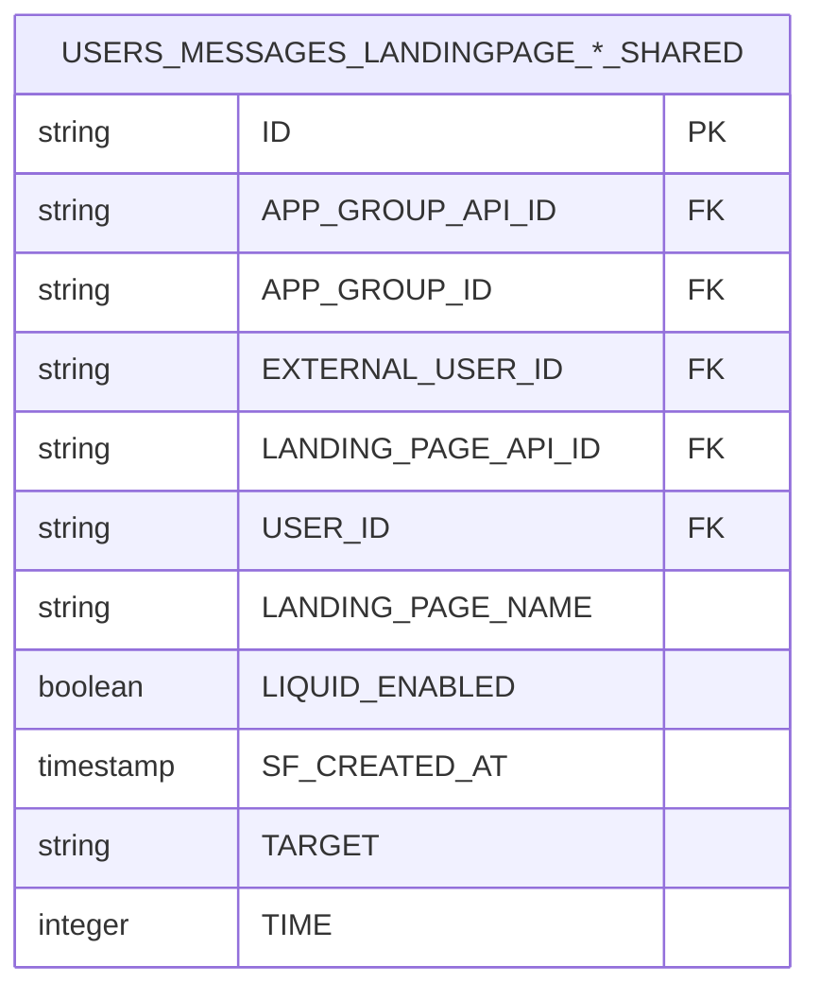

- `PK` = primary key
- `FK` = foreign key

## Relationship tables

### `CLICK_SHARED`

```json
// USERS_MESSAGES_LANDINGPAGE_CLICK_SHARED
// This event occurs when an end-user clicks on select elements and form fields on a landing page.

{
    "primary_key": {
        "ID": "Globally unique ID for this event"
    },
    "foreign_keys": {
        "APP_GROUP_API_ID": "API ID of the app group this user belongs to",
        "APP_GROUP_ID": "BSON ID of the app group this user belongs to",
        "EXTERNAL_USER_ID": "[PII] External ID of the user",
        "USER_ID": "[PII] Braze user ID of the user who performed this event",
        "LANDING_PAGE_API_ID": "API ID of the landing page this event belongs to"
    },
    "native_keys": {
        "TIME": "UNIX timestamp at which the event happened",
        "TARGET": "Configured tracking ID for the element that was clicked",
        "LANDING_PAGE_NAME": "Name of the landing page",
        "SF_CREATED_AT": "when this event was picked up by the Snowpipe"
    }
}
```

### `FORMSUBMISSION_SHARED`

```json
// USERS_MESSAGES_LANDINGPAGE_FORMSUBMISSION_SHARED
// This event occurs when an end-user completes a form on a landing page and clicks on the button to submit the information.

{
    "primary_key": {
        "ID": "Globally unique ID for this event"
    },
    "foreign_keys": {
        "APP_GROUP_API_ID": "API ID of the app group this user belongs to",
        "APP_GROUP_ID": "BSON ID of the app group this user belongs to",
        "EXTERNAL_USER_ID": "[PII] External ID of the user",
        "USER_ID": "[PII] Braze user ID of the user who performed this event",
        "LANDING_PAGE_API_ID": "API ID of the landing page this event belongs to"
    },
    "native_keys": {
        "TIME": "UNIX timestamp at which the event happened",
        "LANDING_PAGE_NAME": "Name of the landing page",
        "SF_CREATED_AT": "when this event was picked up by the Snowpipe"
    }
}
```

### `IMPRESSION_SHARED`

```json
// USERS_MESSAGES_LANDINGPAGE_IMPRESSION_SHARED
// This event occurs when an end-user's browser loads and displays a landing page.

{
    "primary_key": {
        "ID": "Globally unique ID for this event"
    },
    "foreign_keys": {
        "APP_GROUP_API_ID": "API ID of the app group this user belongs to",
        "APP_GROUP_ID": "BSON ID of the app group this user belongs to",
        "EXTERNAL_USER_ID": "[PII] External ID of the user",
        "USER_ID": "[PII] Braze user ID of the user who performed this event",
        "LANDING_PAGE_API_ID": "API ID of the landing page this event belongs to"
    },
    "native_keys": {
        "TIME": "UNIX timestamp at which the event happened",
        "LIQUID_ENABLED": "A boolean that indicates whether the landing page contains Liquid and was processed through the Liquid rendering pipeline.",
        "LANDING_PAGE_NAME": "Name of the landing page",
        "SF_CREATED_AT": "when this event was picked up by the Snowpipe"
    }
}
```


## Relationship diagram


- `PK` = primary key
- `FK` = foreign key

## Relationship tables

### `ABORT_SHARED`

```json
// USERS_MESSAGES_LINE_ABORT_SHARED
// When a scheduled LINE message cannot be delivered, before sending to LINE.

{
    "primary_key": {
        "ID": "Globally unique ID for this event"
    },
    "foreign_keys": {
        "APP_GROUP_API_ID": "API ID of the app group this user belongs to",
        "APP_GROUP_ID": "BSON ID of the app group this user belongs to",
        "EXTERNAL_USER_ID": "[PII] External ID of the user",
        "USER_ID": "[PII] Braze user ID of the user who performed this event",
        "CAMPAIGN_API_ID": "API ID of the campaign this event belongs to",
        "CANVAS_STEP_API_ID": "API ID of the Canvas step this event belongs to",
        "CANVAS_STEP_MESSAGE_VARIATION_API_ID": "API ID of the Canvas step message variation this user received",
        "DEVICE_ID": "ID of the device on which the event occurred",
        "DISPATCH_ID": "ID of the dispatch this message belongs to",
        "LINE_CHANNEL_ID": "The LINE Channel ID the message was sent to or received from",
        "MESSAGE_VARIATION_API_ID": "API ID of the message variation this user received",
        "NATIVE_LINE_ID": "[PII] The user's Line ID from which the message was sent to or received from",
        "SUBSCRIPTION_GROUP_API_ID": "Subscription group API ID",
        "CANVAS_VARIATION_API_ID": "API ID of the Canvas variation this event belongs to",
        "CANVAS_API_ID": "API ID of the Canvas this event belongs to"
    },
    "native_keys": {
        "TIME": "UNIX timestamp at which the event happened",
        "ABORT_LOG": "[PII] Log message describing abort details (up to 128 chars)",
        "ABORT_TYPE": "Type of abort. Refer to the abort types reference for a full list of values.",
        "LINE_CHANNEL_NAME": "The LINE Channel Name the message was sent to or received from",
        "TIMEZONE": "Time zone of the user",
        "CAMPAIGN_NAME": "Name of the campaign",
        "CANVAS_STEP_NAME": "Name of the Canvas step",
        "MESSAGE_EXTRAS": "[PII] A JSON string of the tagged key-value pairs during liquid rendering",
        "SF_CREATED_AT": "when this event was picked up by the Snowpipe",
        "SEND_ID": "Message send ID this message belongs to"
    }
}
```

### `CLICK_SHARED`

```json
// USERS_MESSAGES_LINE_CLICK_SHARED
// When a user clicks a link in a LINE message where the link's domain matches the click tracking domain.

{
    "primary_key": {
        "ID": "Globally unique ID for this event"
    },
    "foreign_keys": {
        "APP_GROUP_API_ID": "API ID of the app group this user belongs to",
        "APP_GROUP_ID": "BSON ID of the app group this user belongs to",
        "EXTERNAL_USER_ID": "[PII] External ID of the user",
        "USER_ID": "[PII] Braze user ID of the user who performed this event",
        "NATIVE_LINE_ID": "[PII] The user's Line ID from which the message was sent to or received from",
        "LINE_CHANNEL_ID": "The LINE Channel ID the message was sent to or received from",
        "SUBSCRIPTION_GROUP_API_ID": "Subscription group API ID",
        "CAMPAIGN_API_ID": "API ID of the campaign this event belongs to",
        "MESSAGE_VARIATION_API_ID": "API ID of the message variation this user received",
        "CANVAS_API_ID": "API ID of the Canvas this event belongs to",
        "CANVAS_VARIATION_API_ID": "API ID of the Canvas variation this event belongs to",
        "CANVAS_STEP_API_ID": "API ID of the Canvas step this event belongs to",
        "CANVAS_STEP_MESSAGE_VARIATION_API_ID": "API ID of the Canvas step message variation this user received",
        "DISPATCH_ID": "ID of the dispatch this message belongs to",
        "DEVICE_ID": "ID of the device on which the event occurred"
    },
    "native_keys": {
        "TIME": "UNIX timestamp at which the event happened",
        "TIMEZONE": "Time zone of the user",
        "LINE_CHANNEL_NAME": "The LINE Channel Name the message was sent to or received from",
        "CAMPAIGN_NAME": "Name of the campaign",
        "CANVAS_STEP_NAME": "Name of the Canvas step",
        "IS_SUSPECTED_BOT_CLICK": "Whether this event was processed as a bot event",
        "SHORT_URL": "Shortened url that was clicked",
        "URL": "URL that the user clicked on",
        "USER_AGENT": "User agent on which the spam report occurred",
        "SF_CREATED_AT": "when this event was picked up by the Snowpipe",
        "SEND_ID": "Message send ID this message belongs to"
    }
}
```

### `INBOUNDRECEIVE_SHARED`

```json
// USERS_MESSAGES_LINE_INBOUNDRECEIVE_SHARED
// When a LINE message is received from a user.

{
    "primary_key": {
        "ID": "Globally unique ID for this event"
    },
    "foreign_keys": {
        "APP_GROUP_API_ID": "API ID of the app group this user belongs to",
        "APP_GROUP_ID": "BSON ID of the app group this user belongs to",
        "EXTERNAL_USER_ID": "[PII] External ID of the user",
        "USER_ID": "[PII] Braze user ID of the user who performed this event",
        "CAMPAIGN_API_ID": "API ID of the campaign this event belongs to",
        "CANVAS_API_ID": "API ID of the Canvas this event belongs to",
        "CANVAS_STEP_API_ID": "API ID of the Canvas step this event belongs to",
        "CANVAS_STEP_MESSAGE_VARIATION_API_ID": "API ID of the Canvas step message variation this user received",
        "CANVAS_VARIATION_API_ID": "API ID of the Canvas variation this event belongs to",
        "DEVICE_ID": "ID of the device on which the event occurred",
        "DISPATCH_ID": "ID of the dispatch this message belongs to",
        "LINE_CHANNEL_ID": "The LINE Channel ID the message was sent to or received from",
        "MEDIA_ID": "The LINE-generated ID which can be used to retrieve inbound media from LINE",
        "MESSAGE_VARIATION_API_ID": "API ID of the message variation this user received",
        "NATIVE_LINE_ID": "[PII] The user's Line ID from which the message was sent to or received from",
        "SUBSCRIPTION_GROUP_API_ID": "Subscription group API ID"
    },
    "native_keys": {
        "TIME": "UNIX timestamp at which the event happened",
        "CAMPAIGN_NAME": "Name of the campaign",
        "CANVAS_STEP_NAME": "Name of the Canvas step",
        "LINE_CHANNEL_NAME": "The LINE Channel Name the message was sent to or received from",
        "MESSAGE_BODY": "Typed response from the user",
        "TIMEZONE": "Time zone of the user",
        "SF_CREATED_AT": "when this event was picked up by the Snowpipe",
        "SEND_ID": "Message send ID this message belongs to"
    }
}
```

### `RETRY_SHARED`

```json
// USERS_MESSAGES_LINE_RETRY_SHARED
// This event occurs when a message is deprioritized or frequency capped and will be retried later within the configured retry window.

{
    "primary_key": {
        "ID": "Globally unique ID for this event"
    },
    "foreign_keys": {
        "APP_GROUP_API_ID": "API ID of the app group this user belongs to",
        "APP_GROUP_ID": "BSON ID of the app group this user belongs to",
        "EXTERNAL_USER_ID": "[PII] External ID of the user",
        "USER_ID": "[PII] Braze user ID of the user who performed this event",
        "CAMPAIGN_API_ID": "API ID of the campaign this event belongs to",
        "CAMPAIGN_ID": "BSON ID of the campaign this event belongs to",
        "CANVAS_ID": "BSON ID of the Canvas this event belongs to",
        "CANVAS_STEP_API_ID": "API ID of the Canvas step this event belongs to",
        "CANVAS_STEP_MESSAGE_VARIATION_API_ID": "API ID of the Canvas step message variation this user received",
        "DEVICE_ID": "ID of the device on which the event occurred",
        "DISPATCH_ID": "ID of the dispatch this message belongs to",
        "LINE_CHANNEL_ID": "The LINE Channel ID the message was sent to or received from",
        "MESSAGE_VARIATION_API_ID": "API ID of the message variation this user received",
        "NATIVE_LINE_ID": "[PII] The user's Line ID from which the message was sent to or received from",
        "SUBSCRIPTION_GROUP_API_ID": "Subscription group API ID",
        "CANVAS_VARIATION_API_ID": "API ID of the Canvas variation this event belongs to",
        "CANVAS_API_ID": "API ID of the Canvas this event belongs to"
    },
    "native_keys": {
        "TIME": "UNIX timestamp at which the event happened",
        "RETRY_LOG": "Log message describing retry details",
        "RETRY_TYPE": "Type of retry",
        "LINE_CHANNEL_NAME": "The LINE Channel Name the message was sent to or received from",
        "TIMEZONE": "Time zone of the user",
        "CAMPAIGN_NAME": "Name of the campaign",
        "CANVAS_STEP_NAME": "Name of the Canvas step",
        "SF_CREATED_AT": "when this event was picked up by the Snowpipe",
        "SEND_ID": "Message send ID this message belongs to"
    }
}
```

### `SEND_SHARED`

```json
// USERS_MESSAGES_LINE_SEND_SHARED
// When a LINE message is sent to LINE.

{
    "primary_key": {
        "ID": "Globally unique ID for this event"
    },
    "foreign_keys": {
        "APP_GROUP_API_ID": "API ID of the app group this user belongs to",
        "APP_GROUP_ID": "BSON ID of the app group this user belongs to",
        "EXTERNAL_USER_ID": "[PII] External ID of the user",
        "USER_ID": "[PII] Braze user ID of the user who performed this event",
        "CAMPAIGN_API_ID": "API ID of the campaign this event belongs to",
        "CANVAS_API_ID": "API ID of the Canvas this event belongs to",
        "CANVAS_STEP_API_ID": "API ID of the Canvas step this event belongs to",
        "CANVAS_STEP_MESSAGE_VARIATION_API_ID": "API ID of the Canvas step message variation this user received",
        "CANVAS_VARIATION_API_ID": "API ID of the Canvas variation this event belongs to",
        "DEVICE_ID": "ID of the device on which the event occurred",
        "DISPATCH_ID": "ID of the dispatch this message belongs to",
        "LINE_CHANNEL_ID": "The LINE Channel ID the message was sent to or received from",
        "MESSAGE_VARIATION_API_ID": "API ID of the message variation this user received",
        "NATIVE_LINE_ID": "[PII] The user's Line ID from which the message was sent to or received from",
        "SUBSCRIPTION_GROUP_API_ID": "Subscription group API ID"
    },
    "native_keys": {
        "TIME": "UNIX timestamp at which the event happened",
        "CAMPAIGN_NAME": "Name of the campaign",
        "CANVAS_STEP_NAME": "Name of the Canvas step",
        "LINE_CHANNEL_NAME": "The LINE Channel Name the message was sent to or received from",
        "MESSAGE_EXTRAS": "[PII] A JSON string of the tagged key-value pairs during liquid rendering",
        "TIMEZONE": "Time zone of the user",
        "SF_CREATED_AT": "when this event was picked up by the Snowpipe",
        "SEND_ID": "Message send ID this message belongs to"
    }
}
```


## Relationship diagram

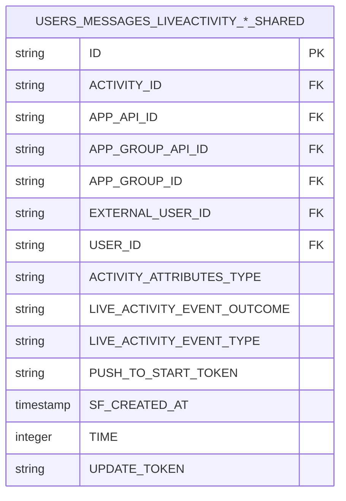

- `PK` = primary key
- `FK` = foreign key

## Relationship tables

### `PUSHTOSTARTTOKENCHANGE_SHARED`

```json
// USERS_BEHAVIORS_LIVEACTIVITY_PUSHTOSTARTTOKENCHANGE_SHARED
// Live Activity Push To Start Token Change Events.

{
    "primary_key": {
        "ID": "Globally unique ID for this event"
    },
    "foreign_keys": {
        "USER_ID": "[PII] Braze user ID of the user who performed this event",
        "EXTERNAL_USER_ID": "[PII] External ID of the user",
        "APP_GROUP_ID": "BSON ID of the app group this user belongs to",
        "DEVICE_ID": "ID of the device on which the event occurred",
        "APP_GROUP_API_ID": "API ID of the app group this user belongs to",
        "APP_API_ID": "API ID of the app on which this event occurred"
    },
    "native_keys": {
        "TIME": "UNIX timestamp at which the event happened",
        "ACTIVITY_ATTRIBUTES_TYPE": "Live Activity attribute type",
        "PUSH_TO_START_TOKEN": "Live Activity push to start token",
        "SDK_VERSION": "Version of the Braze SDK in use during the event",
        "IOS_PUSH_TOKEN_APNS_GATEWAY": "APNS gateway of the push token, only applies to iOS push tokens, 1 for development, 2 for production",
        "PUSH_TOKEN_STATE_CHANGE_TYPE": "A description of the push token state change type",
        "SF_CREATED_AT": "when this event was picked up by the Snowpipe"
    }
}
```

### `UPDATETOKENCHANGE_SHARED`

```json
// USERS_BEHAVIORS_LIVEACTIVITY_UPDATETOKENCHANGE_SHARED
// Live Activity Update Token Change Events.

{
    "primary_key": {
        "ID": "Globally unique ID for this event"
    },
    "foreign_keys": {
        "USER_ID": "[PII] Braze user ID of the user who performed this event",
        "EXTERNAL_USER_ID": "[PII] External ID of the user",
        "APP_GROUP_ID": "BSON ID of the app group this user belongs to",
        "ACTIVITY_ID": "Live Activity identifier",
        "DEVICE_ID": "ID of the device on which the event occurred",
        "APP_GROUP_API_ID": "API ID of the app group this user belongs to",
        "APP_API_ID": "API ID of the app on which this event occurred"
    },
    "native_keys": {
        "TIME": "UNIX timestamp at which the event happened",
        "UPDATE_TOKEN": "Live Activity update token",
        "SDK_VERSION": "Version of the Braze SDK in use during the event",
        "IOS_PUSH_TOKEN_APNS_GATEWAY": "APNS gateway of the push token, only applies to iOS push tokens, 1 for development, 2 for production",
        "PUSH_TOKEN_STATE_CHANGE_TYPE": "A description of the push token state change type",
        "SF_CREATED_AT": "when this event was picked up by the Snowpipe"
    }
}
```

### `OUTCOME_SHARED`

```json
// USERS_MESSAGES_LIVEACTIVITY_OUTCOME_SHARED
// Live Activity Outcome Events.

{
    "primary_key": {
        "ID": "Globally unique ID for this event"
    },
    "foreign_keys": {
        "USER_ID": "[PII] Braze user ID of the user who performed this event",
        "EXTERNAL_USER_ID": "[PII] External ID of the user",
        "APP_GROUP_ID": "BSON ID of the app group this user belongs to",
        "ACTIVITY_ID": "Live Activity identifier",
        "APP_GROUP_API_ID": "API ID of the app group this user belongs to",
        "APP_API_ID": "API ID of the app on which this event occurred"
    },
    "native_keys": {
        "TIME": "UNIX timestamp at which the event happened",
        "ACTIVITY_ATTRIBUTES_TYPE": "Live Activity attribute type",
        "PUSH_TO_START_TOKEN": "Live Activity push to start token",
        "UPDATE_TOKEN": "Live Activity update token",
        "LIVE_ACTIVITY_EVENT_TYPE": "Event type of Live Activity. One of ['start', 'update', 'end']",
        "LIVE_ACTIVITY_EVENT_OUTCOME": "Outcome of Live Activity event",
        "SF_CREATED_AT": "when this event was picked up by the Snowpipe"
    }
}
```

### `SEND_SHARED`

```json
// USERS_MESSAGES_LIVEACTIVITY_SEND_SHARED
// Live Activity Send Events.

{
    "primary_key": {
        "ID": "Globally unique ID for this event"
    },
    "foreign_keys": {
        "USER_ID": "[PII] Braze user ID of the user who performed this event",
        "EXTERNAL_USER_ID": "[PII] External ID of the user",
        "APP_GROUP_ID": "BSON ID of the app group this user belongs to",
        "ACTIVITY_ID": "Live Activity identifier",
        "APP_GROUP_API_ID": "API ID of the app group this user belongs to",
        "APP_API_ID": "API ID of the app on which this event occurred"
    },
    "native_keys": {
        "TIME": "UNIX timestamp at which the event happened",
        "ACTIVITY_ATTRIBUTES_TYPE": "Live Activity attribute type",
        "PUSH_TO_START_TOKEN": "Live Activity push to start token",
        "UPDATE_TOKEN": "Live Activity update token",
        "LIVE_ACTIVITY_EVENT_TYPE": "Event type of Live Activity. One of ['start', 'update', 'end']",
        "SF_CREATED_AT": "when this event was picked up by the Snowpipe"
    }
}
```


## Relationship diagram

```mermaid
---
config:
  layout: elk
  elk:
    mergeEdges: true
    nodePlacementStrategy: LINEAR_SEGMENTS
---
erDiagram
    EVENT["USERS_MESSAGES_PUSHNOTIFICATION_*_SHARED"] {
        string ID PK
        string APP_API_ID FK
        string APP_GROUP_API_ID FK
        string APP_GROUP_ID FK
        string CAMPAIGN_API_ID FK
        string CAMPAIGN_ID FK
        string CANVAS_API_ID FK
        string CANVAS_ID FK
        string CANVAS_STEP_API_ID FK
        string CANVAS_STEP_MESSAGE_VARIATION_API_ID FK
        string CANVAS_VARIATION_API_ID FK
        string DEVICE_ID FK
        string DISPATCH_ID FK
        string EXTERNAL_USER_ID FK
        string MESSAGE_VARIATION_API_ID FK
        string USER_ID FK
        string ABORT_LOG
        string ABORT_TYPE
        string AD_ID
        string AD_ID_TYPE
        boolean AD_TRACKING_ENABLED
        string BROWSER
        string BUTTON_ACTION_TYPE
        string BUTTON_STRING
        string CAMPAIGN_NAME
        string CANVAS_NAME
        string CANVAS_STEP_NAME
        string CANVAS_VARIATION_NAME
        string CARRIER
        string CLICK_URL
        string COUNTRY
        string DEVICE_MODEL
        string GENDER
        boolean IS_ARCHIVED
        string IS_SAMPLED
        string LANGUAGE
        string LOCALE_KEY
        string MESSAGE_EXTRAS
        string MESSAGE_VARIATION_NAME
        string OS_VERSION
        string PLATFORM
        string PUSH_TOKEN
        string RESOLUTION
        string RETRY_LOG
        string RETRY_TYPE
        string SDK_VERSION
        string SEND_ID
        timestamp SF_CREATED_AT
        string SLIDE_ACTION_TYPE
        string SLIDE_ID
        integer TIME
        string TIMEZONE
    }

    CHANGELOGS_CAMPAIGN_SHARED {
        string ID FK
        integer TIME
        string APP_GROUP_ID
        string API_ID
        string NAME
        array CONVERSION_BEHAVIORS
        array ACTIONS
    }
    SNAPSHOTS_CAMPAIGN_MESSAGE_VARIATION_SHARED {
        string ID FK
        integer TIME
        string APP_GROUP_ID
        string API_ID
        string NAME
    }

    USERS_CAMPAIGNS_CONVERSION_SHARED {
        string ID PK
        string APP_API_ID FK
        string APP_GROUP_API_ID FK
        string APP_GROUP_ID FK
        string CAMPAIGN_API_ID FK
        string CAMPAIGN_ID FK
        string DEVICE_ID FK
        string DISPATCH_ID FK
        string EXTERNAL_USER_ID FK
        string MESSAGE_VARIATION_API_ID FK
        string USER_ID FK
        string CAMPAIGN_NAME
        string CONVERSION_BEHAVIOR
        integer CONVERSION_BEHAVIOR_INDEX
        string COUNTRY
        string GENDER
        string LANGUAGE
        string MESSAGE_VARIATION_NAME
        string SEND_ID
        timestamp SF_CREATED_AT
        integer TIME
        string TIMEZONE
    }
    USERS_CAMPAIGNS_ENROLLINCONTROL_SHARED {
        string ID PK
        string APP_API_ID FK
        string APP_GROUP_API_ID FK
        string APP_GROUP_ID FK
        string CAMPAIGN_API_ID FK
        string CAMPAIGN_ID FK
        string DEVICE_ID FK
        string DISPATCH_ID FK
        string EXTERNAL_USER_ID FK
        string MESSAGE_VARIATION_API_ID FK
        string USER_ID FK
        string CAMPAIGN_NAME
        string COUNTRY
        string GENDER
        string LANGUAGE
        string MESSAGE_VARIATION_NAME
        string SEND_ID
        timestamp SF_CREATED_AT
        integer TIME
        string TIMEZONE
    }
    USERS_CAMPAIGNS_FREQUENCYCAP_SHARED {
        string ID PK
        string APP_GROUP_API_ID FK
        string APP_GROUP_ID FK
        string CAMPAIGN_API_ID FK
        string CAMPAIGN_ID FK
        string DEVICE_ID FK
        string DISPATCH_ID FK
        string EXTERNAL_USER_ID FK
        string MESSAGE_VARIATION_API_ID FK
        string USER_ID FK
        string CHANNEL
        string COUNTRY
        string GENDER
        string LANGUAGE
        string SEND_ID
        timestamp SF_CREATED_AT
        integer TIME
        string TIMEZONE
    }
    USERS_CAMPAIGNS_REVENUE_SHARED {
        string ID PK
        string APP_API_ID FK
        string APP_GROUP_API_ID FK
        string APP_GROUP_ID FK
        string CAMPAIGN_API_ID FK
        string CAMPAIGN_ID FK
        string DEVICE_ID FK
        string DISPATCH_ID FK
        string EXTERNAL_USER_ID FK
        string MESSAGE_VARIATION_API_ID FK
        string USER_ID FK
        string COUNTRY
        string GENDER
        string LANGUAGE
        integer REVENUE
        string SEND_ID
        timestamp SF_CREATED_AT
        integer TIME
        string TIMEZONE
    }
    USERS_CAMPAIGNS_UNIQUERECEIPT_SHARED {
        string ID PK
        string APP_API_ID FK
        string APP_GROUP_API_ID FK
        string APP_GROUP_ID FK
        string CAMPAIGN_API_ID FK
        string CAMPAIGN_ID FK
        string DEVICE_ID FK
        string DISPATCH_ID FK
        string EXTERNAL_USER_ID FK
        string MESSAGE_VARIATION_API_ID FK
        string USER_ID FK
        string CAMPAIGN_NAME
        string COUNTRY
        string GENDER
        string LANGUAGE
        string MESSAGE_VARIATION_NAME
        string SEND_ID
        timestamp SF_CREATED_AT
        integer TIME
        string TIMEZONE
    }

    USERS_CANVAS_ENTRY_SHARED {
        string ID PK
        string APP_GROUP_API_ID FK
        string APP_GROUP_ID FK
        string CANVAS_API_ID FK
        string CANVAS_ID FK
        string CANVAS_STEP_API_ID FK
        string CANVAS_VARIATION_API_ID FK
        string DEVICE_ID FK
        string EXTERNAL_USER_ID FK
        string USER_ID FK
        string CANVAS_NAME
        string CANVAS_STEP_NAME
        string CANVAS_VARIATION_NAME
        string COUNTRY
        string GENDER
        boolean IN_CONTROL_GROUP
        string LANGUAGE
        timestamp SF_CREATED_AT
        integer TIME
        string TIMEZONE
    }
    USERS_CANVAS_EXPERIMENTSTEP_SPLITENTRY_SHARED {
        string ID PK
        string APP_GROUP_ID FK
        string CANVAS_API_ID FK
        string CANVAS_ID FK
        string CANVAS_STEP_API_ID FK
        string CANVAS_VARIATION_API_ID FK
        string EXPERIMENT_SPLIT_API_ID FK
        string EXPERIMENT_STEP_API_ID FK
        string EXTERNAL_USER_ID FK
        string USER_ID FK
        string CANVAS_NAME
        string CANVAS_STEP_NAME
        string CANVAS_VARIATION_NAME
        string EXPERIMENT_SPLIT_NAME
        boolean IN_CONTROL_GROUP
        timestamp SF_CREATED_AT
        integer TIME
    }
    USERS_CANVAS_EXIT_MATCHEDAUDIENCE_SHARED {
        string ID PK
        string APP_GROUP_API_ID FK
        string APP_GROUP_ID FK
        string CANVAS_API_ID FK
        string CANVAS_ID FK
        string CANVAS_STEP_API_ID FK
        string CANVAS_VARIATION_API_ID FK
        string EXTERNAL_USER_ID FK
        string USER_ID FK
        string CANVAS_NAME
        string CANVAS_STEP_NAME
        string CANVAS_VARIATION_NAME
        timestamp SF_CREATED_AT
        integer TIME
    }
    USERS_CANVAS_EXIT_PERFORMEDEVENT_SHARED {
        string ID PK
        string APP_GROUP_API_ID FK
        string APP_GROUP_ID FK
        string CANVAS_API_ID FK
        string CANVAS_ID FK
        string CANVAS_STEP_API_ID FK
        string CANVAS_VARIATION_API_ID FK
        string EXTERNAL_USER_ID FK
        string USER_ID FK
        string CANVAS_NAME
        string CANVAS_STEP_NAME
        string CANVAS_VARIATION_NAME
        timestamp SF_CREATED_AT
        integer TIME
    }
    USERS_CANVAS_COSTEP_SEND_SHARED {
        string ID PK
        string APP_GROUP_API_ID FK
        string APP_GROUP_ID FK
        string CANVAS_ID FK
        string CANVAS_VARIATION_API_ID FK
        string CONTENT_OPTIMIZER_STEP_ID FK
        string DISPATCH_ID FK
        string EXTERNAL_USER_ID FK
        string USER_ID FK
        string CHANNEL
        string COMBINATION_TOKEN
        timestamp SF_CREATED_AT
        integer TIME
    }
    USERS_CANVAS_FREQUENCYCAP_SHARED {
        string ID PK
        string APP_GROUP_API_ID FK
        string APP_GROUP_ID FK
        string CANVAS_API_ID FK
        string CANVAS_ID FK
        string CANVAS_STEP_API_ID FK
        string CANVAS_STEP_MESSAGE_VARIATION_API_ID FK
        string CANVAS_VARIATION_API_ID FK
        string DEVICE_ID FK
        string EXTERNAL_USER_ID FK
        string USER_ID FK
        string CHANNEL
        string COUNTRY
        string GENDER
        string LANGUAGE
        timestamp SF_CREATED_AT
        integer TIME
        string TIMEZONE
    }
    USERS_CANVAS_SENDTODESTINATION_NOTSENT_SHARED {
        string ID PK
        string APP_GROUP_API_ID FK
        string APP_GROUP_ID FK
        string CANVAS_API_ID FK
        string CANVAS_ID FK
        string CANVAS_STEP_API_ID FK
        string CANVAS_VARIATION_API_ID FK
        string DESTINATION_API_ID FK
        string EXTERNAL_USER_ID FK
        string USER_ID FK
        string CANVAS_NAME
        string CANVAS_STEP_NAME
        string CANVAS_STEP_TYPE
        string CANVAS_VARIATION_NAME
        string DESTINATION_NAME
        string DESTINATION_TYPE
        string REASON
        timestamp SF_CREATED_AT
        integer TIME
    }
    USERS_CANVAS_SENDTODESTINATION_SENT_SHARED {
        string ID PK
        string APP_GROUP_API_ID FK
        string APP_GROUP_ID FK
        string CANVAS_API_ID FK
        string CANVAS_ID FK
        string CANVAS_STEP_API_ID FK
        string CANVAS_VARIATION_API_ID FK
        string DESTINATION_API_ID FK
        string EXTERNAL_USER_ID FK
        string USER_ID FK
        string CANVAS_NAME
        string CANVAS_STEP_NAME
        string CANVAS_STEP_TYPE
        string CANVAS_VARIATION_NAME
        string DESTINATION_NAME
        string DESTINATION_TYPE
        string DESTINATION_VARIANT_TYPE
        string DESTINATION_VARIATION_NAME
        timestamp SF_CREATED_AT
        integer TIME
    }

    USERS_CANVAS_EXPERIMENTSTEP_CONVERSION_SHARED {
        string ID PK
        string APP_API_ID FK
        string APP_GROUP_ID FK
        string CANVAS_API_ID FK
        string CANVAS_ID FK
        string CANVAS_STEP_API_ID FK
        string CANVAS_VARIATION_API_ID FK
        string EXPERIMENT_SPLIT_API_ID FK
        string EXPERIMENT_STEP_API_ID FK
        string EXTERNAL_USER_ID FK
        string USER_ID FK
        string CANVAS_NAME
        string CANVAS_STEP_NAME
        string CANVAS_VARIATION_NAME
        string CONVERSION_BEHAVIOR
        integer CONVERSION_BEHAVIOR_INDEX
        string EXPERIMENT_SPLIT_NAME
        timestamp SF_CREATED_AT
        integer TIME
    }
    USERS_CANVAS_CONVERSION_SHARED {
        string ID PK
        string APP_API_ID FK
        string APP_GROUP_API_ID FK
        string APP_GROUP_ID FK
        string CANVAS_API_ID FK
        string CANVAS_ID FK
        string CANVAS_STEP_API_ID FK
        string CANVAS_STEP_MESSAGE_VARIATION_API_ID FK
        string CANVAS_VARIATION_API_ID FK
        string DEVICE_ID FK
        string EXTERNAL_USER_ID FK
        string USER_ID FK
        string CANVAS_NAME
        string CANVAS_STEP_NAME
        string CANVAS_VARIATION_NAME
        string CONVERSION_BEHAVIOR
        integer CONVERSION_BEHAVIOR_INDEX
        string COUNTRY
        string GENDER
        string LANGUAGE
        timestamp SF_CREATED_AT
        integer TIME
        string TIMEZONE
    }
    USERS_CANVAS_COSTEP_CONVERSION_SHARED {
        string ID PK
        string APP_GROUP_API_ID FK
        string APP_GROUP_ID FK
        string DISPATCH_ID FK
        string EXTERNAL_USER_ID FK
        string USER_ID FK
        string CHANNEL
        string COMBINATION_TOKEN
        string CONVERSION_TYPE
        timestamp SF_CREATED_AT
        integer TIME
    }
    USERS_CANVAS_REVENUE_SHARED {
        string ID PK
        string APP_API_ID FK
        string APP_GROUP_API_ID FK
        string APP_GROUP_ID FK
        string CANVAS_API_ID FK
        string CANVAS_ID FK
        string CANVAS_STEP_API_ID FK
        string CANVAS_STEP_MESSAGE_VARIATION_API_ID FK
        string CANVAS_VARIATION_API_ID FK
        string DEVICE_ID FK
        string EXTERNAL_USER_ID FK
        string USER_ID FK
        string COUNTRY
        string GENDER
        string LANGUAGE
        integer REVENUE
        timestamp SF_CREATED_AT
        integer TIME
        string TIMEZONE
    }

    CHANGELOGS_CANVAS_SHARED {
        string ID FK
        integer TIME
        string APP_GROUP_ID
        string API_ID
        string NAME
        array CONVERSION_BEHAVIORS
        array VARIATIONS
    }
    SNAPSHOTS_CANVAS_FLOW_STEP_SHARED {
        string ID FK
        integer TIME
        string APP_GROUP_ID
        string TYPE
        string API_STEP_ID
        array EXPERIMENT_SPLITS
        array CONVERSION_BEHAVIORS
        string NAME
    }
    SNAPSHOTS_CANVAS_STEP_SHARED {
        string ID FK
        integer TIME
        string APP_GROUP_ID
        string API_ID
        string NAME
        array ACTIONS
    }
    SNAPSHOTS_CANVAS_VARIATION_SHARED {
        string ID FK
        integer TIME
        string APP_GROUP_ID
        string API_ID
        string NAME
    }
    SNAPSHOTS_EXPERIMENT_STEP_SHARED {
        string ID FK
        integer TIME
        string APP_GROUP_ID
        string TYPE
        string API_STEP_ID
        array EXPERIMENT_SPLITS
        array CONVERSION_BEHAVIORS
        string NAME
    }

    %% Relationships for Group Labels
    GROUP_1["Campaign Snapshots and Log"] { }
    CHANGELOGS_CAMPAIGN_SHARED ||--o{ GROUP_1 : joins
    SNAPSHOTS_CAMPAIGN_MESSAGE_VARIATION_SHARED ||--o{ GROUP_1 : joins
    GROUP_1 ||--o{ EVENT : joins

    GROUP_2["Campaign Events"] { }
    USERS_CAMPAIGNS_CONVERSION_SHARED ||--o{ GROUP_2 : joins
    USERS_CAMPAIGNS_ENROLLINCONTROL_SHARED ||--o{ GROUP_2 : joins
    USERS_CAMPAIGNS_FREQUENCYCAP_SHARED ||--o{ GROUP_2 : joins
    USERS_CAMPAIGNS_REVENUE_SHARED ||--o{ GROUP_2 : joins
    USERS_CAMPAIGNS_UNIQUERECEIPT_SHARED ||--o{ GROUP_2 : joins
    GROUP_2 ||--o{ EVENT : joins

    GROUP_3["Canvas Events"] { }
    USERS_CANVAS_ENTRY_SHARED ||--o{ GROUP_3 : joins
    USERS_CANVAS_EXPERIMENTSTEP_SPLITENTRY_SHARED ||--o{ GROUP_3 : joins
    USERS_CANVAS_EXIT_MATCHEDAUDIENCE_SHARED ||--o{ GROUP_3 : joins
    USERS_CANVAS_EXIT_PERFORMEDEVENT_SHARED ||--o{ GROUP_3 : joins
    USERS_CANVAS_COSTEP_SEND_SHARED ||--o{ GROUP_3 : joins
    USERS_CANVAS_FREQUENCYCAP_SHARED ||--o{ GROUP_3 : joins
    USERS_CANVAS_SENDTODESTINATION_NOTSENT_SHARED ||--o{ GROUP_3 : joins
    USERS_CANVAS_SENDTODESTINATION_SENT_SHARED ||--o{ GROUP_3 : joins
    GROUP_3 ||--o{ EVENT : joins

    GROUP_4["Canvas Conversions"] { }
    USERS_CANVAS_EXPERIMENTSTEP_CONVERSION_SHARED ||--o{ GROUP_4 : joins
    USERS_CANVAS_CONVERSION_SHARED ||--o{ GROUP_4 : joins
    USERS_CANVAS_COSTEP_CONVERSION_SHARED ||--o{ GROUP_4 : joins
    USERS_CANVAS_REVENUE_SHARED ||--o{ GROUP_4 : joins
    GROUP_4 ||--o{ EVENT : joins

    GROUP_5["Canvas Snapshots and Log"] { }
    CHANGELOGS_CANVAS_SHARED ||--o{ GROUP_5 : joins
    SNAPSHOTS_CANVAS_FLOW_STEP_SHARED ||--o{ GROUP_5 : joins
    SNAPSHOTS_CANVAS_STEP_SHARED ||--o{ GROUP_5 : joins
    SNAPSHOTS_CANVAS_VARIATION_SHARED ||--o{ GROUP_5 : joins
    SNAPSHOTS_EXPERIMENT_STEP_SHARED ||--o{ GROUP_5 : joins
    GROUP_5 ||--o{ EVENT : joins
```

- `PK` = primary key
- `FK` = foreign key

## Relationship tables

### `TOKENSTATECHANGE_SHARED`

```json
// USERS_BEHAVIORS_PUSHNOTIFICATION_TOKENSTATECHANGE_SHARED
// Push Notification Token State Change Events.

{
    "primary_key": {
        "ID": "Globally unique ID for this event"
    },
    "foreign_keys": {
        "USER_ID": "[PII] Braze user ID of the user who performed this event",
        "APP_API_ID": "API ID of the app on which this event occurred",
        "APP_GROUP_ID": "BSON ID of the app group this user belongs to",
        "APP_GROUP_API_ID": "API ID of the app group this user belongs to",
        "EXTERNAL_USER_ID": "[PII] External ID of the user",
        "PUSH_TOKEN_DEVICE_ID": "Device id of the push token"
    },
    "native_keys": {
        "TIME": "UNIX timestamp at which the event happened",
        "TIME_MS": "Time in millisecond when the event happened",
        "PLATFORM": "Platform of the device",
        "PUSH_TOKEN": "Push token of the event",
        "SDK_VERSION": "Version of the Braze SDK in use during the event",
        "PUSH_TOKEN_CREATED_AT": "UNIX timestamp at which the push token was created",
        "PUSH_TOKEN_UPDATED_AT": "UNIX timestamp at which the push token was last updated",
        "WEB_PUSH_TOKEN_USER_AUTH": "User auth of the push token, only applies to web push tokens",
        "WEB_PUSH_TOKEN_PUBLIC_KEY": "Public key of the push token, only applies to web push tokens",
        "IOS_PUSH_TOKEN_APNS_GATEWAY": "APNS gateway of the push token, only applies to iOS push tokens, 1 for development, 2 for production",
        "PUSH_TOKEN_STATE_CHANGE_TYPE": "A description of the push token state change type",
        "WEB_PUSH_TOKEN_VAPID_PUBLIC_KEY": "VAPID public key of the push token, only applies to web push tokens",
        "PUSH_TOKEN_PROVISIONALLY_OPTED_IN": "Provisionally opted in flag of the push token",
        "PUSH_TOKEN_FOREGROUND_PUSH_DISABLED": "Foreground push disabled flag of the push token",
        "SF_CREATED_AT": "when this event was picked up by the Snowpipe"
    }
}
```

### `ABORT_SHARED`

```json
// USERS_MESSAGES_PUSHNOTIFICATION_ABORT_SHARED
// An originally scheduled pushnotification message was aborted for some reason.

{
    "primary_key": {
        "ID": "Globally unique ID for this event"
    },
    "foreign_keys": {
        "USER_ID": "[PII] Braze user ID of the user who performed this event",
        "EXTERNAL_USER_ID": "[PII] External ID of the user",
        "DEVICE_ID": "ID of the device on which the event occurred",
        "APP_GROUP_ID": "BSON ID of the app group this user belongs to",
        "APP_GROUP_API_ID": "API ID of the app group this user belongs to",
        "APP_API_ID": "API ID of the app on which this event occurred",
        "DISPATCH_ID": "ID of the dispatch this message belongs to",
        "CAMPAIGN_ID": "BSON ID of the campaign this event belongs to",
        "CAMPAIGN_API_ID": "API ID of the campaign this event belongs to",
        "MESSAGE_VARIATION_API_ID": "API ID of the message variation this user received",
        "CANVAS_ID": "BSON ID of the Canvas this event belongs to",
        "CANVAS_API_ID": "API ID of the Canvas this event belongs to",
        "CANVAS_VARIATION_API_ID": "API ID of the Canvas variation this event belongs to",
        "CANVAS_STEP_API_ID": "API ID of the Canvas step this event belongs to",
        "CANVAS_STEP_MESSAGE_VARIATION_API_ID": "API ID of the Canvas step message variation this user received"
    },
    "native_keys": {
        "TIME": "UNIX timestamp at which the event happened",
        "GENDER": "[PII] Gender of the user",
        "COUNTRY": "[PII] Country of the user",
        "TIMEZONE": "Time zone of the user",
        "LANGUAGE": "[PII] Language of the user",
        "PLATFORM": "Platform of the device",
        "ABORT_TYPE": "Type of abort. Refer to the abort types reference for a full list of values.",
        "ABORT_LOG": "[PII] Log message describing abort details (up to 128 chars)",
        "CAMPAIGN_NAME": "Name of the campaign",
        "MESSAGE_VARIATION_NAME": "Name of the message variation",
        "CANVAS_NAME": "Name of the Canvas",
        "CANVAS_VARIATION_NAME": "Name of the Canvas variation this user received",
        "CANVAS_STEP_NAME": "Name of the Canvas step",
        "MESSAGE_EXTRAS": "[PII] A JSON string of the tagged key-value pairs during liquid rendering",
        "SF_CREATED_AT": "when this event was picked up by the Snowpipe",
        "SEND_ID": "Message send ID this message belongs to"
    }
}
```

### `BOUNCE_SHARED`

```json
// USERS_MESSAGES_PUSHNOTIFICATION_BOUNCE_SHARED
// When a push notification bounces.

{
    "primary_key": {
        "ID": "Globally unique ID for this event"
    },
    "foreign_keys": {
        "USER_ID": "[PII] Braze user ID of the user who performed this event",
        "EXTERNAL_USER_ID": "[PII] External ID of the user",
        "DEVICE_ID": "ID of the device on which the event occurred",
        "APP_GROUP_ID": "BSON ID of the app group this user belongs to",
        "APP_GROUP_API_ID": "API ID of the app group this user belongs to",
        "APP_API_ID": "API ID of the app on which this event occurred",
        "DISPATCH_ID": "ID of the dispatch this message belongs to",
        "CAMPAIGN_ID": "BSON ID of the campaign this event belongs to",
        "CAMPAIGN_API_ID": "API ID of the campaign this event belongs to",
        "MESSAGE_VARIATION_API_ID": "API ID of the message variation this user received",
        "CANVAS_ID": "BSON ID of the Canvas this event belongs to",
        "CANVAS_API_ID": "API ID of the Canvas this event belongs to",
        "CANVAS_VARIATION_API_ID": "API ID of the Canvas variation this event belongs to",
        "CANVAS_STEP_API_ID": "API ID of the Canvas step this event belongs to",
        "CANVAS_STEP_MESSAGE_VARIATION_API_ID": "API ID of the Canvas step message variation this user received"
    },
    "native_keys": {
        "PUSH_TOKEN": "Push token of the event",
        "TIME": "UNIX timestamp at which the event happened",
        "GENDER": "[PII] Gender of the user",
        "COUNTRY": "[PII] Country of the user",
        "TIMEZONE": "Time zone of the user",
        "LANGUAGE": "[PII] Language of the user",
        "PLATFORM": "Platform of the device",
        "AD_ID_TYPE": "One of ['ios_idfa', 'google_ad_id', 'windows_ad_id', 'roku_ad_id']",
        "AD_TRACKING_ENABLED": "Whether advertising tracking is enabled for the device",
        "CAMPAIGN_NAME": "Name of the campaign",
        "MESSAGE_VARIATION_NAME": "Name of the message variation",
        "CANVAS_NAME": "Name of the Canvas",
        "CANVAS_VARIATION_NAME": "Name of the Canvas variation this user received",
        "CANVAS_STEP_NAME": "Name of the Canvas step",
        "SF_CREATED_AT": "when this event was picked up by the Snowpipe",
        "AD_ID": "[PII] Advertising identifier",
        "SEND_ID": "Message send ID this message belongs to"
    }
}
```

### `INFLUENCEDOPEN_SHARED`

```json
// USERS_MESSAGES_PUSHNOTIFICATION_INFLUENCEDOPEN_SHARED
// When a user opens the app after receiving a notification without clicking on the notification.

{
    "primary_key": {
        "ID": "Globally unique ID for this event"
    },
    "foreign_keys": {
        "USER_ID": "[PII] Braze user ID of the user who performed this event",
        "EXTERNAL_USER_ID": "[PII] External ID of the user",
        "APP_GROUP_ID": "BSON ID of the app group this user belongs to",
        "APP_GROUP_API_ID": "API ID of the app group this user belongs to",
        "APP_API_ID": "API ID of the app on which this event occurred",
        "DISPATCH_ID": "ID of the dispatch this message belongs to",
        "CAMPAIGN_ID": "BSON ID of the campaign this event belongs to",
        "CAMPAIGN_API_ID": "API ID of the campaign this event belongs to",
        "MESSAGE_VARIATION_API_ID": "API ID of the message variation this user received",
        "CANVAS_ID": "BSON ID of the Canvas this event belongs to",
        "CANVAS_API_ID": "API ID of the Canvas this event belongs to",
        "CANVAS_VARIATION_API_ID": "API ID of the Canvas variation this event belongs to",
        "CANVAS_STEP_API_ID": "API ID of the Canvas step this event belongs to",
        "CANVAS_STEP_MESSAGE_VARIATION_API_ID": "API ID of the Canvas step message variation this user received",
        "DEVICE_ID": "ID of the device on which the event occurred"
    },
    "native_keys": {
        "TIME": "UNIX timestamp at which the event happened",
        "GENDER": "[PII] Gender of the user",
        "COUNTRY": "[PII] Country of the user",
        "TIMEZONE": "Time zone of the user",
        "LANGUAGE": "[PII] Language of the user",
        "SDK_VERSION": "Version of the Braze SDK in use during the event",
        "PLATFORM": "Platform of the device",
        "OS_VERSION": "Version of the operating system of the device",
        "DEVICE_MODEL": "Model of the device",
        "RESOLUTION": "Resolution of the device",
        "CARRIER": "Carrier of the device",
        "BROWSER": "Device browser - extracted from user_agent - on which the open occurred",
        "CAMPAIGN_NAME": "Name of the campaign",
        "MESSAGE_VARIATION_NAME": "Name of the message variation",
        "CANVAS_NAME": "Name of the Canvas",
        "CANVAS_VARIATION_NAME": "Name of the Canvas variation this user received",
        "CANVAS_STEP_NAME": "Name of the Canvas step",
        "SF_CREATED_AT": "when this event was picked up by the Snowpipe",
        "SEND_ID": "Message send ID this message belongs to"
    }
}
```

### `IOSFOREGROUND_SHARED`

```json
// USERS_MESSAGES_PUSHNOTIFICATION_IOSFOREGROUND_SHARED
// When a user receives a push notification while the app is open.
// This event is not supported by the Swift SDK and is deprecated in the Obj-C SDK.

{
    "primary_key": {
        "ID": "Globally unique ID for this event"
    },
    "foreign_keys": {
        "USER_ID": "[PII] Braze user ID of the user who performed this event",
        "EXTERNAL_USER_ID": "[PII] External ID of the user",
        "APP_GROUP_ID": "BSON ID of the app group this user belongs to",
        "APP_GROUP_API_ID": "API ID of the app group this user belongs to",
        "APP_API_ID": "API ID of the app on which this event occurred",
        "DISPATCH_ID": "ID of the dispatch this message belongs to",
        "CAMPAIGN_ID": "BSON ID of the campaign this event belongs to",
        "CAMPAIGN_API_ID": "API ID of the campaign this event belongs to",
        "MESSAGE_VARIATION_API_ID": "API ID of the message variation this user received",
        "CANVAS_ID": "BSON ID of the Canvas this event belongs to",
        "CANVAS_API_ID": "API ID of the Canvas this event belongs to",
        "CANVAS_VARIATION_API_ID": "API ID of the Canvas variation this event belongs to",
        "CANVAS_STEP_API_ID": "API ID of the Canvas step this event belongs to",
        "CANVAS_STEP_MESSAGE_VARIATION_API_ID": "API ID of the Canvas step message variation this user received",
        "DEVICE_ID": "ID of the device on which the event occurred"
    },
    "native_keys": {
        "TIME": "UNIX timestamp at which the event happened",
        "GENDER": "[PII] Gender of the user",
        "COUNTRY": "[PII] Country of the user",
        "TIMEZONE": "Time zone of the user",
        "LANGUAGE": "[PII] Language of the user",
        "SDK_VERSION": "Version of the Braze SDK in use during the event",
        "PLATFORM": "Platform of the device",
        "OS_VERSION": "Version of the operating system of the device",
        "DEVICE_MODEL": "Model of the device",
        "RESOLUTION": "Resolution of the device",
        "CARRIER": "Carrier of the device",
        "BROWSER": "Device browser - extracted from user_agent - on which the open occurred",
        "AD_ID_TYPE": "One of ['ios_idfa', 'google_ad_id', 'windows_ad_id', 'roku_ad_id']",
        "AD_TRACKING_ENABLED": "Whether advertising tracking is enabled for the device",
        "CAMPAIGN_NAME": "Name of the campaign",
        "MESSAGE_VARIATION_NAME": "Name of the message variation",
        "CANVAS_NAME": "Name of the Canvas",
        "CANVAS_VARIATION_NAME": "Name of the Canvas variation this user received",
        "CANVAS_STEP_NAME": "Name of the Canvas step",
        "SF_CREATED_AT": "when this event was picked up by the Snowpipe",
        "AD_ID": "[PII] Advertising identifier",
        "SEND_ID": "Message send ID this message belongs to"
    }
}
```

### `OPEN_SHARED`

```json
// USERS_MESSAGES_PUSHNOTIFICATION_OPEN_SHARED
// When a user opens a push notification or clicks a push notification button (including a CLOSE button that does NOT open the app).

{
    "primary_key": {
        "ID": "Globally unique ID for this event"
    },
    "foreign_keys": {
        "USER_ID": "[PII] Braze user ID of the user who performed this event",
        "EXTERNAL_USER_ID": "[PII] External ID of the user",
        "APP_GROUP_ID": "BSON ID of the app group this user belongs to",
        "APP_GROUP_API_ID": "API ID of the app group this user belongs to",
        "APP_API_ID": "API ID of the app on which this event occurred",
        "DISPATCH_ID": "ID of the dispatch this message belongs to",
        "CAMPAIGN_ID": "BSON ID of the campaign this event belongs to",
        "CAMPAIGN_API_ID": "API ID of the campaign this event belongs to",
        "MESSAGE_VARIATION_API_ID": "API ID of the message variation this user received",
        "CANVAS_ID": "BSON ID of the Canvas this event belongs to",
        "CANVAS_API_ID": "API ID of the Canvas this event belongs to",
        "CANVAS_VARIATION_API_ID": "API ID of the Canvas variation this event belongs to",
        "CANVAS_STEP_API_ID": "API ID of the Canvas step this event belongs to",
        "CANVAS_STEP_MESSAGE_VARIATION_API_ID": "API ID of the Canvas step message variation this user received",
        "DEVICE_ID": "ID of the device on which the event occurred"
    },
    "native_keys": {
        "TIME": "UNIX timestamp at which the event happened",
        "GENDER": "[PII] Gender of the user",
        "COUNTRY": "[PII] Country of the user",
        "TIMEZONE": "Time zone of the user",
        "LANGUAGE": "[PII] Language of the user",
        "SDK_VERSION": "Version of the Braze SDK in use during the event",
        "PLATFORM": "Platform of the device",
        "OS_VERSION": "Version of the operating system of the device",
        "DEVICE_MODEL": "Model of the device",
        "RESOLUTION": "Resolution of the device",
        "CARRIER": "Carrier of the device",
        "BROWSER": "Device browser - extracted from user_agent - on which the open occurred",
        "BUTTON_STRING": "Identifier (button_string) of the push notification button clicked. null if not from a button click",
        "BUTTON_ACTION_TYPE": "Action type of the push notification button, null if not from a button click. One of ['uri', 'deep_link', 'none', 'close']",
        "SLIDE_ACTION_TYPE": "Action type of the push carousel slide",
        "AD_ID_TYPE": "One of ['ios_idfa', 'google_ad_id', 'windows_ad_id', 'roku_ad_id']",
        "AD_TRACKING_ENABLED": "Whether advertising tracking is enabled for the device",
        "CAMPAIGN_NAME": "Name of the campaign",
        "MESSAGE_VARIATION_NAME": "Name of the message variation",
        "CANVAS_NAME": "Name of the Canvas",
        "CANVAS_VARIATION_NAME": "Name of the Canvas variation this user received",
        "CANVAS_STEP_NAME": "Name of the Canvas step",
        "SF_CREATED_AT": "when this event was picked up by the Snowpipe",
        "AD_ID": "[PII] Advertising identifier",
        "SEND_ID": "Message send ID this message belongs to",
        "SLIDE_ID": "Slide identifier of the push carousel slide user clicks on"
    }
}
```

### `RETRY_SHARED`

```json
// USERS_MESSAGES_PUSHNOTIFICATION_RETRY_SHARED
// This event occurs when a message is deprioritized or frequency capped and will be retried later within the configured retry window.

{
    "primary_key": {
        "ID": "Globally unique ID for this event"
    },
    "foreign_keys": {
        "APP_GROUP_API_ID": "API ID of the app group this user belongs to",
        "APP_GROUP_ID": "BSON ID of the app group this user belongs to",
        "EXTERNAL_USER_ID": "[PII] External ID of the user",
        "USER_ID": "[PII] Braze user ID of the user who performed this event",
        "DEVICE_ID": "ID of the device on which the event occurred",
        "APP_API_ID": "API ID of the app on which this event occurred",
        "DISPATCH_ID": "ID of the dispatch this message belongs to",
        "CAMPAIGN_ID": "BSON ID of the campaign this event belongs to",
        "CAMPAIGN_API_ID": "API ID of the campaign this event belongs to",
        "MESSAGE_VARIATION_API_ID": "API ID of the message variation this user received",
        "CANVAS_ID": "BSON ID of the Canvas this event belongs to",
        "CANVAS_API_ID": "API ID of the Canvas this event belongs to",
        "CANVAS_VARIATION_API_ID": "API ID of the Canvas variation this event belongs to",
        "CANVAS_STEP_API_ID": "API ID of the Canvas step this event belongs to",
        "CANVAS_STEP_MESSAGE_VARIATION_API_ID": "API ID of the Canvas step message variation this user received"
    },
    "native_keys": {
        "TIME": "UNIX timestamp at which the event happened",
        "GENDER": "[PII] Gender of the user",
        "COUNTRY": "[PII] Country of the user",
        "TIMEZONE": "Time zone of the user",
        "LANGUAGE": "[PII] Language of the user",
        "PLATFORM": "Platform of the device",
        "RETRY_TYPE": "Type of retry",
        "RETRY_LOG": "Log message describing retry details",
        "CAMPAIGN_NAME": "Name of the campaign",
        "MESSAGE_VARIATION_NAME": "Name of the message variation",
        "CANVAS_NAME": "Name of the Canvas",
        "CANVAS_VARIATION_NAME": "Name of the Canvas variation this user received",
        "CANVAS_STEP_NAME": "Name of the Canvas step",
        "SF_CREATED_AT": "when this event was picked up by the Snowpipe",
        "SEND_ID": "Message send ID this message belongs to"
    }
}
```

### `SEND_SHARED`

```json
// USERS_MESSAGES_PUSHNOTIFICATION_SEND_SHARED
// When we send a push notification to a user.

{
    "primary_key": {
        "ID": "Globally unique ID for this event"
    },
    "foreign_keys": {
        "USER_ID": "[PII] Braze user ID of the user who performed this event",
        "EXTERNAL_USER_ID": "[PII] External ID of the user",
        "DEVICE_ID": "ID of the device on which the event occurred",
        "APP_GROUP_ID": "BSON ID of the app group this user belongs to",
        "APP_GROUP_API_ID": "API ID of the app group this user belongs to",
        "APP_API_ID": "API ID of the app on which this event occurred",
        "DISPATCH_ID": "ID of the dispatch this message belongs to",
        "CAMPAIGN_ID": "BSON ID of the campaign this event belongs to",
        "CAMPAIGN_API_ID": "API ID of the campaign this event belongs to",
        "MESSAGE_VARIATION_API_ID": "API ID of the message variation this user received",
        "CANVAS_ID": "BSON ID of the Canvas this event belongs to",
        "CANVAS_API_ID": "API ID of the Canvas this event belongs to",
        "CANVAS_VARIATION_API_ID": "API ID of the Canvas variation this event belongs to",
        "CANVAS_STEP_API_ID": "API ID of the Canvas step this event belongs to",
        "CANVAS_STEP_MESSAGE_VARIATION_API_ID": "API ID of the Canvas step message variation this user received"
    },
    "native_keys": {
        "PUSH_TOKEN": "Push token of the event",
        "TIME": "UNIX timestamp at which the event happened",
        "GENDER": "[PII] Gender of the user",
        "COUNTRY": "[PII] Country of the user",
        "TIMEZONE": "Time zone of the user",
        "LANGUAGE": "[PII] Language of the user",
        "PLATFORM": "Platform of the device",
        "AD_ID_TYPE": "One of ['ios_idfa', 'google_ad_id', 'windows_ad_id', 'roku_ad_id']",
        "AD_TRACKING_ENABLED": "Whether advertising tracking is enabled for the device",
        "MESSAGE_EXTRAS": "[PII] A JSON string of the tagged key-value pairs during liquid rendering",
        "IS_SAMPLED": "Indicates whether the push send was sampled and expected a delivery event",
        "LOCALE_KEY": "[PII] The key corresponding to the translations (for example 'en-us') used to compose this message (null for default).",
        "CAMPAIGN_NAME": "Name of the campaign",
        "MESSAGE_VARIATION_NAME": "Name of the message variation",
        "CANVAS_NAME": "Name of the Canvas",
        "CANVAS_VARIATION_NAME": "Name of the Canvas variation this user received",
        "CANVAS_STEP_NAME": "Name of the Canvas step",
        "CLICK_URL": "The rendered click action URL associated with the push notification, if one was set",
        "IS_ARCHIVED": "Whether a rendered copy of this message was archived to your configured message archiving destination.",
        "SF_CREATED_AT": "when this event was picked up by the Snowpipe",
        "AD_ID": "[PII] Advertising identifier",
        "SEND_ID": "Message send ID this message belongs to"
    }
}
```


## Relationship diagram

```mermaid
---
config:
  layout: elk
  elk:
    mergeEdges: true
    nodePlacementStrategy: LINEAR_SEGMENTS
---
erDiagram
    EVENT["USERS_MESSAGES_RCS_*_SHARED"] {
        string ID PK
        string APP_GROUP_API_ID FK
        string APP_GROUP_ID FK
        string CAMPAIGN_API_ID FK
        string CAMPAIGN_ID FK
        string CANVAS_API_ID FK
        string CANVAS_ID FK
        string CANVAS_STEP_API_ID FK
        string CANVAS_STEP_MESSAGE_VARIATION_API_ID FK
        string CANVAS_VARIATION_API_ID FK
        string DEVICE_ID FK
        string DISPATCH_ID FK
        string EXTERNAL_USER_ID FK
        string MESSAGE_VARIATION_API_ID FK
        string SUBSCRIPTION_GROUP_API_ID FK
        string USER_ID FK
        string ABORT_LOG
        string ABORT_TYPE
        string ACTION
        string CAMPAIGN_NAME
        string CANVAS_NAME
        string CANVAS_STEP_NAME
        string CANVAS_VARIATION_NAME
        string CATEGORY
        string ELEMENT_LABEL
        string ELEMENT_TYPE
        string ERROR
        string FROM_RCS_SENDER
        string INTERACTION_TYPE
        boolean IS_SMS_FALLBACK
        boolean IS_SUSPECTED_BOT_CLICK
        array MEDIA_URLS
        string MESSAGE_BODY
        string MESSAGE_EXTRAS
        string MESSAGE_VARIATION_NAME
        string PROVIDER_ERROR_CODE
        string SEND_ID
        timestamp SF_CREATED_AT
        string SHORT_URL
        array SUSPECTED_BOT_CLICK_REASON
        integer TIME
        string TO_PHONE_NUMBER
        string TO_RCS_SENDER
        string URL
        string USER_AGENT
        string USER_PHONE_NUMBER
    }

    CHANGELOGS_CAMPAIGN_SHARED {
        string ID FK
        integer TIME
        string APP_GROUP_ID
        string API_ID
        string NAME
        array CONVERSION_BEHAVIORS
        array ACTIONS
    }
    SNAPSHOTS_CAMPAIGN_MESSAGE_VARIATION_SHARED {
        string ID FK
        integer TIME
        string APP_GROUP_ID
        string API_ID
        string NAME
    }

    USERS_CAMPAIGNS_CONVERSION_SHARED {
        string ID PK
        string APP_API_ID FK
        string APP_GROUP_API_ID FK
        string APP_GROUP_ID FK
        string CAMPAIGN_API_ID FK
        string CAMPAIGN_ID FK
        string DEVICE_ID FK
        string DISPATCH_ID FK
        string EXTERNAL_USER_ID FK
        string MESSAGE_VARIATION_API_ID FK
        string USER_ID FK
        string CAMPAIGN_NAME
        string CONVERSION_BEHAVIOR
        integer CONVERSION_BEHAVIOR_INDEX
        string COUNTRY
        string GENDER
        string LANGUAGE
        string MESSAGE_VARIATION_NAME
        string SEND_ID
        timestamp SF_CREATED_AT
        integer TIME
        string TIMEZONE
    }
    USERS_CAMPAIGNS_ENROLLINCONTROL_SHARED {
        string ID PK
        string APP_API_ID FK
        string APP_GROUP_API_ID FK
        string APP_GROUP_ID FK
        string CAMPAIGN_API_ID FK
        string CAMPAIGN_ID FK
        string DEVICE_ID FK
        string DISPATCH_ID FK
        string EXTERNAL_USER_ID FK
        string MESSAGE_VARIATION_API_ID FK
        string USER_ID FK
        string CAMPAIGN_NAME
        string COUNTRY
        string GENDER
        string LANGUAGE
        string MESSAGE_VARIATION_NAME
        string SEND_ID
        timestamp SF_CREATED_AT
        integer TIME
        string TIMEZONE
    }
    USERS_CAMPAIGNS_FREQUENCYCAP_SHARED {
        string ID PK
        string APP_GROUP_API_ID FK
        string APP_GROUP_ID FK
        string CAMPAIGN_API_ID FK
        string CAMPAIGN_ID FK
        string DEVICE_ID FK
        string DISPATCH_ID FK
        string EXTERNAL_USER_ID FK
        string MESSAGE_VARIATION_API_ID FK
        string USER_ID FK
        string CHANNEL
        string COUNTRY
        string GENDER
        string LANGUAGE
        string SEND_ID
        timestamp SF_CREATED_AT
        integer TIME
        string TIMEZONE
    }
    USERS_CAMPAIGNS_REVENUE_SHARED {
        string ID PK
        string APP_API_ID FK
        string APP_GROUP_API_ID FK
        string APP_GROUP_ID FK
        string CAMPAIGN_API_ID FK
        string CAMPAIGN_ID FK
        string DEVICE_ID FK
        string DISPATCH_ID FK
        string EXTERNAL_USER_ID FK
        string MESSAGE_VARIATION_API_ID FK
        string USER_ID FK
        string COUNTRY
        string GENDER
        string LANGUAGE
        integer REVENUE
        string SEND_ID
        timestamp SF_CREATED_AT
        integer TIME
        string TIMEZONE
    }
    USERS_CAMPAIGNS_UNIQUERECEIPT_SHARED {
        string ID PK
        string APP_API_ID FK
        string APP_GROUP_API_ID FK
        string APP_GROUP_ID FK
        string CAMPAIGN_API_ID FK
        string CAMPAIGN_ID FK
        string DEVICE_ID FK
        string DISPATCH_ID FK
        string EXTERNAL_USER_ID FK
        string MESSAGE_VARIATION_API_ID FK
        string USER_ID FK
        string CAMPAIGN_NAME
        string COUNTRY
        string GENDER
        string LANGUAGE
        string MESSAGE_VARIATION_NAME
        string SEND_ID
        timestamp SF_CREATED_AT
        integer TIME
        string TIMEZONE
    }

    USERS_CANVAS_ENTRY_SHARED {
        string ID PK
        string APP_GROUP_API_ID FK
        string APP_GROUP_ID FK
        string CANVAS_API_ID FK
        string CANVAS_ID FK
        string CANVAS_STEP_API_ID FK
        string CANVAS_VARIATION_API_ID FK
        string DEVICE_ID FK
        string EXTERNAL_USER_ID FK
        string USER_ID FK
        string CANVAS_NAME
        string CANVAS_STEP_NAME
        string CANVAS_VARIATION_NAME
        string COUNTRY
        string GENDER
        boolean IN_CONTROL_GROUP
        string LANGUAGE
        timestamp SF_CREATED_AT
        integer TIME
        string TIMEZONE
    }
    USERS_CANVAS_EXPERIMENTSTEP_SPLITENTRY_SHARED {
        string ID PK
        string APP_GROUP_ID FK
        string CANVAS_API_ID FK
        string CANVAS_ID FK
        string CANVAS_STEP_API_ID FK
        string CANVAS_VARIATION_API_ID FK
        string EXPERIMENT_SPLIT_API_ID FK
        string EXPERIMENT_STEP_API_ID FK
        string EXTERNAL_USER_ID FK
        string USER_ID FK
        string CANVAS_NAME
        string CANVAS_STEP_NAME
        string CANVAS_VARIATION_NAME
        string EXPERIMENT_SPLIT_NAME
        boolean IN_CONTROL_GROUP
        timestamp SF_CREATED_AT
        integer TIME
    }
    USERS_CANVAS_EXIT_MATCHEDAUDIENCE_SHARED {
        string ID PK
        string APP_GROUP_API_ID FK
        string APP_GROUP_ID FK
        string CANVAS_API_ID FK
        string CANVAS_ID FK
        string CANVAS_STEP_API_ID FK
        string CANVAS_VARIATION_API_ID FK
        string EXTERNAL_USER_ID FK
        string USER_ID FK
        string CANVAS_NAME
        string CANVAS_STEP_NAME
        string CANVAS_VARIATION_NAME
        timestamp SF_CREATED_AT
        integer TIME
    }
    USERS_CANVAS_EXIT_PERFORMEDEVENT_SHARED {
        string ID PK
        string APP_GROUP_API_ID FK
        string APP_GROUP_ID FK
        string CANVAS_API_ID FK
        string CANVAS_ID FK
        string CANVAS_STEP_API_ID FK
        string CANVAS_VARIATION_API_ID FK
        string EXTERNAL_USER_ID FK
        string USER_ID FK
        string CANVAS_NAME
        string CANVAS_STEP_NAME
        string CANVAS_VARIATION_NAME
        timestamp SF_CREATED_AT
        integer TIME
    }
    USERS_CANVAS_COSTEP_SEND_SHARED {
        string ID PK
        string APP_GROUP_API_ID FK
        string APP_GROUP_ID FK
        string CANVAS_ID FK
        string CANVAS_VARIATION_API_ID FK
        string CONTENT_OPTIMIZER_STEP_ID FK
        string DISPATCH_ID FK
        string EXTERNAL_USER_ID FK
        string USER_ID FK
        string CHANNEL
        string COMBINATION_TOKEN
        timestamp SF_CREATED_AT
        integer TIME
    }
    USERS_CANVAS_FREQUENCYCAP_SHARED {
        string ID PK
        string APP_GROUP_API_ID FK
        string APP_GROUP_ID FK
        string CANVAS_API_ID FK
        string CANVAS_ID FK
        string CANVAS_STEP_API_ID FK
        string CANVAS_STEP_MESSAGE_VARIATION_API_ID FK
        string CANVAS_VARIATION_API_ID FK
        string DEVICE_ID FK
        string EXTERNAL_USER_ID FK
        string USER_ID FK
        string CHANNEL
        string COUNTRY
        string GENDER
        string LANGUAGE
        timestamp SF_CREATED_AT
        integer TIME
        string TIMEZONE
    }
    USERS_CANVAS_SENDTODESTINATION_NOTSENT_SHARED {
        string ID PK
        string APP_GROUP_API_ID FK
        string APP_GROUP_ID FK
        string CANVAS_API_ID FK
        string CANVAS_ID FK
        string CANVAS_STEP_API_ID FK
        string CANVAS_VARIATION_API_ID FK
        string DESTINATION_API_ID FK
        string EXTERNAL_USER_ID FK
        string USER_ID FK
        string CANVAS_NAME
        string CANVAS_STEP_NAME
        string CANVAS_STEP_TYPE
        string CANVAS_VARIATION_NAME
        string DESTINATION_NAME
        string DESTINATION_TYPE
        string REASON
        timestamp SF_CREATED_AT
        integer TIME
    }
    USERS_CANVAS_SENDTODESTINATION_SENT_SHARED {
        string ID PK
        string APP_GROUP_API_ID FK
        string APP_GROUP_ID FK
        string CANVAS_API_ID FK
        string CANVAS_ID FK
        string CANVAS_STEP_API_ID FK
        string CANVAS_VARIATION_API_ID FK
        string DESTINATION_API_ID FK
        string EXTERNAL_USER_ID FK
        string USER_ID FK
        string CANVAS_NAME
        string CANVAS_STEP_NAME
        string CANVAS_STEP_TYPE
        string CANVAS_VARIATION_NAME
        string DESTINATION_NAME
        string DESTINATION_TYPE
        string DESTINATION_VARIANT_TYPE
        string DESTINATION_VARIATION_NAME
        timestamp SF_CREATED_AT
        integer TIME
    }

    USERS_CANVAS_EXPERIMENTSTEP_CONVERSION_SHARED {
        string ID PK
        string APP_API_ID FK
        string APP_GROUP_ID FK
        string CANVAS_API_ID FK
        string CANVAS_ID FK
        string CANVAS_STEP_API_ID FK
        string CANVAS_VARIATION_API_ID FK
        string EXPERIMENT_SPLIT_API_ID FK
        string EXPERIMENT_STEP_API_ID FK
        string EXTERNAL_USER_ID FK
        string USER_ID FK
        string CANVAS_NAME
        string CANVAS_STEP_NAME
        string CANVAS_VARIATION_NAME
        string CONVERSION_BEHAVIOR
        integer CONVERSION_BEHAVIOR_INDEX
        string EXPERIMENT_SPLIT_NAME
        timestamp SF_CREATED_AT
        integer TIME
    }
    USERS_CANVAS_CONVERSION_SHARED {
        string ID PK
        string APP_API_ID FK
        string APP_GROUP_API_ID FK
        string APP_GROUP_ID FK
        string CANVAS_API_ID FK
        string CANVAS_ID FK
        string CANVAS_STEP_API_ID FK
        string CANVAS_STEP_MESSAGE_VARIATION_API_ID FK
        string CANVAS_VARIATION_API_ID FK
        string DEVICE_ID FK
        string EXTERNAL_USER_ID FK
        string USER_ID FK
        string CANVAS_NAME
        string CANVAS_STEP_NAME
        string CANVAS_VARIATION_NAME
        string CONVERSION_BEHAVIOR
        integer CONVERSION_BEHAVIOR_INDEX
        string COUNTRY
        string GENDER
        string LANGUAGE
        timestamp SF_CREATED_AT
        integer TIME
        string TIMEZONE
    }
    USERS_CANVAS_COSTEP_CONVERSION_SHARED {
        string ID PK
        string APP_GROUP_API_ID FK
        string APP_GROUP_ID FK
        string DISPATCH_ID FK
        string EXTERNAL_USER_ID FK
        string USER_ID FK
        string CHANNEL
        string COMBINATION_TOKEN
        string CONVERSION_TYPE
        timestamp SF_CREATED_AT
        integer TIME
    }
    USERS_CANVAS_REVENUE_SHARED {
        string ID PK
        string APP_API_ID FK
        string APP_GROUP_API_ID FK
        string APP_GROUP_ID FK
        string CANVAS_API_ID FK
        string CANVAS_ID FK
        string CANVAS_STEP_API_ID FK
        string CANVAS_STEP_MESSAGE_VARIATION_API_ID FK
        string CANVAS_VARIATION_API_ID FK
        string DEVICE_ID FK
        string EXTERNAL_USER_ID FK
        string USER_ID FK
        string COUNTRY
        string GENDER
        string LANGUAGE
        integer REVENUE
        timestamp SF_CREATED_AT
        integer TIME
        string TIMEZONE
    }

    CHANGELOGS_CANVAS_SHARED {
        string ID FK
        integer TIME
        string APP_GROUP_ID
        string API_ID
        string NAME
        array CONVERSION_BEHAVIORS
        array VARIATIONS
    }
    SNAPSHOTS_CANVAS_FLOW_STEP_SHARED {
        string ID FK
        integer TIME
        string APP_GROUP_ID
        string TYPE
        string API_STEP_ID
        array EXPERIMENT_SPLITS
        array CONVERSION_BEHAVIORS
        string NAME
    }
    SNAPSHOTS_CANVAS_STEP_SHARED {
        string ID FK
        integer TIME
        string APP_GROUP_ID
        string API_ID
        string NAME
        array ACTIONS
    }
    SNAPSHOTS_CANVAS_VARIATION_SHARED {
        string ID FK
        integer TIME
        string APP_GROUP_ID
        string API_ID
        string NAME
    }
    SNAPSHOTS_EXPERIMENT_STEP_SHARED {
        string ID FK
        integer TIME
        string APP_GROUP_ID
        string TYPE
        string API_STEP_ID
        array EXPERIMENT_SPLITS
        array CONVERSION_BEHAVIORS
        string NAME
    }

    %% Relationships for Group Labels
    GROUP_1["Campaign Snapshots and Log"] { }
    CHANGELOGS_CAMPAIGN_SHARED ||--o{ GROUP_1 : joins
    SNAPSHOTS_CAMPAIGN_MESSAGE_VARIATION_SHARED ||--o{ GROUP_1 : joins
    GROUP_1 ||--o{ EVENT : joins

    GROUP_2["Campaign Events"] { }
    USERS_CAMPAIGNS_CONVERSION_SHARED ||--o{ GROUP_2 : joins
    USERS_CAMPAIGNS_ENROLLINCONTROL_SHARED ||--o{ GROUP_2 : joins
    USERS_CAMPAIGNS_FREQUENCYCAP_SHARED ||--o{ GROUP_2 : joins
    USERS_CAMPAIGNS_REVENUE_SHARED ||--o{ GROUP_2 : joins
    USERS_CAMPAIGNS_UNIQUERECEIPT_SHARED ||--o{ GROUP_2 : joins
    GROUP_2 ||--o{ EVENT : joins

    GROUP_3["Canvas Events"] { }
    USERS_CANVAS_ENTRY_SHARED ||--o{ GROUP_3 : joins
    USERS_CANVAS_EXPERIMENTSTEP_SPLITENTRY_SHARED ||--o{ GROUP_3 : joins
    USERS_CANVAS_EXIT_MATCHEDAUDIENCE_SHARED ||--o{ GROUP_3 : joins
    USERS_CANVAS_EXIT_PERFORMEDEVENT_SHARED ||--o{ GROUP_3 : joins
    USERS_CANVAS_COSTEP_SEND_SHARED ||--o{ GROUP_3 : joins
    USERS_CANVAS_FREQUENCYCAP_SHARED ||--o{ GROUP_3 : joins
    USERS_CANVAS_SENDTODESTINATION_NOTSENT_SHARED ||--o{ GROUP_3 : joins
    USERS_CANVAS_SENDTODESTINATION_SENT_SHARED ||--o{ GROUP_3 : joins
    GROUP_3 ||--o{ EVENT : joins

    GROUP_4["Canvas Conversions"] { }
    USERS_CANVAS_EXPERIMENTSTEP_CONVERSION_SHARED ||--o{ GROUP_4 : joins
    USERS_CANVAS_CONVERSION_SHARED ||--o{ GROUP_4 : joins
    USERS_CANVAS_COSTEP_CONVERSION_SHARED ||--o{ GROUP_4 : joins
    USERS_CANVAS_REVENUE_SHARED ||--o{ GROUP_4 : joins
    GROUP_4 ||--o{ EVENT : joins

    GROUP_5["Canvas Snapshots and Log"] { }
    CHANGELOGS_CANVAS_SHARED ||--o{ GROUP_5 : joins
    SNAPSHOTS_CANVAS_FLOW_STEP_SHARED ||--o{ GROUP_5 : joins
    SNAPSHOTS_CANVAS_STEP_SHARED ||--o{ GROUP_5 : joins
    SNAPSHOTS_CANVAS_VARIATION_SHARED ||--o{ GROUP_5 : joins
    SNAPSHOTS_EXPERIMENT_STEP_SHARED ||--o{ GROUP_5 : joins
    GROUP_5 ||--o{ EVENT : joins
```

- `PK` = primary key
- `FK` = foreign key

## Relationship tables

### `ABORT_SHARED`

```json
// USERS_MESSAGES_RCS_ABORT_SHARED
// An event that is created when an RCS send is interrupted due to an error detected within Braze and the message is dropped.

{
    "primary_key": {
        "ID": "Globally unique ID for this event"
    },
    "foreign_keys": {
        "APP_GROUP_API_ID": "API ID of the app group this user belongs to",
        "APP_GROUP_ID": "BSON ID of the app group this user belongs to",
        "EXTERNAL_USER_ID": "[PII] External ID of the user",
        "USER_ID": "[PII] Braze user ID of the user who performed this event",
        "CANVAS_ID": "BSON ID of the Canvas this event belongs to",
        "SUBSCRIPTION_GROUP_API_ID": "Subscription group API ID",
        "MESSAGE_VARIATION_API_ID": "API ID of the message variation this user received",
        "CANVAS_VARIATION_API_ID": "API ID of the Canvas variation this event belongs to",
        "CANVAS_STEP_API_ID": "API ID of the Canvas step this event belongs to",
        "CANVAS_STEP_MESSAGE_VARIATION_API_ID": "API ID of the Canvas step message variation this user received",
        "CAMPAIGN_API_ID": "API ID of the campaign this event belongs to",
        "CANVAS_API_ID": "API ID of the Canvas this event belongs to"
    },
    "native_keys": {
        "TIME": "UNIX timestamp at which the event happened",
        "ABORT_LOG": "[PII] Log message describing abort details (up to 128 chars)",
        "ABORT_TYPE": "Type of abort. Refer to the abort types reference for a full list of values.",
        "CAMPAIGN_NAME": "Name of the campaign",
        "CANVAS_NAME": "Name of the Canvas",
        "CANVAS_STEP_NAME": "Name of the Canvas step",
        "CANVAS_VARIATION_NAME": "Name of the Canvas variation this user received",
        "MESSAGE_VARIATION_NAME": "Name of the message variation",
        "MESSAGE_EXTRAS": "[PII] A JSON string of the tagged key-value pairs during liquid rendering",
        "SF_CREATED_AT": "when this event was picked up by the Snowpipe"
    }
}
```

### `CLICK_SHARED`

```json
// USERS_MESSAGES_RCS_CLICK_SHARED
// An event that is created when the end user interacts with an RCS message in a way that involves tapping or clicking on a UI element.

{
    "primary_key": {
        "ID": "Globally unique ID for this event"
    },
    "foreign_keys": {
        "APP_GROUP_API_ID": "API ID of the app group this user belongs to",
        "APP_GROUP_ID": "BSON ID of the app group this user belongs to",
        "EXTERNAL_USER_ID": "[PII] External ID of the user",
        "USER_ID": "[PII] Braze user ID of the user who performed this event",
        "CANVAS_ID": "BSON ID of the Canvas this event belongs to",
        "DEVICE_ID": "ID of the device on which the event occurred",
        "MESSAGE_VARIATION_API_ID": "API ID of the message variation this user received",
        "CANVAS_VARIATION_API_ID": "API ID of the Canvas variation this event belongs to",
        "CANVAS_STEP_API_ID": "API ID of the Canvas step this event belongs to",
        "CANVAS_STEP_MESSAGE_VARIATION_API_ID": "API ID of the Canvas step message variation this user received",
        "CAMPAIGN_API_ID": "API ID of the campaign this event belongs to",
        "SUBSCRIPTION_GROUP_API_ID": "Subscription group API ID",
        "CANVAS_API_ID": "API ID of the Canvas this event belongs to"
    },
    "native_keys": {
        "TIME": "UNIX timestamp at which the event happened",
        "CAMPAIGN_NAME": "Name of the campaign",
        "CANVAS_NAME": "Name of the Canvas",
        "CANVAS_STEP_NAME": "Name of the Canvas step",
        "IS_SUSPECTED_BOT_CLICK": "Whether this event was processed as a bot event",
        "MESSAGE_VARIATION_NAME": "Name of the message variation",
        "SHORT_URL": "Shortened url that was clicked",
        "SUSPECTED_BOT_CLICK_REASON": "Why this event was classified as a bot",
        "USER_AGENT": "User agent on which the spam report occurred",
        "USER_PHONE_NUMBER": "[PII] The user's phone number from which the message was received",
        "INTERACTION_TYPE": "The type of interaction that generated the click. Example string values: Text URL, Reply, OpenURL",
        "ELEMENT_LABEL": "Optional details about the clicked element, such as the text of a suggested reply or button",
        "ELEMENT_TYPE": "Specifies if an interaction_type that is common across suggestions and buttons came from a suggestion or button. Examples: Suggestion, Button",
        "URL": "URL that the user clicked on",
        "CANVAS_VARIATION_NAME": "Name of the Canvas variation this user received",
        "SF_CREATED_AT": "when this event was picked up by the Snowpipe",
        "SEND_ID": "Message send ID this message belongs to"
    }
}
```

### `DELIVERY_SHARED`

```json
// USERS_MESSAGES_RCS_DELIVERY_SHARED
// An event that is created when an RCS message is successfully delivered to an end user's mobile device.

{
    "primary_key": {
        "ID": "Globally unique ID for this event"
    },
    "foreign_keys": {
        "APP_GROUP_API_ID": "API ID of the app group this user belongs to",
        "APP_GROUP_ID": "BSON ID of the app group this user belongs to",
        "EXTERNAL_USER_ID": "[PII] External ID of the user",
        "USER_ID": "[PII] Braze user ID of the user who performed this event",
        "CANVAS_ID": "BSON ID of the Canvas this event belongs to",
        "DEVICE_ID": "ID of the device on which the event occurred",
        "DISPATCH_ID": "ID of the dispatch this message belongs to",
        "SUBSCRIPTION_GROUP_API_ID": "Subscription group API ID",
        "MESSAGE_VARIATION_API_ID": "API ID of the message variation this user received",
        "CANVAS_VARIATION_API_ID": "API ID of the Canvas variation this event belongs to",
        "CANVAS_STEP_API_ID": "API ID of the Canvas step this event belongs to",
        "CANVAS_STEP_MESSAGE_VARIATION_API_ID": "API ID of the Canvas step message variation this user received",
        "CAMPAIGN_API_ID": "API ID of the campaign this event belongs to",
        "CANVAS_API_ID": "API ID of the Canvas this event belongs to"
    },
    "native_keys": {
        "TIME": "UNIX timestamp at which the event happened",
        "CAMPAIGN_NAME": "Name of the campaign",
        "CANVAS_NAME": "Name of the Canvas",
        "CANVAS_STEP_NAME": "Name of the Canvas step",
        "CANVAS_VARIATION_NAME": "Name of the Canvas variation this user received",
        "MESSAGE_VARIATION_NAME": "Name of the message variation",
        "TO_PHONE_NUMBER": "[PII] Phone number of the user receiving the message in e.164 format (for example +14155552671)",
        "FROM_RCS_SENDER": "The RCS sender ID or agent name used to send the message",
        "SF_CREATED_AT": "when this event was picked up by the Snowpipe",
        "SEND_ID": "Message send ID this message belongs to"
    }
}
```

### `INBOUNDRECEIVE_SHARED`

```json
// USERS_MESSAGES_RCS_INBOUNDRECEIVE_SHARED
// An event that is created when Braze receives an RCS message that originates from the end user.

{
    "primary_key": {
        "ID": "Globally unique ID for this event"
    },
    "foreign_keys": {
        "APP_GROUP_API_ID": "API ID of the app group this user belongs to",
        "APP_GROUP_ID": "BSON ID of the app group this user belongs to",
        "EXTERNAL_USER_ID": "[PII] External ID of the user",
        "USER_ID": "[PII] Braze user ID of the user who performed this event",
        "CANVAS_ID": "BSON ID of the Canvas this event belongs to",
        "SUBSCRIPTION_GROUP_API_ID": "Subscription group API ID",
        "MESSAGE_VARIATION_API_ID": "API ID of the message variation this user received",
        "CANVAS_STEP_API_ID": "API ID of the Canvas step this event belongs to",
        "CANVAS_VARIATION_API_ID": "API ID of the Canvas variation this event belongs to",
        "CANVAS_STEP_MESSAGE_VARIATION_API_ID": "API ID of the Canvas step message variation this user received",
        "CAMPAIGN_API_ID": "API ID of the campaign this event belongs to",
        "CAMPAIGN_ID": "BSON ID of the campaign this event belongs to",
        "CANVAS_API_ID": "API ID of the Canvas this event belongs to"
    },
    "native_keys": {
        "TIME": "UNIX timestamp at which the event happened",
        "ACTION": "Action taken in response to this message. (for example Subscribed, Unsubscribed or None).",
        "CAMPAIGN_NAME": "Name of the campaign",
        "CANVAS_NAME": "Name of the Canvas",
        "CANVAS_STEP_NAME": "Name of the Canvas step",
        "MEDIA_URLS": "Media URLs from the user",
        "MESSAGE_VARIATION_NAME": "Name of the message variation",
        "USER_PHONE_NUMBER": "[PII] The user's phone number from which the message was received",
        "MESSAGE_BODY": "Typed response from the user",
        "TO_RCS_SENDER": "The inbound RCS sender that the message was sent to",
        "CANVAS_VARIATION_NAME": "Name of the Canvas variation this user received",
        "SF_CREATED_AT": "when this event was picked up by the Snowpipe",
        "SEND_ID": "Message send ID this message belongs to"
    }
}
```

### `READ_SHARED`

```json
// USERS_MESSAGES_RCS_READ_SHARED
// An event that is created when the end user opens an RCS message on their device, indicating that they have seen/read the message content.

{
    "primary_key": {
        "ID": "Globally unique ID for this event"
    },
    "foreign_keys": {
        "APP_GROUP_API_ID": "API ID of the app group this user belongs to",
        "APP_GROUP_ID": "BSON ID of the app group this user belongs to",
        "EXTERNAL_USER_ID": "[PII] External ID of the user",
        "USER_ID": "[PII] Braze user ID of the user who performed this event",
        "CANVAS_ID": "BSON ID of the Canvas this event belongs to",
        "MESSAGE_VARIATION_API_ID": "API ID of the message variation this user received",
        "CANVAS_VARIATION_API_ID": "API ID of the Canvas variation this event belongs to",
        "CANVAS_STEP_API_ID": "API ID of the Canvas step this event belongs to",
        "CANVAS_STEP_MESSAGE_VARIATION_API_ID": "API ID of the Canvas step message variation this user received",
        "CAMPAIGN_API_ID": "API ID of the campaign this event belongs to",
        "CANVAS_API_ID": "API ID of the Canvas this event belongs to"
    },
    "native_keys": {
        "TIME": "UNIX timestamp at which the event happened",
        "CAMPAIGN_NAME": "Name of the campaign",
        "CANVAS_NAME": "Name of the Canvas",
        "CANVAS_STEP_NAME": "Name of the Canvas step",
        "CANVAS_VARIATION_NAME": "Name of the Canvas variation this user received",
        "MESSAGE_VARIATION_NAME": "Name of the message variation",
        "TO_PHONE_NUMBER": "[PII] Phone number of the user receiving the message in e.164 format (for example +14155552671)",
        "SF_CREATED_AT": "when this event was picked up by the Snowpipe"
    }
}
```

### `REJECTION_SHARED`

```json
// USERS_MESSAGES_RCS_REJECTION_SHARED
// An event that is created when an RCS message fails to be delivered to an end user's mobile device due to intervention by the carrier.

{
    "primary_key": {
        "ID": "Globally unique ID for this event"
    },
    "foreign_keys": {
        "APP_GROUP_API_ID": "API ID of the app group this user belongs to",
        "APP_GROUP_ID": "BSON ID of the app group this user belongs to",
        "EXTERNAL_USER_ID": "[PII] External ID of the user",
        "USER_ID": "[PII] Braze user ID of the user who performed this event",
        "CANVAS_ID": "BSON ID of the Canvas this event belongs to",
        "DEVICE_ID": "ID of the device on which the event occurred",
        "DISPATCH_ID": "ID of the dispatch this message belongs to",
        "SUBSCRIPTION_GROUP_API_ID": "Subscription group API ID",
        "MESSAGE_VARIATION_API_ID": "API ID of the message variation this user received",
        "CANVAS_VARIATION_API_ID": "API ID of the Canvas variation this event belongs to",
        "CANVAS_STEP_API_ID": "API ID of the Canvas step this event belongs to",
        "CAMPAIGN_API_ID": "API ID of the campaign this event belongs to",
        "CANVAS_STEP_MESSAGE_VARIATION_API_ID": "API ID of the Canvas step message variation this user received",
        "CANVAS_API_ID": "API ID of the Canvas this event belongs to"
    },
    "native_keys": {
        "TIME": "UNIX timestamp at which the event happened",
        "CAMPAIGN_NAME": "Name of the campaign",
        "CANVAS_NAME": "Name of the Canvas",
        "CANVAS_STEP_NAME": "Name of the Canvas step",
        "CANVAS_VARIATION_NAME": "Name of the Canvas variation this user received",
        "ERROR": "Error name",
        "FROM_RCS_SENDER": "The RCS sender ID or agent name used to send the message",
        "IS_SMS_FALLBACK": "Indicates if SMS fallback was attempted for this rejected RCS message. It is linked/paired to the SMS Delivery event",
        "MESSAGE_VARIATION_NAME": "Name of the message variation",
        "PROVIDER_ERROR_CODE": "Error code from the provider",
        "TO_PHONE_NUMBER": "[PII] Phone number of the user receiving the message in e.164 format (for example +14155552671)",
        "SF_CREATED_AT": "when this event was picked up by the Snowpipe",
        "SEND_ID": "Message send ID this message belongs to"
    }
}
```

### `SEND_SHARED`

```json
// USERS_MESSAGES_RCS_SEND_SHARED
// An event that is created when an RCS messages is sent out of Braze's systems to our last-mile delivery partners.

{
    "primary_key": {
        "ID": "Globally unique ID for this event"
    },
    "foreign_keys": {
        "APP_GROUP_API_ID": "API ID of the app group this user belongs to",
        "APP_GROUP_ID": "BSON ID of the app group this user belongs to",
        "EXTERNAL_USER_ID": "[PII] External ID of the user",
        "USER_ID": "[PII] Braze user ID of the user who performed this event",
        "CANVAS_ID": "BSON ID of the Canvas this event belongs to",
        "DEVICE_ID": "ID of the device on which the event occurred",
        "DISPATCH_ID": "ID of the dispatch this message belongs to",
        "SUBSCRIPTION_GROUP_API_ID": "Subscription group API ID",
        "MESSAGE_VARIATION_API_ID": "API ID of the message variation this user received",
        "CANVAS_VARIATION_API_ID": "API ID of the Canvas variation this event belongs to",
        "CANVAS_STEP_MESSAGE_VARIATION_API_ID": "API ID of the Canvas step message variation this user received",
        "CANVAS_STEP_API_ID": "API ID of the Canvas step this event belongs to",
        "CAMPAIGN_API_ID": "API ID of the campaign this event belongs to",
        "CANVAS_API_ID": "API ID of the Canvas this event belongs to"
    },
    "native_keys": {
        "TIME": "UNIX timestamp at which the event happened",
        "CAMPAIGN_NAME": "Name of the campaign",
        "CANVAS_NAME": "Name of the Canvas",
        "CANVAS_STEP_NAME": "Name of the Canvas step",
        "CANVAS_VARIATION_NAME": "Name of the Canvas variation this user received",
        "CATEGORY": "Keyword category name, only populated for auto-reply messages: 'opt-in', 'opt-out', 'help', or custom value",
        "FROM_RCS_SENDER": "The RCS sender ID or agent name used to send the message",
        "MESSAGE_EXTRAS": "A JSON string of the tagged key-value pairs during liquid rendering",
        "MESSAGE_VARIATION_NAME": "Name of the message variation",
        "TO_PHONE_NUMBER": "[PII] Phone number of the user receiving the message in e.164 format (for example +14155552671)",
        "SF_CREATED_AT": "when this event was picked up by the Snowpipe",
        "SEND_ID": "Message send ID this message belongs to"
    }
}
```


## Relationship diagram


- `PK` = primary key
- `FK` = foreign key

## Relationship tables

### `ABORT_SHARED`

```json
// USERS_MESSAGES_SMS_ABORT_SHARED
// An originally scheduled SMS message was aborted.

{
    "primary_key": {
        "ID": "Globally unique ID for this event"
    },
    "foreign_keys": {
        "USER_ID": "[PII] Braze user ID of the user who performed this event",
        "EXTERNAL_USER_ID": "[PII] External ID of the user",
        "APP_GROUP_ID": "BSON ID of the app group this user belongs to",
        "APP_GROUP_API_ID": "API ID of the app group this user belongs to",
        "CAMPAIGN_ID": "BSON ID of the campaign this event belongs to",
        "CAMPAIGN_API_ID": "API ID of the campaign this event belongs to",
        "MESSAGE_VARIATION_API_ID": "API ID of the message variation this user received",
        "CANVAS_ID": "BSON ID of the Canvas this event belongs to",
        "CANVAS_API_ID": "API ID of the Canvas this event belongs to",
        "CANVAS_VARIATION_API_ID": "API ID of the Canvas variation this event belongs to",
        "CANVAS_STEP_API_ID": "API ID of the Canvas step this event belongs to",
        "CANVAS_STEP_MESSAGE_VARIATION_API_ID": "API ID of the Canvas step message variation this user received",
        "SUBSCRIPTION_GROUP_API_ID": "Subscription group API ID"
    },
    "native_keys": {
        "TIME": "UNIX timestamp at which the event happened",
        "ABORT_TYPE": "Type of abort. Refer to the abort types reference for a full list of values.",
        "ABORT_LOG": "[PII] Log message describing abort details (up to 128 chars)",
        "CAMPAIGN_NAME": "Name of the campaign",
        "MESSAGE_VARIATION_NAME": "Name of the message variation",
        "CANVAS_NAME": "Name of the Canvas",
        "CANVAS_VARIATION_NAME": "Name of the Canvas variation this user received",
        "CANVAS_STEP_NAME": "Name of the Canvas step",
        "MESSAGE_EXTRAS": "[PII] A JSON string of the tagged key-value pairs during liquid rendering",
        "SF_CREATED_AT": "when this event was picked up by the Snowpipe"
    }
}
```

### `CARRIERSEND_SHARED`

```json
// USERS_MESSAGES_SMS_CARRIERSEND_SHARED
// When a SMS message is sent to carrier.

{
    "primary_key": {
        "ID": "Globally unique ID for this event"
    },
    "foreign_keys": {
        "USER_ID": "[PII] Braze user ID of the user who performed this event",
        "EXTERNAL_USER_ID": "[PII] External ID of the user",
        "DEVICE_ID": "ID of the device on which the event occurred",
        "APP_GROUP_ID": "BSON ID of the app group this user belongs to",
        "APP_GROUP_API_ID": "API ID of the app group this user belongs to",
        "DISPATCH_ID": "ID of the dispatch this message belongs to",
        "CAMPAIGN_ID": "BSON ID of the campaign this event belongs to",
        "CAMPAIGN_API_ID": "API ID of the campaign this event belongs to",
        "MESSAGE_VARIATION_API_ID": "API ID of the message variation this user received",
        "CANVAS_ID": "BSON ID of the Canvas this event belongs to",
        "CANVAS_API_ID": "API ID of the Canvas this event belongs to",
        "CANVAS_VARIATION_API_ID": "API ID of the Canvas variation this event belongs to",
        "CANVAS_STEP_API_ID": "API ID of the Canvas step this event belongs to",
        "CANVAS_STEP_MESSAGE_VARIATION_API_ID": "API ID of the Canvas step message variation this user received",
        "SUBSCRIPTION_GROUP_API_ID": "Subscription group API ID"
    },
    "native_keys": {
        "TIME": "UNIX timestamp at which the event happened",
        "GENDER": "[PII] Gender of the user",
        "COUNTRY": "[PII] Country of the user",
        "TIMEZONE": "Time zone of the user",
        "LANGUAGE": "[PII] Language of the user",
        "TO_PHONE_NUMBER": "[PII] Phone number of the user receiving the message in e.164 format (for example +14155552671)",
        "FROM_PHONE_NUMBER": "Phone number used to send in e.164 format (for example +14155552671)",
        "CAMPAIGN_NAME": "Name of the campaign",
        "MESSAGE_VARIATION_NAME": "Name of the message variation",
        "CANVAS_NAME": "Name of the Canvas",
        "CANVAS_VARIATION_NAME": "Name of the Canvas variation this user received",
        "CANVAS_STEP_NAME": "Name of the Canvas step",
        "SF_CREATED_AT": "when this event was picked up by the Snowpipe",
        "SEND_ID": "Message send ID this message belongs to"
    }
}
```

### `DELIVERYFAILURE_SHARED`

```json
// USERS_MESSAGES_SMS_DELIVERYFAILURE_SHARED
// When Braze is unable to deliver the SMS message to the SMS service provider.

{
    "primary_key": {
        "ID": "Globally unique ID for this event"
    },
    "foreign_keys": {
        "USER_ID": "[PII] Braze user ID of the user who performed this event",
        "EXTERNAL_USER_ID": "[PII] External ID of the user",
        "DEVICE_ID": "ID of the device on which the event occurred",
        "APP_GROUP_ID": "BSON ID of the app group this user belongs to",
        "APP_GROUP_API_ID": "API ID of the app group this user belongs to",
        "DISPATCH_ID": "ID of the dispatch this message belongs to",
        "CAMPAIGN_ID": "BSON ID of the campaign this event belongs to",
        "CAMPAIGN_API_ID": "API ID of the campaign this event belongs to",
        "MESSAGE_VARIATION_API_ID": "API ID of the message variation this user received",
        "CANVAS_ID": "BSON ID of the Canvas this event belongs to",
        "CANVAS_API_ID": "API ID of the Canvas this event belongs to",
        "CANVAS_VARIATION_API_ID": "API ID of the Canvas variation this event belongs to",
        "CANVAS_STEP_API_ID": "API ID of the Canvas step this event belongs to",
        "CANVAS_STEP_MESSAGE_VARIATION_API_ID": "API ID of the Canvas step message variation this user received",
        "SUBSCRIPTION_GROUP_API_ID": "Subscription group API ID"
    },
    "native_keys": {
        "TIME": "UNIX timestamp at which the event happened",
        "GENDER": "[PII] Gender of the user",
        "COUNTRY": "[PII] Country of the user",
        "TIMEZONE": "Time zone of the user",
        "LANGUAGE": "[PII] Language of the user",
        "TO_PHONE_NUMBER": "[PII] Phone number of the user receiving the message in e.164 format (for example +14155552671)",
        "ERROR": "Error name",
        "PROVIDER_ERROR_CODE": "Error code from the SMS provider",
        "CAMPAIGN_NAME": "Name of the campaign",
        "MESSAGE_VARIATION_NAME": "Name of the message variation",
        "CANVAS_NAME": "Name of the Canvas",
        "CANVAS_VARIATION_NAME": "Name of the Canvas variation this user received",
        "CANVAS_STEP_NAME": "Name of the Canvas step",
        "IS_SMS_FALLBACK": "Indicates if SMS fallback was attempted for this rejected RCS message. It is linked/paired to the SMS Delivery event",
        "SF_CREATED_AT": "when this event was picked up by the Snowpipe",
        "SEND_ID": "Message send ID this message belongs to"
    }
}
```

### `DELIVERY_SHARED`

```json
// USERS_MESSAGES_SMS_DELIVERY_SHARED
// When a SMS message is delivered.

{
    "primary_key": {
        "ID": "Globally unique ID for this event"
    },
    "foreign_keys": {
        "USER_ID": "[PII] Braze user ID of the user who performed this event",
        "EXTERNAL_USER_ID": "[PII] External ID of the user",
        "DEVICE_ID": "ID of the device on which the event occurred",
        "APP_GROUP_ID": "BSON ID of the app group this user belongs to",
        "APP_GROUP_API_ID": "API ID of the app group this user belongs to",
        "DISPATCH_ID": "ID of the dispatch this message belongs to",
        "CAMPAIGN_ID": "BSON ID of the campaign this event belongs to",
        "CAMPAIGN_API_ID": "API ID of the campaign this event belongs to",
        "MESSAGE_VARIATION_API_ID": "API ID of the message variation this user received",
        "CANVAS_ID": "BSON ID of the Canvas this event belongs to",
        "CANVAS_API_ID": "API ID of the Canvas this event belongs to",
        "CANVAS_VARIATION_API_ID": "API ID of the Canvas variation this event belongs to",
        "CANVAS_STEP_API_ID": "API ID of the Canvas step this event belongs to",
        "CANVAS_STEP_MESSAGE_VARIATION_API_ID": "API ID of the Canvas step message variation this user received",
        "SUBSCRIPTION_GROUP_API_ID": "Subscription group API ID"
    },
    "native_keys": {
        "TIME": "UNIX timestamp at which the event happened",
        "GENDER": "[PII] Gender of the user",
        "COUNTRY": "[PII] Country of the user",
        "TIMEZONE": "Time zone of the user",
        "LANGUAGE": "[PII] Language of the user",
        "TO_PHONE_NUMBER": "[PII] Phone number of the user receiving the message in e.164 format (for example +14155552671)",
        "FROM_PHONE_NUMBER": "Phone number used to send in e.164 format (for example +14155552671)",
        "CAMPAIGN_NAME": "Name of the campaign",
        "MESSAGE_VARIATION_NAME": "Name of the message variation",
        "CANVAS_NAME": "Name of the Canvas",
        "CANVAS_VARIATION_NAME": "Name of the Canvas variation this user received",
        "CANVAS_STEP_NAME": "Name of the Canvas step",
        "IS_SMS_FALLBACK": "Indicates if SMS fallback was attempted for this rejected RCS message. It is linked/paired to the SMS Delivery event",
        "SF_CREATED_AT": "when this event was picked up by the Snowpipe",
        "SEND_ID": "Message send ID this message belongs to"
    }
}
```

### `INBOUNDRECEIVE_SHARED`

```json
// USERS_MESSAGES_SMS_INBOUNDRECEIVE_SHARED
// When a SMS message is received from a user.

{
    "primary_key": {
        "ID": "Globally unique ID for this event"
    },
    "foreign_keys": {
        "USER_ID": "[PII] Braze user ID of the user who performed this event",
        "EXTERNAL_USER_ID": "[PII] External ID of the user",
        "APP_GROUP_ID": "BSON ID of the app group this user belongs to",
        "APP_GROUP_API_ID": "API ID of the app group this user belongs to",
        "SUBSCRIPTION_GROUP_ID": "BSON ID of subscription group",
        "SUBSCRIPTION_GROUP_API_ID": "Subscription group API ID",
        "CAMPAIGN_ID": "BSON ID of the campaign this event belongs to",
        "CAMPAIGN_API_ID": "API ID of the campaign this event belongs to",
        "MESSAGE_VARIATION_API_ID": "API ID of the message variation this user received",
        "CANVAS_ID": "BSON ID of the Canvas this event belongs to",
        "CANVAS_API_ID": "API ID of the Canvas this event belongs to",
        "CANVAS_VARIATION_API_ID": "API ID of the Canvas variation this event belongs to",
        "CANVAS_STEP_API_ID": "API ID of the Canvas step this event belongs to",
        "CANVAS_STEP_MESSAGE_VARIATION_API_ID": "API ID of the Canvas step message variation this user received"
    },
    "native_keys": {
        "TIME": "UNIX timestamp at which the event happened",
        "USER_PHONE_NUMBER": "[PII] The user's phone number from which the message was received",
        "INBOUND_PHONE_NUMBER": "The inbound number that the message was sent to",
        "ACTION": "Action taken in response to this message. (for example Subscribed, Unsubscribed or None).",
        "MESSAGE_BODY": "Typed response from the user",
        "MEDIA_URLS": "Media URLs from the user",
        "CAMPAIGN_NAME": "Name of the campaign",
        "MESSAGE_VARIATION_NAME": "Name of the message variation",
        "CANVAS_NAME": "Name of the Canvas",
        "CANVAS_VARIATION_NAME": "Name of the Canvas variation this user received",
        "CANVAS_STEP_NAME": "Name of the Canvas step",
        "SF_CREATED_AT": "when this event was picked up by the Snowpipe"
    }
}
```

### `REJECTION_SHARED`

```json
// USERS_MESSAGES_SMS_REJECTION_SHARED
// When a SMS message is not delivered to a user.

{
    "primary_key": {
        "ID": "Globally unique ID for this event"
    },
    "foreign_keys": {
        "USER_ID": "[PII] Braze user ID of the user who performed this event",
        "EXTERNAL_USER_ID": "[PII] External ID of the user",
        "DEVICE_ID": "ID of the device on which the event occurred",
        "APP_GROUP_ID": "BSON ID of the app group this user belongs to",
        "APP_GROUP_API_ID": "API ID of the app group this user belongs to",
        "DISPATCH_ID": "ID of the dispatch this message belongs to",
        "CAMPAIGN_ID": "BSON ID of the campaign this event belongs to",
        "CAMPAIGN_API_ID": "API ID of the campaign this event belongs to",
        "MESSAGE_VARIATION_API_ID": "API ID of the message variation this user received",
        "CANVAS_ID": "BSON ID of the Canvas this event belongs to",
        "CANVAS_API_ID": "API ID of the Canvas this event belongs to",
        "CANVAS_VARIATION_API_ID": "API ID of the Canvas variation this event belongs to",
        "CANVAS_STEP_API_ID": "API ID of the Canvas step this event belongs to",
        "CANVAS_STEP_MESSAGE_VARIATION_API_ID": "API ID of the Canvas step message variation this user received",
        "SUBSCRIPTION_GROUP_API_ID": "Subscription group API ID"
    },
    "native_keys": {
        "TIME": "UNIX timestamp at which the event happened",
        "GENDER": "[PII] Gender of the user",
        "COUNTRY": "[PII] Country of the user",
        "TIMEZONE": "Time zone of the user",
        "LANGUAGE": "[PII] Language of the user",
        "TO_PHONE_NUMBER": "[PII] Phone number of the user receiving the message in e.164 format (for example +14155552671)",
        "FROM_PHONE_NUMBER": "Phone number used to send in e.164 format (for example +14155552671)",
        "ERROR": "Error name",
        "PROVIDER_ERROR_CODE": "Error code from the SMS provider",
        "CAMPAIGN_NAME": "Name of the campaign",
        "MESSAGE_VARIATION_NAME": "Name of the message variation",
        "CANVAS_NAME": "Name of the Canvas",
        "CANVAS_VARIATION_NAME": "Name of the Canvas variation this user received",
        "CANVAS_STEP_NAME": "Name of the Canvas step",
        "IS_SMS_FALLBACK": "Indicates if SMS fallback was attempted for this rejected RCS message. It is linked/paired to the SMS Delivery event",
        "SF_CREATED_AT": "when this event was picked up by the Snowpipe",
        "SEND_ID": "Message send ID this message belongs to"
    }
}
```

### `RETRY_SHARED`

```json
// USERS_MESSAGES_SMS_RETRY_SHARED
// This event occurs when a message is deprioritized or frequency capped and will be retried later within the configured retry window.

{
    "primary_key": {
        "ID": "Globally unique ID for this event"
    },
    "foreign_keys": {
        "APP_GROUP_API_ID": "API ID of the app group this user belongs to",
        "APP_GROUP_ID": "BSON ID of the app group this user belongs to",
        "EXTERNAL_USER_ID": "[PII] External ID of the user",
        "USER_ID": "[PII] Braze user ID of the user who performed this event",
        "CAMPAIGN_ID": "BSON ID of the campaign this event belongs to",
        "CAMPAIGN_API_ID": "API ID of the campaign this event belongs to",
        "MESSAGE_VARIATION_API_ID": "API ID of the message variation this user received",
        "CANVAS_ID": "BSON ID of the Canvas this event belongs to",
        "CANVAS_API_ID": "API ID of the Canvas this event belongs to",
        "CANVAS_VARIATION_API_ID": "API ID of the Canvas variation this event belongs to",
        "CANVAS_STEP_API_ID": "API ID of the Canvas step this event belongs to",
        "CANVAS_STEP_MESSAGE_VARIATION_API_ID": "API ID of the Canvas step message variation this user received",
        "SUBSCRIPTION_GROUP_API_ID": "Subscription group API ID"
    },
    "native_keys": {
        "TIME": "UNIX timestamp at which the event happened",
        "RETRY_TYPE": "Type of retry",
        "RETRY_LOG": "Log message describing retry details",
        "CAMPAIGN_NAME": "Name of the campaign",
        "MESSAGE_VARIATION_NAME": "Name of the message variation",
        "CANVAS_NAME": "Name of the Canvas",
        "CANVAS_VARIATION_NAME": "Name of the Canvas variation this user received",
        "CANVAS_STEP_NAME": "Name of the Canvas step",
        "SF_CREATED_AT": "when this event was picked up by the Snowpipe"
    }
}
```

### `SEND_SHARED`

```json
// USERS_MESSAGES_SMS_SEND_SHARED
// When a SMS message is sent.

{
    "primary_key": {
        "ID": "Globally unique ID for this event"
    },
    "foreign_keys": {
        "USER_ID": "[PII] Braze user ID of the user who performed this event",
        "EXTERNAL_USER_ID": "[PII] External ID of the user",
        "DEVICE_ID": "ID of the device on which the event occurred",
        "APP_GROUP_ID": "BSON ID of the app group this user belongs to",
        "APP_GROUP_API_ID": "API ID of the app group this user belongs to",
        "DISPATCH_ID": "ID of the dispatch this message belongs to",
        "CAMPAIGN_ID": "BSON ID of the campaign this event belongs to",
        "CAMPAIGN_API_ID": "API ID of the campaign this event belongs to",
        "MESSAGE_VARIATION_API_ID": "API ID of the message variation this user received",
        "CANVAS_ID": "BSON ID of the Canvas this event belongs to",
        "CANVAS_API_ID": "API ID of the Canvas this event belongs to",
        "CANVAS_VARIATION_API_ID": "API ID of the Canvas variation this event belongs to",
        "CANVAS_STEP_API_ID": "API ID of the Canvas step this event belongs to",
        "CANVAS_STEP_MESSAGE_VARIATION_API_ID": "API ID of the Canvas step message variation this user received",
        "SUBSCRIPTION_GROUP_API_ID": "Subscription group API ID"
    },
    "native_keys": {
        "TIME": "UNIX timestamp at which the event happened",
        "GENDER": "[PII] Gender of the user",
        "COUNTRY": "[PII] Country of the user",
        "TIMEZONE": "Time zone of the user",
        "LANGUAGE": "[PII] Language of the user",
        "TO_PHONE_NUMBER": "[PII] Phone number of the user receiving the message in e.164 format (for example +14155552671)",
        "CATEGORY": "Keyword category name, only populated for auto-reply messages: 'opt-in', 'opt-out', 'help', or custom value",
        "MESSAGE_EXTRAS": "[PII] A JSON string of the tagged key-value pairs during liquid rendering",
        "CAMPAIGN_NAME": "Name of the campaign",
        "MESSAGE_VARIATION_NAME": "Name of the message variation",
        "CANVAS_NAME": "Name of the Canvas",
        "CANVAS_VARIATION_NAME": "Name of the Canvas variation this user received",
        "CANVAS_STEP_NAME": "Name of the Canvas step",
        "IS_ARCHIVED": "Whether a rendered copy of this message was archived to your configured message archiving destination.",
        "SF_CREATED_AT": "when this event was picked up by the Snowpipe",
        "SEND_ID": "Message send ID this message belongs to"
    }
}
```

### `SHORTLINKCLICK_SHARED`

```json
// USERS_MESSAGES_SMS_SHORTLINKCLICK_SHARED
// When a user clicks a Braze shortened URL included in an SMS message.

{
    "primary_key": {
        "ID": "Globally unique ID for this event"
    },
    "foreign_keys": {
        "USER_ID": "[PII] Braze user ID of the user who performed this event",
        "EXTERNAL_USER_ID": "[PII] External ID of the user",
        "DEVICE_ID": "ID of the device on which the event occurred",
        "APP_GROUP_ID": "BSON ID of the app group this user belongs to",
        "APP_GROUP_API_ID": "API ID of the app group this user belongs to",
        "CAMPAIGN_ID": "BSON ID of the campaign this event belongs to",
        "CAMPAIGN_API_ID": "API ID of the campaign this event belongs to",
        "MESSAGE_VARIATION_API_ID": "API ID of the message variation this user received",
        "CANVAS_ID": "BSON ID of the Canvas this event belongs to",
        "CANVAS_API_ID": "API ID of the Canvas this event belongs to",
        "CANVAS_VARIATION_API_ID": "API ID of the Canvas variation this event belongs to",
        "CANVAS_STEP_API_ID": "API ID of the Canvas step this event belongs to",
        "CANVAS_STEP_MESSAGE_VARIATION_API_ID": "API ID of the Canvas step message variation this user received"
    },
    "native_keys": {
        "TIME": "UNIX timestamp at which the event happened",
        "TIMEZONE": "Time zone of the user",
        "URL": "URL that the user clicked on",
        "SHORT_URL": "Shortened url that was clicked",
        "USER_AGENT": "User agent on which the spam report occurred",
        "USER_PHONE_NUMBER": "[PII] The user's phone number from which the message was received",
        "IS_SUSPECTED_BOT_CLICK": "Whether this event was processed as a bot event",
        "SUSPECTED_BOT_CLICK_REASON": "Array of reasons why this event was classified as a bot",
        "CAMPAIGN_NAME": "Name of the campaign",
        "MESSAGE_VARIATION_NAME": "Name of the message variation",
        "CANVAS_NAME": "Name of the Canvas",
        "CANVAS_VARIATION_NAME": "Name of the Canvas variation this user received",
        "CANVAS_STEP_NAME": "Name of the Canvas step",
        "SF_CREATED_AT": "when this event was picked up by the Snowpipe"
    }
}
```


## Relationship diagram

```mermaid
---
config:
  layout: elk
  elk:
    mergeEdges: true
    nodePlacementStrategy: LINEAR_SEGMENTS
---
erDiagram
    EVENT["USERS_MESSAGES_SURVEY_*_SHARED"] {
        string ID PK
        string APP_API_ID FK
        string APP_GROUP_API_ID FK
        string APP_GROUP_ID FK
        string CAMPAIGN_API_ID FK
        string CANVAS_API_ID FK
        string CANVAS_STEP_API_ID FK
        string CANVAS_STEP_MESSAGE_VARIATION_API_ID FK
        string CANVAS_VARIATION_API_ID FK
        string DEVICE_ID FK
        string EXTERNAL_USER_ID FK
        string LANDING_PAGE_API_ID FK
        string MESSAGE_VARIATION_API_ID FK
        string QUESTION_ID FK
        string QUESTION_REPORTING_ID FK
        string RESPONSE_ID FK
        string SURVEY_ID FK
        string SURVEY_SESSION_ID FK
        string USER_ID FK
        string AD_ID
        string AD_ID_TYPE
        boolean AD_TRACKING_ENABLED
        string ANSWER_LONG_STRING
        string ANSWER_MULTIPLE_STRINGS
        boolean ANSWER_SINGLE_BOOLEAN
        float ANSWER_SINGLE_NUMBER
        string ANSWER_SINGLE_STRING
        string ANSWER_TYPE
        string BROWSER
        string CAMPAIGN_NAME
        string CANVAS_NAME
        string CANVAS_STEP_NAME
        string CANVAS_VARIATION_NAME
        string CARRIER
        string COUNTRY
        string DEVICE_MODEL
        string GENDER
        string LANDING_PAGE_NAME
        string MESSAGE_EXTRAS
        string MESSAGE_VARIATION_NAME
        string OS_VERSION
        string PLATFORM
        string SDK_VERSION
        timestamp SF_CREATED_AT
        string SURVEY_COMPLETION_STATUS
        integer TIME
        string TIMEZONE
    }

    CHANGELOGS_CAMPAIGN_SHARED {
        string ID FK
        integer TIME
        string APP_GROUP_ID
        string API_ID
        string NAME
        array CONVERSION_BEHAVIORS
        array ACTIONS
    }
    SNAPSHOTS_CAMPAIGN_MESSAGE_VARIATION_SHARED {
        string ID FK
        integer TIME
        string APP_GROUP_ID
        string API_ID
        string NAME
    }

    USERS_CAMPAIGNS_CONVERSION_SHARED {
        string ID PK
        string APP_API_ID FK
        string APP_GROUP_API_ID FK
        string APP_GROUP_ID FK
        string CAMPAIGN_API_ID FK
        string CAMPAIGN_ID FK
        string DEVICE_ID FK
        string DISPATCH_ID FK
        string EXTERNAL_USER_ID FK
        string MESSAGE_VARIATION_API_ID FK
        string USER_ID FK
        string CAMPAIGN_NAME
        string CONVERSION_BEHAVIOR
        integer CONVERSION_BEHAVIOR_INDEX
        string COUNTRY
        string GENDER
        string LANGUAGE
        string MESSAGE_VARIATION_NAME
        string SEND_ID
        timestamp SF_CREATED_AT
        integer TIME
        string TIMEZONE
    }
    USERS_CAMPAIGNS_ENROLLINCONTROL_SHARED {
        string ID PK
        string APP_API_ID FK
        string APP_GROUP_API_ID FK
        string APP_GROUP_ID FK
        string CAMPAIGN_API_ID FK
        string CAMPAIGN_ID FK
        string DEVICE_ID FK
        string DISPATCH_ID FK
        string EXTERNAL_USER_ID FK
        string MESSAGE_VARIATION_API_ID FK
        string USER_ID FK
        string CAMPAIGN_NAME
        string COUNTRY
        string GENDER
        string LANGUAGE
        string MESSAGE_VARIATION_NAME
        string SEND_ID
        timestamp SF_CREATED_AT
        integer TIME
        string TIMEZONE
    }
    USERS_CAMPAIGNS_FREQUENCYCAP_SHARED {
        string ID PK
        string APP_GROUP_API_ID FK
        string APP_GROUP_ID FK
        string CAMPAIGN_API_ID FK
        string CAMPAIGN_ID FK
        string DEVICE_ID FK
        string DISPATCH_ID FK
        string EXTERNAL_USER_ID FK
        string MESSAGE_VARIATION_API_ID FK
        string USER_ID FK
        string CHANNEL
        string COUNTRY
        string GENDER
        string LANGUAGE
        string SEND_ID
        timestamp SF_CREATED_AT
        integer TIME
        string TIMEZONE
    }
    USERS_CAMPAIGNS_REVENUE_SHARED {
        string ID PK
        string APP_API_ID FK
        string APP_GROUP_API_ID FK
        string APP_GROUP_ID FK
        string CAMPAIGN_API_ID FK
        string CAMPAIGN_ID FK
        string DEVICE_ID FK
        string DISPATCH_ID FK
        string EXTERNAL_USER_ID FK
        string MESSAGE_VARIATION_API_ID FK
        string USER_ID FK
        string COUNTRY
        string GENDER
        string LANGUAGE
        integer REVENUE
        string SEND_ID
        timestamp SF_CREATED_AT
        integer TIME
        string TIMEZONE
    }
    USERS_CAMPAIGNS_UNIQUERECEIPT_SHARED {
        string ID PK
        string APP_API_ID FK
        string APP_GROUP_API_ID FK
        string APP_GROUP_ID FK
        string CAMPAIGN_API_ID FK
        string CAMPAIGN_ID FK
        string DEVICE_ID FK
        string DISPATCH_ID FK
        string EXTERNAL_USER_ID FK
        string MESSAGE_VARIATION_API_ID FK
        string USER_ID FK
        string CAMPAIGN_NAME
        string COUNTRY
        string GENDER
        string LANGUAGE
        string MESSAGE_VARIATION_NAME
        string SEND_ID
        timestamp SF_CREATED_AT
        integer TIME
        string TIMEZONE
    }

    USERS_CANVAS_ENTRY_SHARED {
        string ID PK
        string APP_GROUP_API_ID FK
        string APP_GROUP_ID FK
        string CANVAS_API_ID FK
        string CANVAS_ID FK
        string CANVAS_STEP_API_ID FK
        string CANVAS_VARIATION_API_ID FK
        string DEVICE_ID FK
        string EXTERNAL_USER_ID FK
        string USER_ID FK
        string CANVAS_NAME
        string CANVAS_STEP_NAME
        string CANVAS_VARIATION_NAME
        string COUNTRY
        string GENDER
        boolean IN_CONTROL_GROUP
        string LANGUAGE
        timestamp SF_CREATED_AT
        integer TIME
        string TIMEZONE
    }
    USERS_CANVAS_EXPERIMENTSTEP_SPLITENTRY_SHARED {
        string ID PK
        string APP_GROUP_ID FK
        string CANVAS_API_ID FK
        string CANVAS_ID FK
        string CANVAS_STEP_API_ID FK
        string CANVAS_VARIATION_API_ID FK
        string EXPERIMENT_SPLIT_API_ID FK
        string EXPERIMENT_STEP_API_ID FK
        string EXTERNAL_USER_ID FK
        string USER_ID FK
        string CANVAS_NAME
        string CANVAS_STEP_NAME
        string CANVAS_VARIATION_NAME
        string EXPERIMENT_SPLIT_NAME
        boolean IN_CONTROL_GROUP
        timestamp SF_CREATED_AT
        integer TIME
    }
    USERS_CANVAS_EXIT_MATCHEDAUDIENCE_SHARED {
        string ID PK
        string APP_GROUP_API_ID FK
        string APP_GROUP_ID FK
        string CANVAS_API_ID FK
        string CANVAS_ID FK
        string CANVAS_STEP_API_ID FK
        string CANVAS_VARIATION_API_ID FK
        string EXTERNAL_USER_ID FK
        string USER_ID FK
        string CANVAS_NAME
        string CANVAS_STEP_NAME
        string CANVAS_VARIATION_NAME
        timestamp SF_CREATED_AT
        integer TIME
    }
    USERS_CANVAS_EXIT_PERFORMEDEVENT_SHARED {
        string ID PK
        string APP_GROUP_API_ID FK
        string APP_GROUP_ID FK
        string CANVAS_API_ID FK
        string CANVAS_ID FK
        string CANVAS_STEP_API_ID FK
        string CANVAS_VARIATION_API_ID FK
        string EXTERNAL_USER_ID FK
        string USER_ID FK
        string CANVAS_NAME
        string CANVAS_STEP_NAME
        string CANVAS_VARIATION_NAME
        timestamp SF_CREATED_AT
        integer TIME
    }
    USERS_CANVAS_FREQUENCYCAP_SHARED {
        string ID PK
        string APP_GROUP_API_ID FK
        string APP_GROUP_ID FK
        string CANVAS_API_ID FK
        string CANVAS_ID FK
        string CANVAS_STEP_API_ID FK
        string CANVAS_STEP_MESSAGE_VARIATION_API_ID FK
        string CANVAS_VARIATION_API_ID FK
        string DEVICE_ID FK
        string EXTERNAL_USER_ID FK
        string USER_ID FK
        string CHANNEL
        string COUNTRY
        string GENDER
        string LANGUAGE
        timestamp SF_CREATED_AT
        integer TIME
        string TIMEZONE
    }
    USERS_CANVAS_SENDTODESTINATION_NOTSENT_SHARED {
        string ID PK
        string APP_GROUP_API_ID FK
        string APP_GROUP_ID FK
        string CANVAS_API_ID FK
        string CANVAS_ID FK
        string CANVAS_STEP_API_ID FK
        string CANVAS_VARIATION_API_ID FK
        string DESTINATION_API_ID FK
        string EXTERNAL_USER_ID FK
        string USER_ID FK
        string CANVAS_NAME
        string CANVAS_STEP_NAME
        string CANVAS_STEP_TYPE
        string CANVAS_VARIATION_NAME
        string DESTINATION_NAME
        string DESTINATION_TYPE
        string REASON
        timestamp SF_CREATED_AT
        integer TIME
    }
    USERS_CANVAS_SENDTODESTINATION_SENT_SHARED {
        string ID PK
        string APP_GROUP_API_ID FK
        string APP_GROUP_ID FK
        string CANVAS_API_ID FK
        string CANVAS_ID FK
        string CANVAS_STEP_API_ID FK
        string CANVAS_VARIATION_API_ID FK
        string DESTINATION_API_ID FK
        string EXTERNAL_USER_ID FK
        string USER_ID FK
        string CANVAS_NAME
        string CANVAS_STEP_NAME
        string CANVAS_STEP_TYPE
        string CANVAS_VARIATION_NAME
        string DESTINATION_NAME
        string DESTINATION_TYPE
        string DESTINATION_VARIANT_TYPE
        string DESTINATION_VARIATION_NAME
        timestamp SF_CREATED_AT
        integer TIME
    }

    USERS_CANVAS_EXPERIMENTSTEP_CONVERSION_SHARED {
        string ID PK
        string APP_API_ID FK
        string APP_GROUP_ID FK
        string CANVAS_API_ID FK
        string CANVAS_ID FK
        string CANVAS_STEP_API_ID FK
        string CANVAS_VARIATION_API_ID FK
        string EXPERIMENT_SPLIT_API_ID FK
        string EXPERIMENT_STEP_API_ID FK
        string EXTERNAL_USER_ID FK
        string USER_ID FK
        string CANVAS_NAME
        string CANVAS_STEP_NAME
        string CANVAS_VARIATION_NAME
        string CONVERSION_BEHAVIOR
        integer CONVERSION_BEHAVIOR_INDEX
        string EXPERIMENT_SPLIT_NAME
        timestamp SF_CREATED_AT
        integer TIME
    }
    USERS_CANVAS_CONVERSION_SHARED {
        string ID PK
        string APP_API_ID FK
        string APP_GROUP_API_ID FK
        string APP_GROUP_ID FK
        string CANVAS_API_ID FK
        string CANVAS_ID FK
        string CANVAS_STEP_API_ID FK
        string CANVAS_STEP_MESSAGE_VARIATION_API_ID FK
        string CANVAS_VARIATION_API_ID FK
        string DEVICE_ID FK
        string EXTERNAL_USER_ID FK
        string USER_ID FK
        string CANVAS_NAME
        string CANVAS_STEP_NAME
        string CANVAS_VARIATION_NAME
        string CONVERSION_BEHAVIOR
        integer CONVERSION_BEHAVIOR_INDEX
        string COUNTRY
        string GENDER
        string LANGUAGE
        timestamp SF_CREATED_AT
        integer TIME
        string TIMEZONE
    }
    USERS_CANVAS_REVENUE_SHARED {
        string ID PK
        string APP_API_ID FK
        string APP_GROUP_API_ID FK
        string APP_GROUP_ID FK
        string CANVAS_API_ID FK
        string CANVAS_ID FK
        string CANVAS_STEP_API_ID FK
        string CANVAS_STEP_MESSAGE_VARIATION_API_ID FK
        string CANVAS_VARIATION_API_ID FK
        string DEVICE_ID FK
        string EXTERNAL_USER_ID FK
        string USER_ID FK
        string COUNTRY
        string GENDER
        string LANGUAGE
        integer REVENUE
        timestamp SF_CREATED_AT
        integer TIME
        string TIMEZONE
    }

    CHANGELOGS_CANVAS_SHARED {
        string ID FK
        integer TIME
        string APP_GROUP_ID
        string API_ID
        string NAME
        array CONVERSION_BEHAVIORS
        array VARIATIONS
    }
    SNAPSHOTS_CANVAS_FLOW_STEP_SHARED {
        string ID FK
        integer TIME
        string APP_GROUP_ID
        string TYPE
        string API_STEP_ID
        array EXPERIMENT_SPLITS
        array CONVERSION_BEHAVIORS
        string NAME
    }
    SNAPSHOTS_CANVAS_STEP_SHARED {
        string ID FK
        integer TIME
        string APP_GROUP_ID
        string API_ID
        string NAME
        array ACTIONS
    }
    SNAPSHOTS_CANVAS_VARIATION_SHARED {
        string ID FK
        integer TIME
        string APP_GROUP_ID
        string API_ID
        string NAME
    }
    SNAPSHOTS_EXPERIMENT_STEP_SHARED {
        string ID FK
        integer TIME
        string APP_GROUP_ID
        string TYPE
        string API_STEP_ID
        array EXPERIMENT_SPLITS
        array CONVERSION_BEHAVIORS
        string NAME
    }

    %% Relationships for Group Labels
    GROUP_1["Campaign Snapshots and Log"] { }
    CHANGELOGS_CAMPAIGN_SHARED ||--o{ GROUP_1 : joins
    SNAPSHOTS_CAMPAIGN_MESSAGE_VARIATION_SHARED ||--o{ GROUP_1 : joins
    GROUP_1 ||--o{ EVENT : joins

    GROUP_2["Campaign Events"] { }
    USERS_CAMPAIGNS_CONVERSION_SHARED ||--o{ GROUP_2 : joins
    USERS_CAMPAIGNS_ENROLLINCONTROL_SHARED ||--o{ GROUP_2 : joins
    USERS_CAMPAIGNS_FREQUENCYCAP_SHARED ||--o{ GROUP_2 : joins
    USERS_CAMPAIGNS_REVENUE_SHARED ||--o{ GROUP_2 : joins
    USERS_CAMPAIGNS_UNIQUERECEIPT_SHARED ||--o{ GROUP_2 : joins
    GROUP_2 ||--o{ EVENT : joins

    GROUP_3["Canvas Events"] { }
    USERS_CANVAS_ENTRY_SHARED ||--o{ GROUP_3 : joins
    USERS_CANVAS_EXPERIMENTSTEP_SPLITENTRY_SHARED ||--o{ GROUP_3 : joins
    USERS_CANVAS_EXIT_MATCHEDAUDIENCE_SHARED ||--o{ GROUP_3 : joins
    USERS_CANVAS_EXIT_PERFORMEDEVENT_SHARED ||--o{ GROUP_3 : joins
    USERS_CANVAS_FREQUENCYCAP_SHARED ||--o{ GROUP_3 : joins
    USERS_CANVAS_SENDTODESTINATION_NOTSENT_SHARED ||--o{ GROUP_3 : joins
    USERS_CANVAS_SENDTODESTINATION_SENT_SHARED ||--o{ GROUP_3 : joins
    GROUP_3 ||--o{ EVENT : joins

    GROUP_4["Canvas Conversions"] { }
    USERS_CANVAS_EXPERIMENTSTEP_CONVERSION_SHARED ||--o{ GROUP_4 : joins
    USERS_CANVAS_CONVERSION_SHARED ||--o{ GROUP_4 : joins
    USERS_CANVAS_REVENUE_SHARED ||--o{ GROUP_4 : joins
    GROUP_4 ||--o{ EVENT : joins

    GROUP_5["Canvas Snapshots and Log"] { }
    CHANGELOGS_CANVAS_SHARED ||--o{ GROUP_5 : joins
    SNAPSHOTS_CANVAS_FLOW_STEP_SHARED ||--o{ GROUP_5 : joins
    SNAPSHOTS_CANVAS_STEP_SHARED ||--o{ GROUP_5 : joins
    SNAPSHOTS_CANVAS_VARIATION_SHARED ||--o{ GROUP_5 : joins
    SNAPSHOTS_EXPERIMENT_STEP_SHARED ||--o{ GROUP_5 : joins
    GROUP_5 ||--o{ EVENT : joins
```

- `PK` = primary key
- `FK` = foreign key

## Relationship tables

### `RESPONSE_SHARED`

```json
// USERS_MESSAGES_SURVEY_RESPONSE_SHARED
// Survey responses submitted by end users.

{
    "primary_key": {
        "ID": "Globally unique ID for this event"
    },
    "foreign_keys": {
        "APP_GROUP_API_ID": "API ID of the app group this user belongs to",
        "APP_GROUP_ID": "BSON ID of the app group this user belongs to",
        "EXTERNAL_USER_ID": "[PII] External ID of the user",
        "USER_ID": "[PII] Braze user ID of the user who performed this event",
        "SURVEY_ID": "UUID of the survey to which this response belongs.",
        "QUESTION_ID": "UUID of the question to which this response belongs.",
        "DEVICE_ID": "[PII] ID of the device on which the event occurred",
        "SURVEY_SESSION_ID": "Unique identifier to group all responses from a single survey session",
        "LANDING_PAGE_API_ID": "API ID of the landing page this event belongs to",
        "CAMPAIGN_API_ID": "API ID of the campaign this event belongs to",
        "MESSAGE_VARIATION_API_ID": "API ID of the message variation this user received",
        "CANVAS_API_ID": "API ID of the Canvas this event belongs to",
        "CANVAS_VARIATION_API_ID": "API ID of the Canvas variation this event belongs to",
        "CANVAS_STEP_API_ID": "API ID of the Canvas step this event belongs to",
        "CANVAS_STEP_MESSAGE_VARIATION_API_ID": "API ID of the Canvas step message variation this user received",
        "RESPONSE_ID": "Unique identifier represent the response",
        "APP_API_ID": "API ID of the app on which this event occurred",
        "QUESTION_REPORTING_ID": "The reporting identifier for the survey question"
    },
    "native_keys": {
        "TIME": "UNIX timestamp at which the event happened",
        "MESSAGE_EXTRAS": "[PII] A JSON string of the tagged key-value pairs during liquid rendering",
        "GENDER": "[PII] Gender of the user",
        "COUNTRY": "[PII] Country of the user",
        "TIMEZONE": "Time zone of the user",
        "SDK_VERSION": "Version of the Braze SDK in use during the event",
        "PLATFORM": "Platform of the device",
        "OS_VERSION": "Version of the operating system of the device",
        "DEVICE_MODEL": "Model of the device",
        "CARRIER": "Carrier of the device",
        "BROWSER": "Device browser - extracted from user_agent - on which the open occurred",
        "AD_ID_TYPE": "One of ['ios_idfa', 'google_ad_id', 'windows_ad_id', 'roku_ad_id']",
        "AD_TRACKING_ENABLED": "Whether advertising tracking is enabled for the device",
        "ANSWER_SINGLE_STRING": "[PII] The raw response when response_type is single_string",
        "ANSWER_SINGLE_BOOLEAN": "[PII] The raw response when response_type is single_boolean",
        "ANSWER_TYPE": "Answer type of the event, one of ['single_int', 'single_string', 'single_boolean']",
        "ANSWER_LONG_STRING": "[PII] The raw response when response_type is free_form_text",
        "ANSWER_MULTIPLE_STRINGS": "[PII] The raw response when answer_type is multiple_string.",
        "SURVEY_COMPLETION_STATUS": "One of ['completed', 'incomplete']",
        "CAMPAIGN_NAME": "Name of the campaign",
        "CANVAS_NAME": "Name of the Canvas",
        "CANVAS_STEP_NAME": "Name of the Canvas step",
        "CANVAS_VARIATION_NAME": "Name of the Canvas variation this user received",
        "MESSAGE_VARIATION_NAME": "Name of the message variation",
        "LANDING_PAGE_NAME": "Name of the landing page",
        "ANSWER_SINGLE_NUMBER": "[PII] The raw response when answer_type is single_number",
        "SF_CREATED_AT": "when this event was picked up by the Snowpipe",
        "AD_ID": "[PII] Advertising identifier"
    }
}
```


## Relationship diagram


- `PK` = primary key
- `FK` = foreign key

## Relationship tables

### `ABORT_SHARED`

```json
// USERS_MESSAGES_WEBHOOK_ABORT_SHARED
// An originally scheduled webhook message was aborted for some reason.

{
    "primary_key": {
        "ID": "Globally unique ID for this event"
    },
    "foreign_keys": {
        "USER_ID": "[PII] Braze user ID of the user who performed this event",
        "EXTERNAL_USER_ID": "[PII] External ID of the user",
        "DEVICE_ID": "ID of the device on which the event occurred",
        "APP_GROUP_ID": "BSON ID of the app group this user belongs to",
        "APP_GROUP_API_ID": "API ID of the app group this user belongs to",
        "DISPATCH_ID": "ID of the dispatch this message belongs to",
        "CAMPAIGN_ID": "BSON ID of the campaign this event belongs to",
        "CAMPAIGN_API_ID": "API ID of the campaign this event belongs to",
        "MESSAGE_VARIATION_API_ID": "API ID of the message variation this user received",
        "CANVAS_ID": "BSON ID of the Canvas this event belongs to",
        "CANVAS_API_ID": "API ID of the Canvas this event belongs to",
        "CANVAS_VARIATION_API_ID": "API ID of the Canvas variation this event belongs to",
        "CANVAS_STEP_API_ID": "API ID of the Canvas step this event belongs to",
        "CANVAS_STEP_MESSAGE_VARIATION_API_ID": "API ID of the Canvas step message variation this user received"
    },
    "native_keys": {
        "TIME": "UNIX timestamp at which the event happened",
        "GENDER": "[PII] Gender of the user",
        "COUNTRY": "[PII] Country of the user",
        "TIMEZONE": "Time zone of the user",
        "LANGUAGE": "[PII] Language of the user",
        "ABORT_TYPE": "Type of abort. Refer to the abort types reference for a full list of values.",
        "ABORT_LOG": "[PII] Log message describing abort details (up to 128 chars)",
        "CAMPAIGN_NAME": "Name of the campaign",
        "MESSAGE_VARIATION_NAME": "Name of the message variation",
        "CANVAS_NAME": "Name of the Canvas",
        "CANVAS_VARIATION_NAME": "Name of the Canvas variation this user received",
        "CANVAS_STEP_NAME": "Name of the Canvas step",
        "MESSAGE_EXTRAS": "[PII] A JSON string of the tagged key-value pairs during liquid rendering",
        "SF_CREATED_AT": "when this event was picked up by the Snowpipe",
        "SEND_ID": "Message send ID this message belongs to"
    }
}
```

### `FAILURE_SHARED`

```json
// USERS_MESSAGES_WEBHOOK_FAILURE_SHARED
// A webhook message was delivered but failed with an error response from the endpoint.

{
    "primary_key": {
        "ID": "Globally unique ID for this event"
    },
    "foreign_keys": {
        "APP_GROUP_API_ID": "API ID of the app group this user belongs to",
        "APP_GROUP_ID": "BSON ID of the app group this user belongs to",
        "CAMPAIGN_API_ID": "API ID of the campaign this event belongs to",
        "CAMPAIGN_ID": "BSON ID of the campaign this event belongs to",
        "CANVAS_API_ID": "API ID of the Canvas this event belongs to",
        "CANVAS_ID": "BSON ID of the Canvas this event belongs to",
        "CANVAS_STEP_API_ID": "API ID of the Canvas step this event belongs to",
        "CANVAS_STEP_MESSAGE_VARIATION_API_ID": "API ID of the Canvas step message variation this user received",
        "CANVAS_VARIATION_API_ID": "API ID of the Canvas variation this event belongs to",
        "DISPATCH_ID": "ID of the dispatch this message belongs to",
        "EXTERNAL_USER_ID": "[PII] External ID of the user",
        "MESSAGE_VARIATION_API_ID": "API ID of the message variation this user received",
        "USER_ID": "[PII] Braze user ID of the user who performed this event"
    },
    "native_keys": {
        "HTTP_STATUS_CODE": "HTTP status code of the response",
        "ENDPOINT_URL": "The endpoint url being requested",
        "CONTENT_LENGTH": "Content length of the response",
        "HOST": "The host for the request",
        "RAW_RESPONSE": "Truncated raw response from endpoint",
        "RETRY_COUNT": "The number of retries attempted",
        "TIME": "UNIX timestamp at which the event happened",
        "URL_PATH": "The path of the url being requested",
        "WEBHOOK_DURATION": "Total duration of this request in milliseconds",
        "WEBHOOK_FAILURE_SOURCE": "To tell whether an error was created by Braze or by the endpoint itself. The source field could be External Endpoint, Treat no status code to host unreachable",
        "IS_TERMINAL": "Whether this event was the terminal attempt in a send",
        "CAMPAIGN_NAME": "Name of the campaign",
        "CANVAS_NAME": "Name of the Canvas",
        "CANVAS_STEP_NAME": "Name of the Canvas step",
        "CANVAS_VARIATION_NAME": "Name of the Canvas variation this user received",
        "MESSAGE_VARIATION_NAME": "Name of the message variation",
        "SF_CREATED_AT": "when this event was picked up by the Snowpipe",
        "SEND_ID": "Message send ID this message belongs to"
    }
}
```

### `RETRY_SHARED`

```json
// USERS_MESSAGES_WEBHOOK_RETRY_SHARED
// This event occurs when a message is deprioritized or frequency capped and will be retried later within the configured retry window.

{
    "primary_key": {
        "ID": "Globally unique ID for this event"
    },
    "foreign_keys": {
        "APP_GROUP_API_ID": "API ID of the app group this user belongs to",
        "APP_GROUP_ID": "BSON ID of the app group this user belongs to",
        "EXTERNAL_USER_ID": "[PII] External ID of the user",
        "USER_ID": "[PII] Braze user ID of the user who performed this event",
        "DEVICE_ID": "ID of the device on which the event occurred",
        "DISPATCH_ID": "ID of the dispatch this message belongs to",
        "CAMPAIGN_ID": "BSON ID of the campaign this event belongs to",
        "CAMPAIGN_API_ID": "API ID of the campaign this event belongs to",
        "MESSAGE_VARIATION_API_ID": "API ID of the message variation this user received",
        "CANVAS_ID": "BSON ID of the Canvas this event belongs to",
        "CANVAS_API_ID": "API ID of the Canvas this event belongs to",
        "CANVAS_VARIATION_API_ID": "API ID of the Canvas variation this event belongs to",
        "CANVAS_STEP_API_ID": "API ID of the Canvas step this event belongs to",
        "CANVAS_STEP_MESSAGE_VARIATION_API_ID": "API ID of the Canvas step message variation this user received"
    },
    "native_keys": {
        "TIME": "UNIX timestamp at which the event happened",
        "GENDER": "[PII] Gender of the user",
        "COUNTRY": "[PII] Country of the user",
        "TIMEZONE": "Time zone of the user",
        "LANGUAGE": "[PII] Language of the user",
        "RETRY_TYPE": "Type of retry",
        "RETRY_LOG": "Log message describing retry details",
        "CAMPAIGN_NAME": "Name of the campaign",
        "MESSAGE_VARIATION_NAME": "Name of the message variation",
        "CANVAS_NAME": "Name of the Canvas",
        "CANVAS_VARIATION_NAME": "Name of the Canvas variation this user received",
        "CANVAS_STEP_NAME": "Name of the Canvas step",
        "SF_CREATED_AT": "when this event was picked up by the Snowpipe",
        "SEND_ID": "Message send ID this message belongs to"
    }
}
```

### `SEND_SHARED`

```json
// USERS_MESSAGES_WEBHOOK_SEND_SHARED
// When we send a webhook for a user.

{
    "primary_key": {
        "ID": "Globally unique ID for this event"
    },
    "foreign_keys": {
        "USER_ID": "[PII] Braze user ID of the user who performed this event",
        "EXTERNAL_USER_ID": "[PII] External ID of the user",
        "DEVICE_ID": "ID of the device on which the event occurred",
        "APP_GROUP_ID": "BSON ID of the app group this user belongs to",
        "APP_GROUP_API_ID": "API ID of the app group this user belongs to",
        "DISPATCH_ID": "ID of the dispatch this message belongs to",
        "CAMPAIGN_ID": "BSON ID of the campaign this event belongs to",
        "CAMPAIGN_API_ID": "API ID of the campaign this event belongs to",
        "MESSAGE_VARIATION_API_ID": "API ID of the message variation this user received",
        "CANVAS_ID": "BSON ID of the Canvas this event belongs to",
        "CANVAS_API_ID": "API ID of the Canvas this event belongs to",
        "CANVAS_VARIATION_API_ID": "API ID of the Canvas variation this event belongs to",
        "CANVAS_STEP_API_ID": "API ID of the Canvas step this event belongs to",
        "CANVAS_STEP_MESSAGE_VARIATION_API_ID": "API ID of the Canvas step message variation this user received"
    },
    "native_keys": {
        "TIME": "UNIX timestamp at which the event happened",
        "GENDER": "[PII] Gender of the user",
        "COUNTRY": "[PII] Country of the user",
        "TIMEZONE": "Time zone of the user",
        "LANGUAGE": "[PII] Language of the user",
        "MESSAGE_EXTRAS": "[PII] A JSON string of the tagged key-value pairs during liquid rendering",
        "CAMPAIGN_NAME": "Name of the campaign",
        "MESSAGE_VARIATION_NAME": "Name of the message variation",
        "CANVAS_NAME": "Name of the Canvas",
        "CANVAS_VARIATION_NAME": "Name of the Canvas variation this user received",
        "CANVAS_STEP_NAME": "Name of the Canvas step",
        "SF_CREATED_AT": "when this event was picked up by the Snowpipe",
        "SEND_ID": "Message send ID this message belongs to"
    }
}
```


## Relationship diagram

```mermaid
---
config:
  layout: elk
  elk:
    mergeEdges: true
    nodePlacementStrategy: LINEAR_SEGMENTS
---
erDiagram
    EVENT["USERS_MESSAGES_WHATSAPP_*_SHARED"] {
        string ID PK
        string APP_GROUP_API_ID FK
        string APP_GROUP_ID FK
        string CAMPAIGN_API_ID FK
        string CAMPAIGN_ID FK
        string CANVAS_API_ID FK
        string CANVAS_ID FK
        string CANVAS_STEP_API_ID FK
        string CANVAS_STEP_MESSAGE_VARIATION_API_ID FK
        string CANVAS_VARIATION_API_ID FK
        string CATALOG_ID FK
        string DEVICE_ID FK
        string DISPATCH_ID FK
        string EXTERNAL_USER_ID FK
        string FLOW_ID FK
        string MESSAGE_ID FK
        string MESSAGE_VARIATION_API_ID FK
        string PRODUCT_ID FK
        string SUBSCRIPTION_GROUP_API_ID FK
        string USER_ID FK
        string ABORT_LOG
        string ABORT_TYPE
        string ACTION
        string BSUID
        string CAMPAIGN_NAME
        string CANVAS_NAME
        string CANVAS_STEP_NAME
        string CANVAS_VARIATION_NAME
        string FLOW_RESPONSE_JSON
        string FROM_PHONE_NUMBER
        string INBOUND_PHONE_NUMBER
        string IN_REPLY_TO
        array MEDIA_URLS
        string MESSAGE_BODY
        string MESSAGE_EXTRAS
        string MESSAGE_VARIATION_NAME
        string PROVIDER_ERROR_CODE
        string PROVIDER_ERROR_TITLE
        string QUICK_REPLY_TEXT
        string RETRY_LOG
        string RETRY_TYPE
        string SEND_ID
        timestamp SF_CREATED_AT
        string SHORT_URL
        string TEMPLATE_NAME
        integer TIME
        string TIMEZONE
        string TO_PHONE_NUMBER
        string URL
        string USER_AGENT
        string USER_PHONE_NUMBER
    }

    CHANGELOGS_CAMPAIGN_SHARED {
        string ID FK
        integer TIME
        string APP_GROUP_ID
        string API_ID
        string NAME
        array CONVERSION_BEHAVIORS
        array ACTIONS
    }
    SNAPSHOTS_CAMPAIGN_MESSAGE_VARIATION_SHARED {
        string ID FK
        integer TIME
        string APP_GROUP_ID
        string API_ID
        string NAME
    }

    USERS_CAMPAIGNS_CONVERSION_SHARED {
        string ID PK
        string APP_API_ID FK
        string APP_GROUP_API_ID FK
        string APP_GROUP_ID FK
        string CAMPAIGN_API_ID FK
        string CAMPAIGN_ID FK
        string DEVICE_ID FK
        string DISPATCH_ID FK
        string EXTERNAL_USER_ID FK
        string MESSAGE_VARIATION_API_ID FK
        string USER_ID FK
        string CAMPAIGN_NAME
        string CONVERSION_BEHAVIOR
        integer CONVERSION_BEHAVIOR_INDEX
        string COUNTRY
        string GENDER
        string LANGUAGE
        string MESSAGE_VARIATION_NAME
        string SEND_ID
        timestamp SF_CREATED_AT
        integer TIME
        string TIMEZONE
    }
    USERS_CAMPAIGNS_ENROLLINCONTROL_SHARED {
        string ID PK
        string APP_API_ID FK
        string APP_GROUP_API_ID FK
        string APP_GROUP_ID FK
        string CAMPAIGN_API_ID FK
        string CAMPAIGN_ID FK
        string DEVICE_ID FK
        string DISPATCH_ID FK
        string EXTERNAL_USER_ID FK
        string MESSAGE_VARIATION_API_ID FK
        string USER_ID FK
        string CAMPAIGN_NAME
        string COUNTRY
        string GENDER
        string LANGUAGE
        string MESSAGE_VARIATION_NAME
        string SEND_ID
        timestamp SF_CREATED_AT
        integer TIME
        string TIMEZONE
    }
    USERS_CAMPAIGNS_FREQUENCYCAP_SHARED {
        string ID PK
        string APP_GROUP_API_ID FK
        string APP_GROUP_ID FK
        string CAMPAIGN_API_ID FK
        string CAMPAIGN_ID FK
        string DEVICE_ID FK
        string DISPATCH_ID FK
        string EXTERNAL_USER_ID FK
        string MESSAGE_VARIATION_API_ID FK
        string USER_ID FK
        string CHANNEL
        string COUNTRY
        string GENDER
        string LANGUAGE
        string SEND_ID
        timestamp SF_CREATED_AT
        integer TIME
        string TIMEZONE
    }
    USERS_CAMPAIGNS_REVENUE_SHARED {
        string ID PK
        string APP_API_ID FK
        string APP_GROUP_API_ID FK
        string APP_GROUP_ID FK
        string CAMPAIGN_API_ID FK
        string CAMPAIGN_ID FK
        string DEVICE_ID FK
        string DISPATCH_ID FK
        string EXTERNAL_USER_ID FK
        string MESSAGE_VARIATION_API_ID FK
        string USER_ID FK
        string COUNTRY
        string GENDER
        string LANGUAGE
        integer REVENUE
        string SEND_ID
        timestamp SF_CREATED_AT
        integer TIME
        string TIMEZONE
    }
    USERS_CAMPAIGNS_UNIQUERECEIPT_SHARED {
        string ID PK
        string APP_API_ID FK
        string APP_GROUP_API_ID FK
        string APP_GROUP_ID FK
        string CAMPAIGN_API_ID FK
        string CAMPAIGN_ID FK
        string DEVICE_ID FK
        string DISPATCH_ID FK
        string EXTERNAL_USER_ID FK
        string MESSAGE_VARIATION_API_ID FK
        string USER_ID FK
        string CAMPAIGN_NAME
        string COUNTRY
        string GENDER
        string LANGUAGE
        string MESSAGE_VARIATION_NAME
        string SEND_ID
        timestamp SF_CREATED_AT
        integer TIME
        string TIMEZONE
    }

    USERS_CANVAS_ENTRY_SHARED {
        string ID PK
        string APP_GROUP_API_ID FK
        string APP_GROUP_ID FK
        string CANVAS_API_ID FK
        string CANVAS_ID FK
        string CANVAS_STEP_API_ID FK
        string CANVAS_VARIATION_API_ID FK
        string DEVICE_ID FK
        string EXTERNAL_USER_ID FK
        string USER_ID FK
        string CANVAS_NAME
        string CANVAS_STEP_NAME
        string CANVAS_VARIATION_NAME
        string COUNTRY
        string GENDER
        boolean IN_CONTROL_GROUP
        string LANGUAGE
        timestamp SF_CREATED_AT
        integer TIME
        string TIMEZONE
    }
    USERS_CANVAS_EXPERIMENTSTEP_SPLITENTRY_SHARED {
        string ID PK
        string APP_GROUP_ID FK
        string CANVAS_API_ID FK
        string CANVAS_ID FK
        string CANVAS_STEP_API_ID FK
        string CANVAS_VARIATION_API_ID FK
        string EXPERIMENT_SPLIT_API_ID FK
        string EXPERIMENT_STEP_API_ID FK
        string EXTERNAL_USER_ID FK
        string USER_ID FK
        string CANVAS_NAME
        string CANVAS_STEP_NAME
        string CANVAS_VARIATION_NAME
        string EXPERIMENT_SPLIT_NAME
        boolean IN_CONTROL_GROUP
        timestamp SF_CREATED_AT
        integer TIME
    }
    USERS_CANVAS_EXIT_MATCHEDAUDIENCE_SHARED {
        string ID PK
        string APP_GROUP_API_ID FK
        string APP_GROUP_ID FK
        string CANVAS_API_ID FK
        string CANVAS_ID FK
        string CANVAS_STEP_API_ID FK
        string CANVAS_VARIATION_API_ID FK
        string EXTERNAL_USER_ID FK
        string USER_ID FK
        string CANVAS_NAME
        string CANVAS_STEP_NAME
        string CANVAS_VARIATION_NAME
        timestamp SF_CREATED_AT
        integer TIME
    }
    USERS_CANVAS_EXIT_PERFORMEDEVENT_SHARED {
        string ID PK
        string APP_GROUP_API_ID FK
        string APP_GROUP_ID FK
        string CANVAS_API_ID FK
        string CANVAS_ID FK
        string CANVAS_STEP_API_ID FK
        string CANVAS_VARIATION_API_ID FK
        string EXTERNAL_USER_ID FK
        string USER_ID FK
        string CANVAS_NAME
        string CANVAS_STEP_NAME
        string CANVAS_VARIATION_NAME
        timestamp SF_CREATED_AT
        integer TIME
    }
    USERS_CANVAS_FREQUENCYCAP_SHARED {
        string ID PK
        string APP_GROUP_API_ID FK
        string APP_GROUP_ID FK
        string CANVAS_API_ID FK
        string CANVAS_ID FK
        string CANVAS_STEP_API_ID FK
        string CANVAS_STEP_MESSAGE_VARIATION_API_ID FK
        string CANVAS_VARIATION_API_ID FK
        string DEVICE_ID FK
        string EXTERNAL_USER_ID FK
        string USER_ID FK
        string CHANNEL
        string COUNTRY
        string GENDER
        string LANGUAGE
        timestamp SF_CREATED_AT
        integer TIME
        string TIMEZONE
    }
    USERS_CANVAS_SENDTODESTINATION_NOTSENT_SHARED {
        string ID PK
        string APP_GROUP_API_ID FK
        string APP_GROUP_ID FK
        string CANVAS_API_ID FK
        string CANVAS_ID FK
        string CANVAS_STEP_API_ID FK
        string CANVAS_VARIATION_API_ID FK
        string DESTINATION_API_ID FK
        string EXTERNAL_USER_ID FK
        string USER_ID FK
        string CANVAS_NAME
        string CANVAS_STEP_NAME
        string CANVAS_STEP_TYPE
        string CANVAS_VARIATION_NAME
        string DESTINATION_NAME
        string DESTINATION_TYPE
        string REASON
        timestamp SF_CREATED_AT
        integer TIME
    }
    USERS_CANVAS_SENDTODESTINATION_SENT_SHARED {
        string ID PK
        string APP_GROUP_API_ID FK
        string APP_GROUP_ID FK
        string CANVAS_API_ID FK
        string CANVAS_ID FK
        string CANVAS_STEP_API_ID FK
        string CANVAS_VARIATION_API_ID FK
        string DESTINATION_API_ID FK
        string EXTERNAL_USER_ID FK
        string USER_ID FK
        string CANVAS_NAME
        string CANVAS_STEP_NAME
        string CANVAS_STEP_TYPE
        string CANVAS_VARIATION_NAME
        string DESTINATION_NAME
        string DESTINATION_TYPE
        string DESTINATION_VARIANT_TYPE
        string DESTINATION_VARIATION_NAME
        timestamp SF_CREATED_AT
        integer TIME
    }

    USERS_CANVAS_EXPERIMENTSTEP_CONVERSION_SHARED {
        string ID PK
        string APP_API_ID FK
        string APP_GROUP_ID FK
        string CANVAS_API_ID FK
        string CANVAS_ID FK
        string CANVAS_STEP_API_ID FK
        string CANVAS_VARIATION_API_ID FK
        string EXPERIMENT_SPLIT_API_ID FK
        string EXPERIMENT_STEP_API_ID FK
        string EXTERNAL_USER_ID FK
        string USER_ID FK
        string CANVAS_NAME
        string CANVAS_STEP_NAME
        string CANVAS_VARIATION_NAME
        string CONVERSION_BEHAVIOR
        integer CONVERSION_BEHAVIOR_INDEX
        string EXPERIMENT_SPLIT_NAME
        timestamp SF_CREATED_AT
        integer TIME
    }
    USERS_CANVAS_CONVERSION_SHARED {
        string ID PK
        string APP_API_ID FK
        string APP_GROUP_API_ID FK
        string APP_GROUP_ID FK
        string CANVAS_API_ID FK
        string CANVAS_ID FK
        string CANVAS_STEP_API_ID FK
        string CANVAS_STEP_MESSAGE_VARIATION_API_ID FK
        string CANVAS_VARIATION_API_ID FK
        string DEVICE_ID FK
        string EXTERNAL_USER_ID FK
        string USER_ID FK
        string CANVAS_NAME
        string CANVAS_STEP_NAME
        string CANVAS_VARIATION_NAME
        string CONVERSION_BEHAVIOR
        integer CONVERSION_BEHAVIOR_INDEX
        string COUNTRY
        string GENDER
        string LANGUAGE
        timestamp SF_CREATED_AT
        integer TIME
        string TIMEZONE
    }
    USERS_CANVAS_REVENUE_SHARED {
        string ID PK
        string APP_API_ID FK
        string APP_GROUP_API_ID FK
        string APP_GROUP_ID FK
        string CANVAS_API_ID FK
        string CANVAS_ID FK
        string CANVAS_STEP_API_ID FK
        string CANVAS_STEP_MESSAGE_VARIATION_API_ID FK
        string CANVAS_VARIATION_API_ID FK
        string DEVICE_ID FK
        string EXTERNAL_USER_ID FK
        string USER_ID FK
        string COUNTRY
        string GENDER
        string LANGUAGE
        integer REVENUE
        timestamp SF_CREATED_AT
        integer TIME
        string TIMEZONE
    }

    CHANGELOGS_CANVAS_SHARED {
        string ID FK
        integer TIME
        string APP_GROUP_ID
        string API_ID
        string NAME
        array CONVERSION_BEHAVIORS
        array VARIATIONS
    }
    SNAPSHOTS_CANVAS_FLOW_STEP_SHARED {
        string ID FK
        integer TIME
        string APP_GROUP_ID
        string TYPE
        string API_STEP_ID
        array EXPERIMENT_SPLITS
        array CONVERSION_BEHAVIORS
        string NAME
    }
    SNAPSHOTS_CANVAS_STEP_SHARED {
        string ID FK
        integer TIME
        string APP_GROUP_ID
        string API_ID
        string NAME
        array ACTIONS
    }
    SNAPSHOTS_CANVAS_VARIATION_SHARED {
        string ID FK
        integer TIME
        string APP_GROUP_ID
        string API_ID
        string NAME
    }
    SNAPSHOTS_EXPERIMENT_STEP_SHARED {
        string ID FK
        integer TIME
        string APP_GROUP_ID
        string TYPE
        string API_STEP_ID
        array EXPERIMENT_SPLITS
        array CONVERSION_BEHAVIORS
        string NAME
    }

    %% Relationships for Group Labels
    GROUP_1["Campaign Snapshots and Log"] { }
    CHANGELOGS_CAMPAIGN_SHARED ||--o{ GROUP_1 : joins
    SNAPSHOTS_CAMPAIGN_MESSAGE_VARIATION_SHARED ||--o{ GROUP_1 : joins
    GROUP_1 ||--o{ EVENT : joins

    GROUP_2["Campaign Events"] { }
    USERS_CAMPAIGNS_CONVERSION_SHARED ||--o{ GROUP_2 : joins
    USERS_CAMPAIGNS_ENROLLINCONTROL_SHARED ||--o{ GROUP_2 : joins
    USERS_CAMPAIGNS_FREQUENCYCAP_SHARED ||--o{ GROUP_2 : joins
    USERS_CAMPAIGNS_REVENUE_SHARED ||--o{ GROUP_2 : joins
    USERS_CAMPAIGNS_UNIQUERECEIPT_SHARED ||--o{ GROUP_2 : joins
    GROUP_2 ||--o{ EVENT : joins

    GROUP_3["Canvas Events"] { }
    USERS_CANVAS_ENTRY_SHARED ||--o{ GROUP_3 : joins
    USERS_CANVAS_EXPERIMENTSTEP_SPLITENTRY_SHARED ||--o{ GROUP_3 : joins
    USERS_CANVAS_EXIT_MATCHEDAUDIENCE_SHARED ||--o{ GROUP_3 : joins
    USERS_CANVAS_EXIT_PERFORMEDEVENT_SHARED ||--o{ GROUP_3 : joins
    USERS_CANVAS_FREQUENCYCAP_SHARED ||--o{ GROUP_3 : joins
    USERS_CANVAS_SENDTODESTINATION_NOTSENT_SHARED ||--o{ GROUP_3 : joins
    USERS_CANVAS_SENDTODESTINATION_SENT_SHARED ||--o{ GROUP_3 : joins
    GROUP_3 ||--o{ EVENT : joins

    GROUP_4["Canvas Conversions"] { }
    USERS_CANVAS_EXPERIMENTSTEP_CONVERSION_SHARED ||--o{ GROUP_4 : joins
    USERS_CANVAS_CONVERSION_SHARED ||--o{ GROUP_4 : joins
    USERS_CANVAS_REVENUE_SHARED ||--o{ GROUP_4 : joins
    GROUP_4 ||--o{ EVENT : joins

    GROUP_5["Canvas Snapshots and Log"] { }
    CHANGELOGS_CANVAS_SHARED ||--o{ GROUP_5 : joins
    SNAPSHOTS_CANVAS_FLOW_STEP_SHARED ||--o{ GROUP_5 : joins
    SNAPSHOTS_CANVAS_STEP_SHARED ||--o{ GROUP_5 : joins
    SNAPSHOTS_CANVAS_VARIATION_SHARED ||--o{ GROUP_5 : joins
    SNAPSHOTS_EXPERIMENT_STEP_SHARED ||--o{ GROUP_5 : joins
    GROUP_5 ||--o{ EVENT : joins
```

- `PK` = primary key
- `FK` = foreign key

## Relationship tables

### `ABORT_SHARED`

```json
// USERS_MESSAGES_WHATSAPP_ABORT_SHARED
// When a scheduled WhatsApp message cannot be delivered, before sending to Meta.

{
    "primary_key": {
        "ID": "Globally unique ID for this event"
    },
    "foreign_keys": {
        "USER_ID": "[PII] Braze user ID of the user who performed this event",
        "EXTERNAL_USER_ID": "[PII] External ID of the user",
        "DEVICE_ID": "ID of the device on which the event occurred",
        "APP_GROUP_ID": "BSON ID of the app group this user belongs to",
        "APP_GROUP_API_ID": "API ID of the app group this user belongs to",
        "SUBSCRIPTION_GROUP_API_ID": "Subscription group API ID",
        "CAMPAIGN_ID": "BSON ID of the campaign this event belongs to",
        "CAMPAIGN_API_ID": "API ID of the campaign this event belongs to",
        "MESSAGE_VARIATION_API_ID": "API ID of the message variation this user received",
        "CANVAS_ID": "BSON ID of the Canvas this event belongs to",
        "CANVAS_API_ID": "API ID of the Canvas this event belongs to",
        "CANVAS_VARIATION_API_ID": "API ID of the Canvas variation this event belongs to",
        "CANVAS_STEP_API_ID": "API ID of the Canvas step this event belongs to",
        "CANVAS_STEP_MESSAGE_VARIATION_API_ID": "API ID of the Canvas step message variation this user received",
        "DISPATCH_ID": "ID of the dispatch this message belongs to"
    },
    "native_keys": {
        "TIME": "UNIX timestamp at which the event happened",
        "TO_PHONE_NUMBER": "[PII] Phone number of the user receiving the message in e.164 format (for example +14155552671)",
        "TIMEZONE": "Time zone of the user",
        "ABORT_TYPE": "Type of abort. Refer to the abort types reference for a full list of values.",
        "ABORT_LOG": "[PII] Log message describing abort details (up to 128 chars)",
        "CAMPAIGN_NAME": "Name of the campaign",
        "MESSAGE_VARIATION_NAME": "Name of the message variation",
        "CANVAS_NAME": "Name of the Canvas",
        "CANVAS_VARIATION_NAME": "Name of the Canvas variation this user received",
        "CANVAS_STEP_NAME": "Name of the Canvas step",
        "BSUID": "The WhatsApp Business-Scoped User ID of the user from which the message was received.",
        "MESSAGE_EXTRAS": "[PII] A JSON string of the tagged key-value pairs during liquid rendering",
        "SF_CREATED_AT": "when this event was picked up by the Snowpipe"
    }
}
```

### `CLICK_SHARED`

```json
// USERS_MESSAGES_WHATSAPP_CLICK_SHARED
// When a user clicks a link or button in a WhatsApp message where the link's domain matches the click tracking domain.

{
    "primary_key": {
        "ID": "Globally unique ID for this event"
    },
    "foreign_keys": {
        "USER_ID": "[PII] Braze user ID of the user who performed this event",
        "EXTERNAL_USER_ID": "[PII] External ID of the user",
        "DEVICE_ID": "ID of the device on which the event occurred",
        "APP_GROUP_ID": "BSON ID of the app group this user belongs to",
        "APP_GROUP_API_ID": "API ID of the app group this user belongs to",
        "CAMPAIGN_ID": "BSON ID of the campaign this event belongs to",
        "CAMPAIGN_API_ID": "API ID of the campaign this event belongs to",
        "MESSAGE_VARIATION_API_ID": "API ID of the message variation this user received",
        "CANVAS_ID": "BSON ID of the Canvas this event belongs to",
        "CANVAS_API_ID": "API ID of the Canvas this event belongs to",
        "CANVAS_VARIATION_API_ID": "API ID of the Canvas variation this event belongs to",
        "CANVAS_STEP_API_ID": "API ID of the Canvas step this event belongs to",
        "CANVAS_STEP_MESSAGE_VARIATION_API_ID": "API ID of the Canvas step message variation this user received"
    },
    "native_keys": {
        "TIME": "UNIX timestamp at which the event happened",
        "TIMEZONE": "Time zone of the user",
        "URL": "URL that the user clicked on",
        "SHORT_URL": "Shortened url that was clicked",
        "USER_AGENT": "User agent on which the spam report occurred",
        "USER_PHONE_NUMBER": "[PII] The user's phone number from which the message was received",
        "CAMPAIGN_NAME": "Name of the campaign",
        "MESSAGE_VARIATION_NAME": "Name of the message variation",
        "CANVAS_NAME": "Name of the Canvas",
        "CANVAS_VARIATION_NAME": "Name of the Canvas variation this user received",
        "CANVAS_STEP_NAME": "Name of the Canvas step",
        "SF_CREATED_AT": "when this event was picked up by the Snowpipe"
    }
}
```

### `DELIVERY_SHARED`

```json
// USERS_MESSAGES_WHATSAPP_DELIVERY_SHARED
// When a WhatsApp message is delivered to the end user.

{
    "primary_key": {
        "ID": "Globally unique ID for this event"
    },
    "foreign_keys": {
        "USER_ID": "[PII] Braze user ID of the user who performed this event",
        "EXTERNAL_USER_ID": "[PII] External ID of the user",
        "DEVICE_ID": "ID of the device on which the event occurred",
        "APP_GROUP_ID": "BSON ID of the app group this user belongs to",
        "APP_GROUP_API_ID": "API ID of the app group this user belongs to",
        "SUBSCRIPTION_GROUP_API_ID": "Subscription group API ID",
        "CAMPAIGN_ID": "BSON ID of the campaign this event belongs to",
        "CAMPAIGN_API_ID": "API ID of the campaign this event belongs to",
        "MESSAGE_VARIATION_API_ID": "API ID of the message variation this user received",
        "CANVAS_ID": "BSON ID of the Canvas this event belongs to",
        "CANVAS_API_ID": "API ID of the Canvas this event belongs to",
        "CANVAS_VARIATION_API_ID": "API ID of the Canvas variation this event belongs to",
        "CANVAS_STEP_API_ID": "API ID of the Canvas step this event belongs to",
        "CANVAS_STEP_MESSAGE_VARIATION_API_ID": "API ID of the Canvas step message variation this user received",
        "DISPATCH_ID": "ID of the dispatch this message belongs to",
        "FLOW_ID": "The unique ID of the Flow in the WhatsApp Manager. Present if the user is responding to a WhatsApp Flow.",
        "MESSAGE_ID": "The unique ID generated by Meta for this message"
    },
    "native_keys": {
        "TIME": "UNIX timestamp at which the event happened",
        "TO_PHONE_NUMBER": "[PII] Phone number of the user receiving the message in e.164 format (for example +14155552671)",
        "TIMEZONE": "Time zone of the user",
        "FROM_PHONE_NUMBER": "Phone number used to send in e.164 format (for example +14155552671)",
        "CAMPAIGN_NAME": "Name of the campaign",
        "MESSAGE_VARIATION_NAME": "Name of the message variation",
        "CANVAS_NAME": "Name of the Canvas",
        "CANVAS_VARIATION_NAME": "Name of the Canvas variation this user received",
        "CANVAS_STEP_NAME": "Name of the Canvas step",
        "TEMPLATE_NAME": "[PII] Name of the template in the WhatsApp manager. Present if sending a Template Message",
        "BSUID": "The WhatsApp Business-Scoped User ID of the user from which the message was received.",
        "SF_CREATED_AT": "when this event was picked up by the Snowpipe",
        "SEND_ID": "Message send ID this message belongs to"
    }
}
```

### `FAILURE_SHARED`

```json
// USERS_MESSAGES_WHATSAPP_FAILURE_SHARED
// When a WhatsApp message cannot be delivered, after sending to Meta.

{
    "primary_key": {
        "ID": "Globally unique ID for this event"
    },
    "foreign_keys": {
        "USER_ID": "[PII] Braze user ID of the user who performed this event",
        "EXTERNAL_USER_ID": "[PII] External ID of the user",
        "DEVICE_ID": "ID of the device on which the event occurred",
        "APP_GROUP_ID": "BSON ID of the app group this user belongs to",
        "APP_GROUP_API_ID": "API ID of the app group this user belongs to",
        "SUBSCRIPTION_GROUP_API_ID": "Subscription group API ID",
        "CAMPAIGN_ID": "BSON ID of the campaign this event belongs to",
        "CAMPAIGN_API_ID": "API ID of the campaign this event belongs to",
        "MESSAGE_VARIATION_API_ID": "API ID of the message variation this user received",
        "CANVAS_ID": "BSON ID of the Canvas this event belongs to",
        "CANVAS_API_ID": "API ID of the Canvas this event belongs to",
        "CANVAS_VARIATION_API_ID": "API ID of the Canvas variation this event belongs to",
        "CANVAS_STEP_API_ID": "API ID of the Canvas step this event belongs to",
        "CANVAS_STEP_MESSAGE_VARIATION_API_ID": "API ID of the Canvas step message variation this user received",
        "DISPATCH_ID": "ID of the dispatch this message belongs to",
        "MESSAGE_ID": "The unique ID generated by Meta for this message",
        "FLOW_ID": "The unique ID of the Flow in the WhatsApp Manager. Present if the user is responding to a WhatsApp Flow."
    },
    "native_keys": {
        "TIME": "UNIX timestamp at which the event happened",
        "TO_PHONE_NUMBER": "[PII] Phone number of the user receiving the message in e.164 format (for example +14155552671)",
        "TIMEZONE": "Time zone of the user",
        "FROM_PHONE_NUMBER": "Phone number used to send in e.164 format (for example +14155552671)",
        "PROVIDER_ERROR_CODE": "Error code from WhatsApp",
        "PROVIDER_ERROR_TITLE": "Description of error from WhatsApp",
        "CAMPAIGN_NAME": "Name of the campaign",
        "MESSAGE_VARIATION_NAME": "Name of the message variation",
        "CANVAS_NAME": "Name of the Canvas",
        "CANVAS_VARIATION_NAME": "Name of the Canvas variation this user received",
        "CANVAS_STEP_NAME": "Name of the Canvas step",
        "TEMPLATE_NAME": "[PII] Name of the template in the WhatsApp manager. Present if sending a Template Message",
        "BSUID": "The WhatsApp Business-Scoped User ID of the user from which the message was received.",
        "SF_CREATED_AT": "when this event was picked up by the Snowpipe",
        "SEND_ID": "Message send ID this message belongs to"
    }
}
```

### `INBOUNDRECEIVE_SHARED`

```json
// USERS_MESSAGES_WHATSAPP_INBOUNDRECEIVE_SHARED
// When a WhatsApp message is received from a user.

{
    "primary_key": {
        "ID": "Globally unique ID for this event"
    },
    "foreign_keys": {
        "APP_GROUP_API_ID": "API ID of the app group this user belongs to",
        "APP_GROUP_ID": "BSON ID of the app group this user belongs to",
        "EXTERNAL_USER_ID": "[PII] External ID of the user",
        "USER_ID": "[PII] Braze user ID of the user who performed this event",
        "CAMPAIGN_API_ID": "API ID of the campaign this event belongs to",
        "CAMPAIGN_ID": "BSON ID of the campaign this event belongs to",
        "CANVAS_API_ID": "API ID of the Canvas this event belongs to",
        "CANVAS_ID": "BSON ID of the Canvas this event belongs to",
        "CANVAS_STEP_API_ID": "API ID of the Canvas step this event belongs to",
        "CANVAS_STEP_MESSAGE_VARIATION_API_ID": "API ID of the Canvas step message variation this user received",
        "CANVAS_VARIATION_API_ID": "API ID of the Canvas variation this event belongs to",
        "CATALOG_ID": "Catalog ID of a product if a product is referenced in the inbound message. Otherwise, empty.",
        "DEVICE_ID": "ID of the device on which the event occurred",
        "MESSAGE_VARIATION_API_ID": "API ID of the message variation this user received",
        "PRODUCT_ID": "ID of the product purchased",
        "SUBSCRIPTION_GROUP_API_ID": "Subscription group API ID",
        "FLOW_ID": "The unique ID of the Flow in the WhatsApp Manager. Present if the user is responding to a WhatsApp Flow.",
        "MESSAGE_ID": "The unique ID generated by Meta for this message"
    },
    "native_keys": {
        "TIME": "UNIX timestamp at which the event happened",
        "ACTION": "Action taken in response to this message. (for example Subscribed, Unsubscribed or None).",
        "CAMPAIGN_NAME": "Name of the campaign",
        "CANVAS_NAME": "Name of the Canvas",
        "CANVAS_STEP_NAME": "Name of the Canvas step",
        "CANVAS_VARIATION_NAME": "Name of the Canvas variation this user received",
        "INBOUND_PHONE_NUMBER": "The inbound number that the message was sent to",
        "MEDIA_URLS": "Media URLs from the user",
        "MESSAGE_BODY": "Typed response from the user",
        "MESSAGE_VARIATION_NAME": "Name of the message variation",
        "QUICK_REPLY_TEXT": "Text of button pressed by the user",
        "TIMEZONE": "Time zone of the user",
        "USER_PHONE_NUMBER": "[PII] The user's phone number from which the message was received",
        "FLOW_RESPONSE_JSON": "[PII] The form values the user responded with. Present if the user is responding to a WhatsApp Flow.",
        "IN_REPLY_TO": "The message_id of the message this message was replying to",
        "BSUID": "The WhatsApp Business-Scoped User ID of the user from which the message was received.",
        "SF_CREATED_AT": "when this event was picked up by the Snowpipe"
    }
}
```

### `READ_SHARED`

```json
// USERS_MESSAGES_WHATSAPP_READ_SHARED
// When a WhatsApp message is read by the user.

{
    "primary_key": {
        "ID": "Globally unique ID for this event"
    },
    "foreign_keys": {
        "USER_ID": "[PII] Braze user ID of the user who performed this event",
        "EXTERNAL_USER_ID": "[PII] External ID of the user",
        "DEVICE_ID": "ID of the device on which the event occurred",
        "APP_GROUP_ID": "BSON ID of the app group this user belongs to",
        "APP_GROUP_API_ID": "API ID of the app group this user belongs to",
        "SUBSCRIPTION_GROUP_API_ID": "Subscription group API ID",
        "CAMPAIGN_ID": "BSON ID of the campaign this event belongs to",
        "CAMPAIGN_API_ID": "API ID of the campaign this event belongs to",
        "MESSAGE_VARIATION_API_ID": "API ID of the message variation this user received",
        "CANVAS_ID": "BSON ID of the Canvas this event belongs to",
        "CANVAS_API_ID": "API ID of the Canvas this event belongs to",
        "CANVAS_VARIATION_API_ID": "API ID of the Canvas variation this event belongs to",
        "CANVAS_STEP_API_ID": "API ID of the Canvas step this event belongs to",
        "CANVAS_STEP_MESSAGE_VARIATION_API_ID": "API ID of the Canvas step message variation this user received",
        "DISPATCH_ID": "ID of the dispatch this message belongs to",
        "MESSAGE_ID": "The unique ID generated by Meta for this message",
        "FLOW_ID": "The unique ID of the Flow in the WhatsApp Manager. Present if the user is responding to a WhatsApp Flow."
    },
    "native_keys": {
        "TIME": "UNIX timestamp at which the event happened",
        "TO_PHONE_NUMBER": "[PII] Phone number of the user receiving the message in e.164 format (for example +14155552671)",
        "TIMEZONE": "Time zone of the user",
        "FROM_PHONE_NUMBER": "Phone number used to send in e.164 format (for example +14155552671)",
        "CAMPAIGN_NAME": "Name of the campaign",
        "MESSAGE_VARIATION_NAME": "Name of the message variation",
        "CANVAS_NAME": "Name of the Canvas",
        "CANVAS_VARIATION_NAME": "Name of the Canvas variation this user received",
        "CANVAS_STEP_NAME": "Name of the Canvas step",
        "TEMPLATE_NAME": "[PII] Name of the template in the WhatsApp manager. Present if sending a Template Message",
        "BSUID": "The WhatsApp Business-Scoped User ID of the user from which the message was received.",
        "SF_CREATED_AT": "when this event was picked up by the Snowpipe",
        "SEND_ID": "Message send ID this message belongs to"
    }
}
```

### `RETRY_SHARED`

```json
// USERS_MESSAGES_WHATSAPP_RETRY_SHARED
// This event occurs when a message is deprioritized or frequency capped and will be retried later within the configured retry window.

{
    "primary_key": {
        "ID": "Globally unique ID for this event"
    },
    "foreign_keys": {
        "APP_GROUP_API_ID": "API ID of the app group this user belongs to",
        "APP_GROUP_ID": "BSON ID of the app group this user belongs to",
        "EXTERNAL_USER_ID": "[PII] External ID of the user",
        "USER_ID": "[PII] Braze user ID of the user who performed this event",
        "DEVICE_ID": "ID of the device on which the event occurred",
        "SUBSCRIPTION_GROUP_API_ID": "Subscription group API ID",
        "CAMPAIGN_ID": "BSON ID of the campaign this event belongs to",
        "CAMPAIGN_API_ID": "API ID of the campaign this event belongs to",
        "MESSAGE_VARIATION_API_ID": "API ID of the message variation this user received",
        "CANVAS_ID": "BSON ID of the Canvas this event belongs to",
        "CANVAS_API_ID": "API ID of the Canvas this event belongs to",
        "CANVAS_VARIATION_API_ID": "API ID of the Canvas variation this event belongs to",
        "CANVAS_STEP_API_ID": "API ID of the Canvas step this event belongs to",
        "CANVAS_STEP_MESSAGE_VARIATION_API_ID": "API ID of the Canvas step message variation this user received",
        "DISPATCH_ID": "ID of the dispatch this message belongs to"
    },
    "native_keys": {
        "TIME": "UNIX timestamp at which the event happened",
        "TO_PHONE_NUMBER": "[PII] Phone number of the user receiving the message in e.164 format (for example +14155552671)",
        "TIMEZONE": "Time zone of the user",
        "RETRY_TYPE": "Type of retry",
        "RETRY_LOG": "Log message describing retry details",
        "CAMPAIGN_NAME": "Name of the campaign",
        "MESSAGE_VARIATION_NAME": "Name of the message variation",
        "CANVAS_NAME": "Name of the Canvas",
        "CANVAS_VARIATION_NAME": "Name of the Canvas variation this user received",
        "CANVAS_STEP_NAME": "Name of the Canvas step",
        "BSUID": "The WhatsApp Business-Scoped User ID of the user from which the message was received.",
        "SF_CREATED_AT": "when this event was picked up by the Snowpipe"
    }
}
```

### `SEND_SHARED`

```json
// USERS_MESSAGES_WHATSAPP_SEND_SHARED
// When a WhatsApp message is sent to Meta.

{
    "primary_key": {
        "ID": "Globally unique ID for this event"
    },
    "foreign_keys": {
        "APP_GROUP_API_ID": "API ID of the app group this user belongs to",
        "APP_GROUP_ID": "BSON ID of the app group this user belongs to",
        "EXTERNAL_USER_ID": "[PII] External ID of the user",
        "USER_ID": "[PII] Braze user ID of the user who performed this event",
        "CAMPAIGN_API_ID": "API ID of the campaign this event belongs to",
        "CAMPAIGN_ID": "BSON ID of the campaign this event belongs to",
        "CANVAS_API_ID": "API ID of the Canvas this event belongs to",
        "CANVAS_ID": "BSON ID of the Canvas this event belongs to",
        "CANVAS_STEP_API_ID": "API ID of the Canvas step this event belongs to",
        "CANVAS_STEP_MESSAGE_VARIATION_API_ID": "API ID of the Canvas step message variation this user received",
        "CANVAS_VARIATION_API_ID": "API ID of the Canvas variation this event belongs to",
        "DEVICE_ID": "ID of the device on which the event occurred",
        "DISPATCH_ID": "ID of the dispatch this message belongs to",
        "MESSAGE_VARIATION_API_ID": "API ID of the message variation this user received",
        "SUBSCRIPTION_GROUP_API_ID": "Subscription group API ID",
        "FLOW_ID": "The unique ID of the Flow in the WhatsApp Manager. Present if the user is responding to a WhatsApp Flow.",
        "MESSAGE_ID": "The unique ID generated by Meta for this message"
    },
    "native_keys": {
        "TIME": "UNIX timestamp at which the event happened",
        "CAMPAIGN_NAME": "Name of the campaign",
        "CANVAS_NAME": "Name of the Canvas",
        "CANVAS_STEP_NAME": "Name of the Canvas step",
        "CANVAS_VARIATION_NAME": "Name of the Canvas variation this user received",
        "FROM_PHONE_NUMBER": "Phone number used to send in e.164 format (for example +14155552671)",
        "MESSAGE_EXTRAS": "[PII] A JSON string of the tagged key-value pairs during liquid rendering",
        "MESSAGE_VARIATION_NAME": "Name of the message variation",
        "TIMEZONE": "Time zone of the user",
        "TO_PHONE_NUMBER": "[PII] Phone number of the user receiving the message in e.164 format (for example +14155552671)",
        "TEMPLATE_NAME": "[PII] Name of the template in the WhatsApp manager. Present if sending a Template Message",
        "BSUID": "The WhatsApp Business-Scoped User ID of the user from which the message was received.",
        "SF_CREATED_AT": "when this event was picked up by the Snowpipe",
        "SEND_ID": "Message send ID this message belongs to"
    }
}
```


