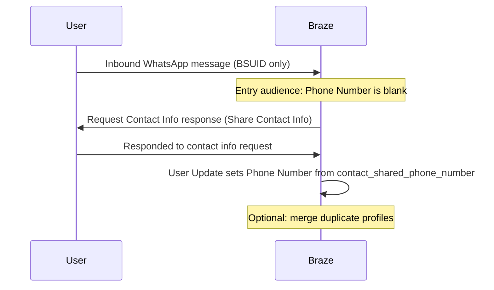

# Request contact info for WhatsApp BSUID-only users

> Build a workflow that detects inbound WhatsApp BSUID-only users with a blank phone number, asks them to share contact information, and saves the shared phone number to their Braze profile so you can merge duplicates if needed.

When a WhatsApp user messages your business with a [username](https://www.braze.com/docs/user_guide/channels/whatsapp/message_features_and_optimization/bsuid) and no prior conversation history, Braze may create or match a profile that has a BSUID and no phone number. Requesting their contact information lets you store a phone number on that profile, check whether they already exist in your workspace, and [merge duplicate users](https://www.braze.com/docs/user_guide/audience/manage_audience/merge_duplicate_users) when appropriate.

## Requirements

Before you build this workflow, confirm the following:

| Requirement | Description |
| --- | --- |
| WhatsApp setup | Your WhatsApp Business Account is connected to Braze and your subscription group can receive inbound messages. See [WhatsApp setup](https://www.braze.com/docs/user_guide/channels/whatsapp/whatsapp_setup/). |
| Contact request messaging | In the WhatsApp message composer, you can select the **Request Contact Info** response layout, or create or select a **Request contact info** template. |
| Inbound contact share Liquid | You can use `{{whats_app.${contact_shared_phone_number}}}` in a User Update step. For attribute details, see [Contact shared phone number](https://www.braze.com/docs/user_guide/channels/whatsapp/message_processing/messaging_users/#contact-shared-phone-number). |
| Merge plan | You have a plan for how shared phone numbers should resolve against existing profiles. See [Merge duplicate users](https://www.braze.com/docs/user_guide/audience/manage_audience/merge_duplicate_users). |
{: .reset-td-br-1 .reset-td-br-2 aria-label="Requirements" }

## How the flow works

1. A user sends an inbound WhatsApp message.
2. Braze enters them into a Canvas only if **Phone Number** is blank, so the inbound sender is using a BSUID without a stored phone number.
3. Braze replies with a **Request Contact Info** response message that includes WhatsApp's built-in **Share Contact Info** button.
4. When the user shares contact info, an [Action Paths](https://www.braze.com/docs/user_guide/messaging/canvas/canvas_components/action_paths) step matches **Responded to contact info request**.
5. A [User Update](https://www.braze.com/docs/user_guide/messaging/canvas/canvas_components/user_update) step writes `{{whats_app.${contact_shared_phone_number}}}` to the profile **Phone Number** attribute.
6. You merge that profile with any existing profile that uses the same phone number, as described in Step 5.

**Important:**

The shared number comes from WhatsApp's contact share response and is not independently verified by Braze. Validate it before treating it as authoritative identity in security-sensitive workflows such as account recovery, fraud checks, or one-time passcodes. For attribute details, see [Contact shared phone number](https://www.braze.com/docs/user_guide/channels/whatsapp/message_processing/messaging_users/#contact-shared-phone-number).

## Build the Canvas

### Step 1: Create an action-based Canvas

1. Go to **Messaging** > **Canvas** and select **Create Canvas**.
2. Name your Canvas (for example, "WhatsApp — Request contact info for BSUID users").
3. Under **Entry Schedule**, select **Action-Based**.
4. Under **Action-Based Options**, add the entry trigger **Send a WhatsApp inbound message** and select your **Subscription group**.
   - Under **Condition to match**, select **None** unless you want only specific keywords to start this flow.
5. Continue to **Target Audience**. In your filter group, add **Phone Number is blank**.

That combination—inbound WhatsApp message plus a blank phone number—targets users who are messaging with a BSUID and do not yet have a phone number on their Braze profile.

**Tip:**

Allow re-entry only if you want users who decline or skip sharing to be asked again later. If you allow re-entry, set a window that matches your follow-up cadence so users aren't prompted on every inbound message.

### Step 2: Send a Request Contact Info response message

Because the user already messaged your business, the 24-hour conversation window is open, so we recommend a **Response Message** instead of a template. Complete the following steps to send the request.

1. Add a **Message** step.
2. Select **WhatsApp** > your subscription group > **Response Message**.
3. Choose the **Request Contact Info** layout.
4. Write body copy that explains why you're asking for their phone number.
  - For example, explain that the user may already have an account and sharing contact info helps you connect their WhatsApp conversation to that profile.
5. Keep the built-in **Share Contact Info** button. WhatsApp provides the user's number in a consistent format, which reduces manual typing and formatting issues.

You can still personalize the body and localize the copy as you would for any response message.

{: style="max-width:80%;"}

**Note:**

If you need to start the conversation yourself (no recent inbound message), use a Meta-approved **Request contact info** template instead. That template type is available under marketing and utility categories. For this inbound identification use case, response messages are usually the better fit because they don't require Meta approval for copy changes, support more flexible localization, and are typically lower cost than initiating a template conversation.

### Step 3: Wait for the contact info response

1. Add an **Action Paths** step after the message.
2. Create a group that uses the same WhatsApp subscription group.
3. Set the condition to **Responded to contact info request**.

This condition matches inbound WhatsApp messages that are replies to your contact information request, so the shared phone number is available on the inbound event.

{: style="max-width:80%;"}

### Step 4: Update the phone number on the profile

On the Action Paths branch for **Responded to contact info request**, update the user profile with the shared phone number.

1. Add a [User Update](https://www.braze.com/docs/user_guide/messaging/canvas/canvas_components/user_update) step.
2. Update the standard **Phone Number** attribute.
3. In personalization, open **WhatsApp properties** and select the contact shared phone number attribute so the value is `{{whats_app.${contact_shared_phone_number}}}`.

After this step, the previously anonymous BSUID profile has a phone number and retains the WhatsApp message history on that profile.

**Tip:**

The `{{whats_app.${contact_shared_phone_number}}}` attribute is populated only when `{{whats_app.${contact_share_origin}}}` is `contact_request` (the user tapped **Share Contact Info**). For other contact shares, the phone Liquid attribute is empty. For more details, see [Contact share origin](https://www.braze.com/docs/user_guide/channels/whatsapp/message_processing/messaging_users/#contact-share-origin).

{: style="max-width:80%;"}

### Step 5: Merge duplicate users

Saving the phone number does not automatically merge profiles. After the number is on the BSUID profile, use your existing duplicate-resolution process to concatenate that profile into the main user when a match exists.

You can:

- Merge profiles [individually](https://www.braze.com/docs/user_guide/audience/manage_audience/merge_duplicate_users#individual-merging)
- [Bulk merge](https://www.braze.com/docs/user_guide/audience/manage_audience/merge_duplicate_users#bulk-merging) duplicates
- Use [rules-based merging](https://www.braze.com/docs/user_guide/audience/manage_audience/merge_duplicate_users#rules-based-merging) so phone-number matches are handled consistently with the rest of your workspace

Treat this the same way you already merge duplicates created from other channels or identity sources.

## Alternative setup: Split the full flow across a campaign and Canvas

Instead of building a full Canvas flow for one guided journey, you can split the same workflow into a campaign and a Canvas. Use this split when multiple upstream messages can ask for contact info and you want one shared update funnel:

1. Build a campaign that enters users on **Send a WhatsApp inbound message** when **Phone Number** **is blank**, then sends the **Request Contact Info** response message.
2. Build a Canvas that enters users on **Send a WhatsApp inbound message** when the condition is **Responded to contact info request**, then runs the User Update step (and any merge follow-up you automate).

## Related articles

<ul class="guide_tiles"><li><a href="/docs/user_guide/channels/whatsapp/message_features_and_optimization/bsuid">
WhatsApp usernames and BSUIDHow Braze stores BSUIDs and when phone numbers are still available.
</a></li><li><a href="/docs/user_guide/channels/whatsapp/message_processing/messaging_users">
Message users (WhatsApp)Inbound Liquid attributes for contact share origin and shared phone number.
</a></li><li><a href="/docs/user_guide/audience/manage_audience/merge_duplicate_users">
Merge duplicate usersIndividual, bulk, and rules-based options after you acquire a phone number.
</a></li></ul>
